# 그림 해석 검토 목록

Gemini가 쓴 숫자 중 OCR로 그림에서 찾지 못한 것이 있어 **본문에 넣지 않은** 항목이에요.
원본과 비교해서 맞으면 `image_regions.json`에서 그 항목의 `status`를 `"ok"`로 바꾸고 `extract.py`를 다시 돌려요.

## 1. additional/retirement_pension_2025.pdf 8쪽 (image)

- 그림에서 찾지 못한 숫자: `1332`
- bbox: `[119.4, 603.0, 471.6, 782.4]`

<table><tr>
<td width="50%" valign="top">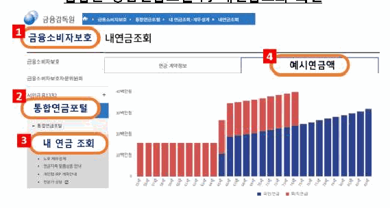</td>
<td width="50%" valign="top"><pre style="white-space: pre-wrap">설명: 금융감독원 홈페이지에서 통합연금포털을 통해 &#x27;내 연금 조회&#x27; 메뉴로 이동하여 &#x27;예시연금액&#x27; 그래프를 확인하는 화면을 보여줍니다. 주요 단계로 금융소비자보호, 통합연금포털, 내 연금 조회, 예시연금액 순의 확인 위치가 표시되어 있습니다.

- 화면 캡처:
  - 상단 메뉴: 금융감독원, 금융소비자보호, 통합연금포털, 내 연금조회·재무설계, 내연금조회
  - 단계별 강조 항목:
    1. 금융소비자보호
    2. 통합연금포털
    3. 내 연금 조회
    4. 예시연금액
  - 좌측 메뉴:
    - 금융소비자보호
    - 금융소비자보호자문위원회
    - 서민금융1332
    - 통합연금포털
      - 내 연금 조회
      - 노후 재무설계
      - 연금저축 맞춤상품 안내
      - 개인형 IRP 계좌안내
      - 전문가 상담
  - 화면 구성 요소를 위한 탭 및 범례:
    - 연금 계약정보
    - 예시연금액
    - 범례: 국민연금, 퇴직연금</pre></td>
</tr></table>

## 2. additional/retirement_pension_2025.pdf 20쪽 (chart)

- 그림에서 찾지 못한 숫자: `2.09`
- bbox: `[66.6, 570.6, 535.2, 768.0]`

<table><tr>
<td width="50%" valign="top">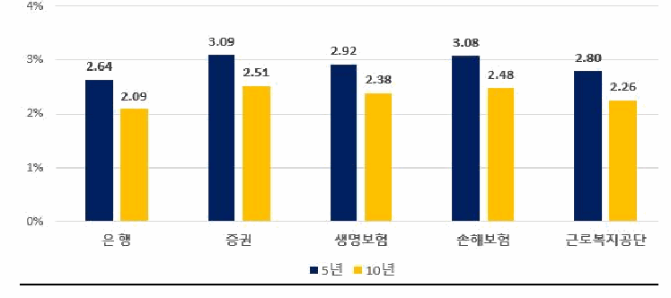</td>
<td width="50%" valign="top"><pre style="white-space: pre-wrap">설명: 이 그래프는 은행, 증권, 생명보험, 손해보험, 근로복지공단의 5년 및 10년 비율(%)을 보여줍니다. 5년과 10년 항목 모두 증권이 각각 3.09, 2.51로 가장 높고, 은행이 각각 2.64, 2.09로 가장 낮습니다. 모든 대상에서 5년 수치가 10년 수치보다 높게 나타납니다.

| 구분 | 5년 | 10년 |
| --- | --- | --- |
| 은행 | 2.64 | 2.09 |
| 증권 | 3.09 | 2.51 |
| 생명보험 | 2.92 | 2.38 |
| 손해보험 | 3.08 | 2.48 |
| 근로복지공단 | 2.80 | 2.26 |</pre></td>
</tr></table>

## 3. financial_life_guide.pdf 23쪽 (table)

- 그림에서 찾지 못한 숫자: `100000`
- bbox: `[159.9, 519.9, 348.3, 666.9]`

<table><tr>
<td width="50%" valign="top">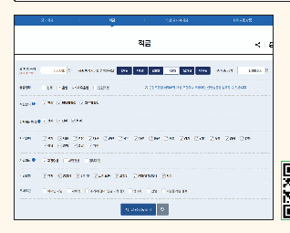</td>
<td width="50%" valign="top"><pre style="white-space: pre-wrap">설명: 적금 금융상품을 조회하고 조건별로 검색할 수 있는 웹페이지 화면 캡처입니다. 월 저축 금액 100,000원과 저축 예정기간 12개월 선택에 따라 총 저축 금액 1,200,000원이 표시되어 있으며, 금융권역·적립방식·이자계산방식·지역·가입대상·가입방법·우대조건 등을 선택해 상품을 검색할 수 있습니다.

- 상단 탭: 정기예금, 적금, 입출금자유예금, 절세금융상품
- 월 저축 금액: 100,000 원 (단위 : 1천원)
- 저축 예정기간을 선택하세요: 1개월, 3개월, 6개월, 12개월, 24개월, 36개월
- 총 저축 금액: 1,200,000 원
- 금융권역: 전체, 은행, 저축은행, 신협조합 (안내: 신협조합을 선택하시면 개별 조합에서 취급되는 신협상품을 검색할 수 있습니다)
- 적립방식: 전체, 정액적립식, 자유적립식
- 이자계산방식: 전체, 단리, 복리
- 지역선택: 전체, 서울, 부산, 대구, 인천, 광주, 대전, 울산, 세종, 경기, 강원, 충북, 충남, 전북, 전남, 경북, 경남, 제주
- 가입대상: 제한없음, 서민전용, 일부제한
- 가입방법: 전체, 영업점, 인터넷, 스마트폰, 모집인, 전화(텔레뱅킹), 기타
- 우대조건: 비대면 가입, 자녀양육, 주거래(급여, 연금 이체 등), 첫거래, 연령, 타상품가입·실적
- 버튼: 금융상품 검색, 초기화 버튼</pre></td>
</tr></table>

## 4. financial_life_guide.pdf 26쪽 (image)

- 그림에서 찾지 못한 숫자: `0100`
- bbox: `[105.9, 368.7, 416.1, 461.1]`

<table><tr>
<td width="50%" valign="top">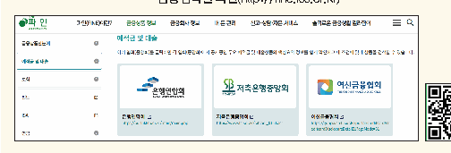</td>
<td width="50%" valign="top"><pre style="white-space: pre-wrap">설명: 금융소비자 정보포털 &#x27;파인&#x27; 웹사이트의 &#x27;예적금 및 대출&#x27; 안내 화면 캡처입니다. 주요 협회 및 중앙회의 공시 페이지로 이동할 수 있는 링크 상자와 좌측 카테고리 메뉴를 보여줍니다.

- 상단 메뉴: 파인(FINE)이란?, 금융상품 정보, 금융회사 정보, 내 돈 관리, 신고·상담·자문 서비스, 슬기로운 금융생활 길라잡이
- 좌측 메뉴: 금융상품한눈에, 예적금 및 대출, 보험, 펀드, ISA, 연금
- 본문 제목: 예적금 및 대출
- 안내문: 아래 협회(중앙회)를 클릭하면 각 협회(중앙회)에서 공시중인 주요 예적금 및 대출상품의 핵심요약 정보를 쉽게 확인하고 내 조건에 맞게 상품을 검색할 수 있습니다.
- 주요 링크 항목:
  - 은행연합회 (https://portal.kfb.or.kr/main/main.php)
  - 저축은행중앙회 (https://www.fsb.or.kr/mtcodi_0100.act)
  - 여신금융협회 (https://gongsi.crefia.or.kr/portal/creditcard/creditcardDisclosureDetail31?cgcMode=31)</pre></td>
</tr></table>

## 5. financial_life_guide.pdf 23쪽 (image)

- 그림에서 찾지 못한 숫자: `1397`
- bbox: `[679.5, 522.9, 849.9, 665.7]`

<table><tr>
<td width="50%" valign="top">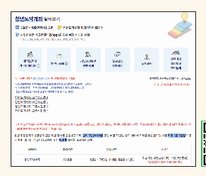</td>
<td width="50%" valign="top"><pre style="white-space: pre-wrap">설명: 청년도약계좌에 대한 안내 및 온라인 웹페이지 서비스 화면을 보여주는 그림입니다. 가입신청 안내, 메뉴 항목, 오픈채팅방 링크, 상품 상세 조건(만기 5년, 매월 70만원 한도, 정부기여금 최대 3만 3천원) 및 관련 표 내용을 포함하고 있습니다.

청년도약계좌 알아보기

- ☎ 1397 &gt; 바로연결번호 3번
- 청년도약계좌 채팅상담 바로가기
- 가입신청은 취급은행* 앱(App)을 통해 매월 비대면 신청
  * 국민, 기업, 농협, 신한, 우리, 하나, 경남, 광주, 대구, 부산, 전북

메뉴 항목:
- 개인요건 및 가구원 최신화 ⓘ
- 가구원 동의 ⓘ
- 가입요건확인 진행 결과
- 일시납입 정보확인
- 유지심사
- 신용개선 정보제공 추가동의

안내 및 링크:
※ 궁금한 사항은 자주하는 질문 페이지를 참고해주세요!
웹페이지 사용 매뉴얼[고객용] 다운로드
신청 및 계좌개설 일정 확인하기

※청년도약계좌와 관련 정보를 자유롭게 공유하고 실시간으로 소통하는 오픈채팅방
→ 상담을 원하는 경우 콜센터 또는 채팅상담을 이용하시기 바랍니다.
(단, 채팅상담은 자세한 상담에 제약이 있을 수 있습니다.)
- 청년도약계좌 오픈채팅방 1
- 청년도약계좌 오픈채팅방 2
- 청년도약계좌 오픈채팅방 3
- 청년도약계좌 오픈채팅방 4

※ 청년도약계좌는 정부기여금(공공재정지급금)이 지급되는 상품으로, 거짓된 정보로 부정청구를 하는 경우 『공공재정환수법』에 따라 정부기여금이 환수되며 제재부가금이 부과될 수 있습니다.

청년의 중장기 자산형성 지원을 위한 정책형 금융상품으로, 만기 5년(60개월) 동안 매월 70만원 한도 내에서 자유롭게 납입하면 매월 최대 3만 3천원의 정부기여금을 지급하고 이자소득에 대한 비과세 혜택을 제공하는 상품

| 상품명 | 가입기간 | 납입금액 | 금리* |
| --- | --- | --- | --- |
| 청년도약계좌 | 60개월 | 1천원 ~ 70만원 내 매월 자유롭게 납입 | 취급기관 자율결정 (3년 고정, 2년 변동) |

* 은행연합회 소비자포털을 통해 확인</pre></td>
</tr></table>

## 6. additional/self_employed_debt_2025.pdf 2쪽 (chart)

- 그림에서 찾지 못한 숫자: `23.1`
- bbox: `[96.7, 116.5, 192.7, 280.9]`

<table><tr>
<td width="50%" valign="top">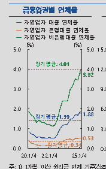</td>
<td width="50%" valign="top"><pre style="white-space: pre-wrap">설명: 20.1/4부터 23.1/4까지 금융업권별 자영업자 대출 연체율(%) 추이를 나타낸 그래프이다. 자영업자 비은행대출 연체율이 3.92%로 가장 높고, 자영업자 대출 연체율은 1.88%, 자영업자 은행대출 연체율은 0.53%로 가장 낮다. 각 연체율의 장기평균은 비은행대출 4.01%, 전체 대출 1.39%, 은행대출 0.34%로 제시되어 있다.

금융업권별 연체율
주: 1) 1개월 이상 원리금 연체 기준(상호</pre></td>
</tr></table>

## 7. financial_life_guide.pdf 31쪽 (chart)

- 그림에서 찾지 못한 숫자: `1970`
- bbox: `[627.9, 404.1, 936.9, 561.3]`

<table><tr>
<td width="50%" valign="top">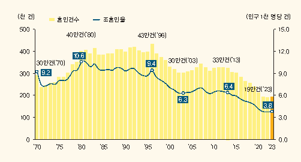</td>
<td width="50%" valign="top"><pre style="white-space: pre-wrap">설명: 1970년부터 2023년까지의 혼인건수(단위: 천 건)와 조혼인율(단위: 인구 1천 명당 건) 추이를 보여주는 그래프입니다. 조혼인율은 &#x27;80년에 10.6으로 가장 높았으며, &#x27;23년에 3.8을 기록했습니다. 혼인건수는 &#x27;96년에 43만건으로 가장 많았고 &#x27;23년에는 19만건을 나타냈습니다.

| 연도 | 혼인건수 | 조혼인율 |
| --- | --- | --- |
| &#x27;70 | 30만건 | 9.2 |
| &#x27;80 | 40만건 | 10.6 |
| &#x27;96 | 43만건 | 9.4 |
| &#x27;03 | 30만건 | 6.3 |
| &#x27;13 | 33만건 | 6.4 |
| &#x27;23 | 19만건 | 3.8 |</pre></td>
</tr></table>

## 8. financial_life_guide.pdf 33쪽 (image)

- 그림에서 찾지 못한 숫자: `100`
- bbox: `[103.5, 562.5, 335.1, 677.7]`

<table><tr>
<td width="50%" valign="top">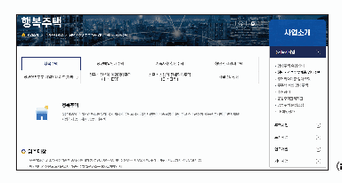</td>
<td width="50%" valign="top"><pre style="white-space: pre-wrap">설명: LH 한국토지주택공사 웹사이트의 행복주택 사업소개 화면을 캡처한 그림이다. 행복주택의 정의와 입주대상 조건, 그리고 관련 카테고리 메뉴 목록을 보여준다.

- 상단 경로: 사업소개 &gt; 주거복지사업 &gt; 청년·신혼부부계층 임대주택 &gt; 행복주택
- 탭 메뉴:
  - 행복주택
  - 청년매입임대주택
  - 기숙사형 청년주택
  - 청년 전세임대주택
  - 청년·신혼부부 매입임대리츠(아파트)
  - 신혼·신생아 매입임대주택 (Ⅰ·Ⅱ형)
  - 신혼·신생아 전세임대주택 (Ⅰ·Ⅱ형)
  - 자립준비청년
- 주요 내용:
  - 행복주택: 젊은계층의 주거비 부담 완화를 위해 국가 재정과 주택도시기금을 지원받아 대중교통이 편리하고 직주근접이 가능한 부지에 주변시세보다 저렴하게 공급하는 공공임대주택
  - 입주대상:
    - 무주택요건 및 소득·자산기준을 충족하는 대학생, 청년, 신혼부부, 예비신혼부부, 한부모가족, 주거급여수급자, 고령자, 산단근로자 등
    - 해당 세대의 월평균 도시근로자 가구원수별 월평균소득 100% 이하인 자
- 우측 사이드 메뉴:
  - 사업소개
  - 주거복지사업
    - 임대주택 유형 안내
    - 청년·신혼부부계층 임대주택
    - 주거취약계층 임대주택
    - 무주택 서민 임대주택
    - 주거급여
    - 공동주택관리지원
    - 공동주택 분쟁조정
    - LH희망상가
  - 주택사업
  - 토지사업
  - 연구개발
  - 기타사업</pre></td>
</tr></table>

## 9. financial_life_guide.pdf 38쪽 (image)

- 그림에서 찾지 못한 숫자: `907098`
- bbox: `[103.5, 115.5, 452.7, 274.5]`

<table><tr>
<td width="50%" valign="top">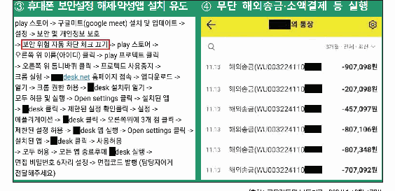</td>
<td width="50%" valign="top"><pre style="white-space: pre-wrap">설명: 휴대폰 보안설정 해제 및 악성 앱 설치 유도 문구와 무단 해외송금이 실행된 통장 거래 내역 화면을 보여줍니다. 보안 설정 변경, 권한 허용 등 앱 설치 단계와 11월 13일에 출금된 6건의 해외송금 내역이 명시되어 있습니다.

- 절차도·다이어그램:
1. play 스토어 -&gt; 구글미트(google meet) 설치 및 업데이트 -&gt; 설정 -&gt; 보안 및 개인정보 보호 -&gt; 보안 위험 자동 차단 체크 끄기 -&gt; play 스토어 -&gt; 오른쪽 위 이름(아이디) 클릭 -&gt; play 프로텍트 클릭 -&gt; 오른쪽 위 톱니바퀴 클릭 -&gt; 프로텍트 사용중지 -&gt; 크롬 실행 -&gt; ■desk.net 홈페이지 접속 -&gt; 앱다운로드 -&gt; 열기 -&gt; 크롬 권한 허용 -&gt; ■desk 설치뒤 열기 -&gt; 모두 허용 및 실행 -&gt; Open settings 클릭 -&gt; 설치된 앱 -&gt; ■desk 클릭 -&gt; 제한된 설정 확인클릭 -&gt; 설정 -&gt; 애플리케이션 -&gt; ■desk 클릭 -&gt; 오른쪽위에 3개 점 클릭 -&gt; 제한된 설정 허용 -&gt; ■desk 앱 실행 -&gt; Open settings 클릭 -&gt; 설치된 앱 -&gt; ■desk 클릭 -&gt; 사용허용 -&gt; 모두 허용 -&gt; 모든 앱 종료후에 ■desk 실행 -&gt; 면접 비밀번호 6자리 설정 -&gt; 면접코드 발행 (담당자에게 전달해주세요)

- 화면 캡처:
- ■■의 통장
- 3개월 · 전체 · 최신
- 11.13 해외송금(WU003224110■) -907,098원
- 11.13 해외송금(WU003224110■) -207,098원
- 11.13 해외송금(WU003224110■) -457,097원
- 11.13 해외송금(WU003224110■) -807,106원
- 11.13 해외송금(WU003224110■) -807,348원
- 11.13 해외송금(WU003224110■) -707,092원

그림 제목: ③ 휴대폰 보안설정 해제·악성앱 설치 유도, ④ 무단 해외송금·소액결제 등 실행
자료 출처: (출처: 금융감독원 보도자료, 2024년 12월 17일)</pre></td>
</tr></table>

## 10. financial_life_guide.pdf 39쪽 (image)

- 그림에서 찾지 못한 숫자: `2024, 308, 311, 312`
- bbox: `[114.3, 551.7, 199.5, 637.5]`

<table><tr>
<td width="50%" valign="top">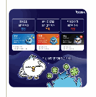</td>
<td width="50%" valign="top"><pre style="white-space: pre-wrap">설명: KISA의 악성 여부 분석 결과 상태인 정상, 주의, 악성에 대한 구분과 접수번호, 접수일자가 포함된 카드 예시를 보여주는 안내문입니다. 정상, 주의, 악성 3가지 단계로 결과가 제공됩니다.

KISA

정상으로
확인된 경우
정상

분석 중이거나
미확인인 경우
주의

악성 행위가
확인된 경우
악성

정상
INFORMATION
유해행위가 발견되지
않았습니다.
• 접수번호 : 312
• 접수일자 : 2024-04-03

주의
WARNING
확인되지 않은 링크,
접속에 주의하세요.
• 접수번호 : 311
• 접수일자 : 2024-04-03

악성
MALICIOUS
악성으로 확인,
클릭하지 마세요.
• 접수번호 : 308
• 접수일자 : 2024-04-03

악성 여부 분석까지 한 번에!</pre></td>
</tr></table>

## 11. financial_life_guide.pdf 39쪽 (image)

- 그림에서 찾지 못한 숫자: `010`
- bbox: `[623.7, 529.5, 788.1, 627.9]`

<table><tr>
<td width="50%" valign="top">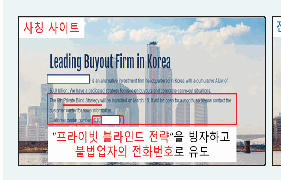</td>
<td width="50%" valign="top"><pre style="white-space: pre-wrap">설명: 불법업자가 제작한 사칭 사이트 화면을 보여주는 그림입니다. &quot;프라이빗 블라인드 전략&quot; 출시 안내와 함께 불법업자의 고객센터 전화번호로 유도하는 내용이 담겨 있습니다.

사칭 사이트
Leading Buyout Firm in Korea
[마스킹] is an alternative investment firm headquartered in Korea with a cumulative AUM of $3.0 billion. We have a dedicated strategy focused on buyouts and corporate carve-out situations.
The 9th Private Blind Strategy will be launched on March 18. It will be open for a month, so please contact the customer center for more information.
Customer center number: 010-[마스킹]
&quot;프라이빗 블라인드 전략&quot;을 빙자하고
불법업자의 전화번호로 유도</pre></td>
</tr></table>
