# additional/housing_policy_finance_2025.pdf

- 쪽수: 22
- 거의 빈 쪽: 없음
- 표: 5개

## 1쪽

<table><tr>
<td width="50%" valign="top"></td>
<td width="50%" valign="top"><pre style="white-space: pre-wrap">이 문서는 한국은행의 자산으로 허가받지 않은 복사, 촬영, 수정 및 배포를 금합니다.
Ⅲ. 우리나라 주택 정책금융
현황과 평가
(1) 검토 배경 125
(2) 주택 정책금융의 현황과 효과 125
(3) 금융안정 측면에서의 잠재리스크 평가 131
(4) 향후 개선 방향 138
이연재 / 안정분석팀 / 2025-07-01 11:36:22</pre></td>
</tr></table>

## 2쪽

<table><tr>
<td width="50%" valign="top">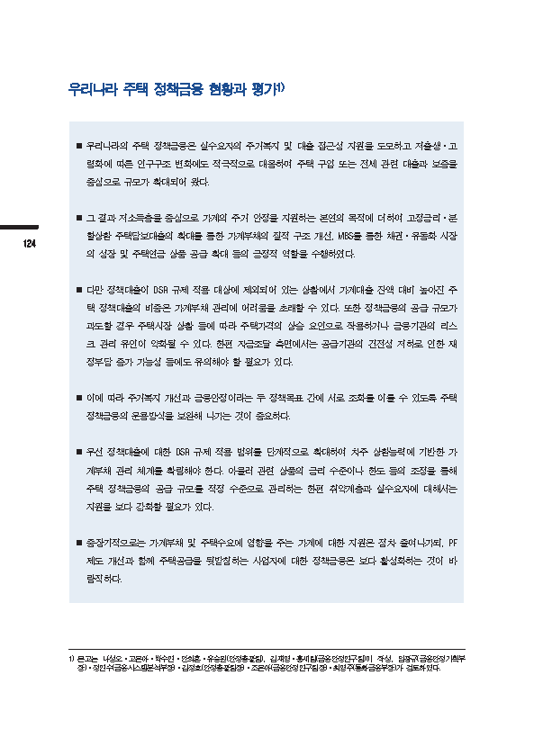</td>
<td width="50%" valign="top"><pre style="white-space: pre-wrap">이 문서는 한국은행의 자산으로 허가받지 않은 복사, 촬영, 수정 및 배포를 금합니다.
우리나라 주택 정책금융 현황과 평가1)
n 우리나라의 주택 정책금융은 실수요자의 주거복지 및 대출 접근성 지원을 도모하고 저출생·고
령화에 따른 인구구조 변화에도 적극적으로 대응하며 주택 구입 또는 전세 관련 대출과 보증을
중심으로 규모가 확대되어 왔다.
n 그 결과 저소득층을 중심으로 가계의 주거 안정을 지원하는 본연의 목적에 더하여 고정금리·분
할상환 주택담보대출의 확대를 통한 가계부채의 질적 구조 개선, MBS를 통한 채권·유동화 시장
124
의 성장 및 주택연금 상품 공급 확대 등의 긍정적 역할을 수행하였다.
n 다만 정책대출이 DSR 규제 적용 대상에 제외되어 있는 상황에서 가계대출 잔액 대비 높아진 주
택 정책대출의 비중은 가계부채 관리에 어려움을 초래할 수 있다. 또한 정책금융의 공급 규모가
과도할 경우 주택시장 상황 등에 따라 주택가격의 상승 요인으로 작용하거나 금융기관의 리스
크 관리 유인이 약화될 수 있다. 한편 자금조달 측면에서는 공급기관의 건전성 저하로 인한 재
정부담 증가 가능성 등에도 유의해야 할 필요가 있다.
n 이에 따라 주거복지 개선과 금융안정이라는 두 정책목표 간에 서로 조화를 이룰 수 있도록 주택
정책금융의 운용방식을 보완해 나가는 것이 중요하다.
n 우선 정책대출에 대한 DSR 규제 적용 범위를 단계적으로 확대하여 차주 상환능력에 기반한 가
계부채 관리 체계를 확립해야 한다. 아울러 관련 상품의 금리 수준이나 한도 등의 조정을 통해
주택 정책금융의 공급 규모를 적정 수준으로 관리하는 한편 취약계층과 실수요자에 대해서는
지원을 보다 강화할 필요가 있다.
n 중장기적으로는 가계부채 및 주택수요에 영향을 주는 가계에 대한 지원은 점차 줄여나가되, PF
제도 개선과 함께 주택공급을 뒷받침하는 사업자에 대한 정책금융은 보다 활성화하는 것이 바
람직하다.
1) 본고는 나성오·고은아·박수연·안희훈·유승원(안정총괄팀), 김재영·홍세림(금융안정연구팀)이 작성, 임광규(금융안정기획부
장)·정연수(금융시스템분석부장)·김정호(안정총괄팀장)·조은아(금융안정연구팀장)·최영주(통화금융부장)가 검토하였다.
이연재 / 안정분석팀 / 2025-07-01 11:36:22</pre></td>
</tr></table>

## 3쪽

<table><tr>
<td width="50%" valign="top">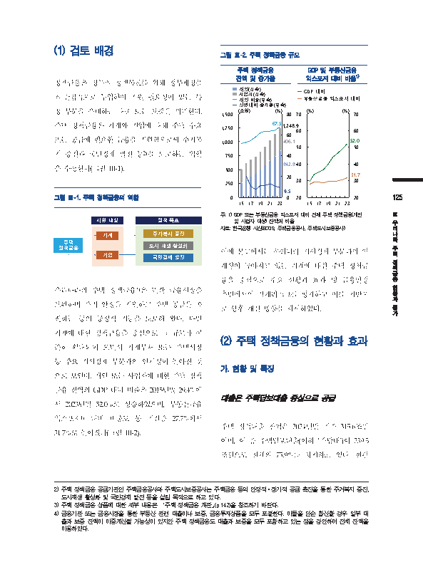</td>
<td width="50%" valign="top"><pre style="white-space: pre-wrap">이 문서는 한국은행의 자산으로 허가받지 않은 복사, 촬영, 수정 및 배포를 금합니다.
(1) 검토 배경
그림 Ⅲ-2. 주택 정책금융 규모

[그래프]
2015년부터 2023년까지 주택 정책금융 잔액 및 증가율과 GDP 및 부동산금융 익스포저 대비 비율 추이를 나타낸 그래프이다. 2023년 기준 주택 정책금융 잔액은 1,248.9조원(개인 842.8조원, 사업자 406.1조원), 개인 비중은 67.5%, 전년대비 증가율은 9.5%이다. 2023년 기준 GDP 대비 비율은 52.0%, 부동산금융 익스포저 대비 비율은 31.7%이다.

| 구분 | 2023 |
| --- | --- |
| 주택 정책금융 전체 잔액(조원) | 1,248.9 |
| 개인(조원) | 842.8 |
| 사업자(조원) | 406.1 |
| 개인 비중(%) | 67.5 |
| 전년대비 증가율(%) | 9.5 |
| GDP 대비(%) | 52.0 |
| 부동산금융 익스포저 대비(%) | 31.7 |

주택 정책금융 잔액 및 증가율
GDP 및 부동산금융 익스포저 대비 비율1)
주: 1) GDP 또는 부동산금융 익스포저 대비 전체 주택 정책금융(개인

정책금융은 정부의 정책목표를 위해 정부재정을
직·간접적으로 투입하여 지원 필요성이 있는 특
정 부문을 우대하는 대출 또는 보증을 의미한다.
주택 정책금융은 가계와 기업에 대해 주택 수요
또는 공급에 필요한 금융을 지원함으로써 주거복
지 증진과 국민경제 발전 등2)을 도모하는 역할
을 수행한다(그림 Ⅲ-1).
그림 Ⅲ-1. 주택 정책금융의 역할 125
주: 1) GDP 또는 부동산금융 익스포저 대비 전체 주택 정책금융(개인 Ⅲ
지원대상 정책목표 및 사업자 대상) 잔액의 비율 우
자료: 한국은행 시산(ECOS, 주택금융공사, 주택도시보증공사) 리

|  |  | 가계 |  |
| --- | --- | --- | --- |
| 주택 정책금융 |  |  |  |
|  |  | 기업 |  |

주거복지증진 나
라
도시재생활성화 주
이에 본고에서는 우리나라 거시경제 부문과의 연
택
국민경제발전
정
계성이 높아지고 있는 가계에 대한 주택 정책금
책
금
융을 중심으로 주요 현황과 효과 및 금융안정 융
우리나라의 주택 정책금융3)은 민간 금융시장을 현
측면에서의 잠재리스크를 평가하고 이를 기반으 황
과
보완하며 주거 안정을 지원하고 주택 공급을 촉
로 향후 개선 방향을 제시하였다. 평
가
진하는 등의 긍정적 기능을 도모해 왔다. 다만
가계에 대한 정책금융을 중심으로 그 규모가 꾸
(2) 주택 정책금융의 현황과 효과
준히 확대되어 오면서 가계부채 또는 주택시장
등 주요 거시경제 부문과의 연계성이 높아진 것
가. 현황 및 특징
으로 보인다. 개인 또는 사업자에 대한 주택 정책
금융 잔액의 GDP 대비 비율은 2015년말 29.4%에
대출은 주택담보대출 중심으로 공급
서 2023년말 52.0%로 상승하였으며, 부동산금융
익스포저4) 대비 비중도 동 기간중 27.7%에서
주택 정책대출 잔액은 2024년말 기준 315.6조원
31.7%로 높아졌다(그림 Ⅲ-2).
이며, 이 중 주택담보대출(이하 ‘주담대’)이 239.5
조원으로 전체의 75.9%를 차지하고 있다. 한편
2) 주택 정책금융 공급기관인 주택금융공사와 주택도시보증공사는 주택금융 등의 안정적·장기적 공급 촉진을 통한 주거복지 증진,
도시재생 활성화 및 국민경제 발전 등을 설립 목적으로 하고 있다.
3) 주택 정책금융 상품에 대한 세부 내용은 「주택 정책금융 개관」(p.142)을 참조하기 바란다.
4) 금융기관 또는 금융시장을 통한 부동산 관련 대출이나 보증, 금융투자상품을 모두 포괄한다. 이들을 단순 합산할 경우 일부 대
출과 보증 잔액이 이중계산될 가능성이 있지만 주택 정책금융도 대출과 보증을 모두 포함하고 있는 점을 감안하여 전체 잔액을
이용하였다.
이연재 / 안정분석팀 / 2025-07-01 11:36:22</pre></td>
</tr></table>

## 4쪽

<table><tr>
<td width="50%" valign="top">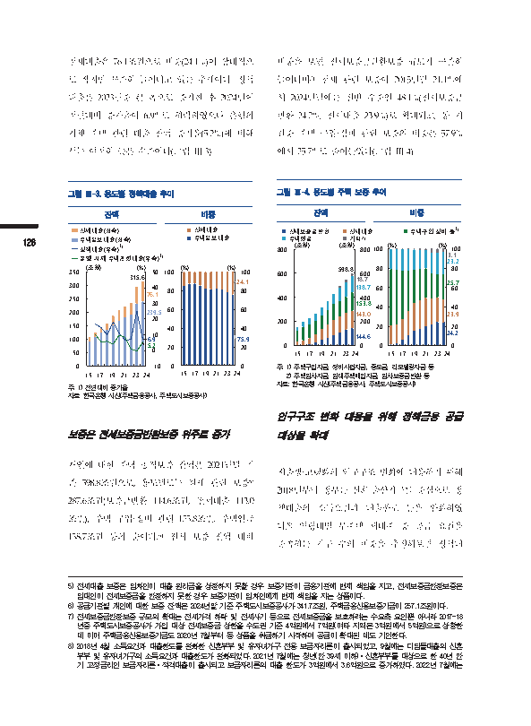</td>
<td width="50%" valign="top"><pre style="white-space: pre-wrap">이 문서는 한국은행의 자산으로 허가받지 않은 복사, 촬영, 수정 및 배포를 금합니다.

전세대출은 76.1조원으로 비중(24.1%)이 상대적으
로 작지만 꾸준히 늘어나고 있는 추세이다. 정책
대출은 2023년중 큰 폭으로 증가한 후 2024년에
전년대비 증가율이 6.9%로 하락하였으나 은행의
자체 주택 관련 대출 잔액 증가율(5.2%)에 비해
서는 여전히 높은 수준이다(그림 Ⅲ-3).
그림 Ⅲ-3. 용도별 정책대출 추이

[그래프]
설명: 2015년부터 2024년까지의 대출 잔액 및 증가율 추이를 나타낸 그래프이다. 단위는 좌축 (조원), 우축 (%)이다. 2024년 기준 수치로 상단 값 315.6, 전세대출 76.1, 주택담보대출 239.5, 정책대출 6.9, 은행 자체 주택관련대출 5.2가 적혀 있다.

- 그래프:

| 구분 | 24 |
| --- | --- |
| 상단 | 315.6 |
| 전세대출(좌축) | 76.1 |
| 주택담보대출(좌축) | 239.5 |
| 정책대출(우축) | 6.9 |
| 은행 자체 주택관련대출(우축) | 5.2 |

잔액
주: 1) 전년대비 증가율

[그래프]
설명: 이 그래프는 2015년부터 2024년까지 전세대출과 주택담보대출의 비중(%)을 나타낸 누적 막대 그래프입니다. 2024년 기준 전세대출의 비중은 24.1%, 주택담보대출의 비중은 75.9%입니다.

| 구분 | 24 |
| --- | --- |
| 전세대출 | 24.1 |
| 주택담보대출 | 75.9 |

그림 제목: 비중

126
주: 1) 전년대비 증가율
자료: 한국은행 시산(주택금융공사, 주택도시보증공사)
보증은 전세보증금반환보증 위주로 증가
개인에 대한 주택 공적보증 잔액은 2024년말 기
준 598.8조원으로, 용도별로는 전세 관련 보증5)
287.6조원(보증금반환 144.6조원, 전세대출 143.0
조원), 주택 구입·정비 관련 153.8조원, 주택연금
138.7조원 등의 순이다.6) 전체 보증 잔액 대비

비중을 보면 전세보증금반환보증 규모가 꾸준히
늘어나며7) 전세 관련 보증이 2015년말 21.1%에
서 2024년말에는 절반 수준인 48.1%(전세보증금
반환 24.2%, 전세대출 23.9%)로 확대되고, 동 기
간중 주택 구입·정비 관련 보증의 비중은 57.9%
에서 25.7%로 줄어들었다(그림 Ⅲ-4).
그림 Ⅲ-4. 용도별 주택 보증 추이

[그래프]
설명: 2015년부터 2024년까지 용도별 잔액 추이를 보여주는 그래프이다. 잔액(단위: 조원)은 지속적으로 증가하는 추세를 보이며, 2024년 기준 598.8조원을 기록한다.

| 구분 | 24 |
| --- | --- |
| 합계 | 598.8 |
| 기타²⁾ | 18.7 |
| 주택연금 | 138.7 |
| - | 153.8 |
| 전세대출 | 143.0 |
| 전세보증금반환 | 144.6 |

주: 1) 주택구입자금, 정비사업자금, 중도금

[그래프]
설명: 2015년부터 2024년까지 항목별 비중 변화를 나타낸 누적 막대 그래프입니다. 단위는 %이며, 2024년 항목별 비중으로 3.1, 23.2, 25.7, 23.9, 24.2가 표시되어 있습니다.

| 구분 | 24 |
| --- | --- |
| 회색 | 3.1 |
| 하늘색 | 23.2 |
| 주택구입·정비 등 (녹색) | 25.7 |
| 갈색 | 23.9 |
| 남색 | 24.2 |

비중
■ 주택구입·정비 등¹)
그 주택, 리모델링자금 등

| 전세보증금반환 전세대출 주택구입·정비등1) 주택연금 기타2) (조원) (조원) (%) (%) 800 800 100 100 3.1 23.2 598.8 80 80 600 600 18.7 25.7 138.7 60 60 400 400 153.8 40 40 143.0 23.9 200 200 20 20 144.6 24.2 0 0 0 0 15 17 19 21 2324 15 17 19 21 23 24 | 전세보증금반환 전세대출 주택구입·정비등1) 주택연금 기타2) (조원) (조원) (%) (%) 800 800 100 100 3.1 23.2 598.8 80 80 600 600 18.7 25.7 138.7 60 60 400 400 153.8 40 40 143.0 23.9 200 200 20 20 144.6 24.2 0 0 0 0 15 17 19 21 2324 15 17 19 21 23 24 |
| --- | --- |
| 전세보증금반환 전세대출 주택구입·정비등1) 주택연금 기타2) (조원) (조원) (%) (%) 800 800 100 100 3.1 23.2 598.8 80 80 600 600 18.7 25.7 138.7 60 60 400 400 153.8 40 40 143.0 23.9 200 200 20 20 144.6 24.2 0 0 0 0 15 17 19 21 2324 15 17 19 21 23 24 | (%) (%) 100 100 3.1 23.2 80 80 25.7 60 60 40 40 23.9 20 20 24.2 0 0 15 17 19 21 23 24 |

주: 1) 주택구입자금, 정비사업자금, 중도금, 리모델링자금 등
2) 주택임차자금, 임대주택매입자금, 임차보증금반환 등
자료: 한국은행 시산(주택금융공사, 주택도시보증공사)
인구구조 변화 대응을 위해 정책금융 공급
대상을 확대
저출생·고령화의 인구구조 변화에 대응하기 위해
2018년부터 정부는 신혼·출산가구를 중심으로 정
책대출의 소득요건과 대출한도 등을 완화하였
다.8) 연령대별 무주택 세대주 중 공급 요건을
충족하는 가구 수의 비중을 추정해보면 정책대

5) 전세대출 보증은 임차인이 대출 원리금을 상환하지 못할 경우 보증기관이 금융기관에 변제 책임을 지고, 전세보증금반환보증은
임대인이 전세보증금을 반환하지 못한 경우 보증기관이 임차인에게 변제 책임을 지는 상품이다.
6) 공급기관별 개인에 대한 보증 잔액은 2024년말 기준 주택도시보증공사가 341.7조원, 주택금융신용보증기금이 257.1조원이다.
7) 전세보증금반환보증 규모의 확대는 전세가격 하락 및 전세사기 등으로 전세보증금을 보호하려는 수요측 요인뿐 아니라 2017~18
년중 주택도시보증공사가 가입 대상 전세보증금 상한을 수도권 기준 4억원에서 7억원(여타 지역은 3억원에서 5억원)으로 상향한
데 이어 주택금융신용보증기금도 2020년 7월부터 동 상품을 취급하기 시작하며 공급이 확대된 데도 기인한다.
8) 2018년 4월 소득요건과 대출한도를 완화한 신혼부부 및 유자녀가구 전용 보금자리론이 출시되었고, 9월에는 디딤돌대출의 신혼
부부 및 유자녀가구의 소득요건과 대출한도가 완화되었다. 2021년 7월에는 청년(만 39세 이하)·신혼부부를 대상으로 한 40년 만
기 고정금리인 보금자리론·적격대출이 출시되고 보금자리론의 대출 한도가 3억원에서 3.6억원으로 증가하였다. 2022년 7월에는
이연재 / 안정분석팀 / 2025-07-01 11:36:22</pre></td>
</tr></table>

## 5쪽

<table><tr>
<td width="50%" valign="top">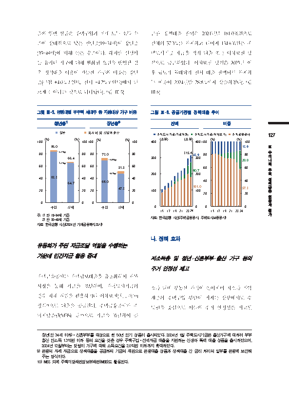</td>
<td width="50%" valign="top"><pre style="white-space: pre-wrap">이 문서는 한국은행의 자산으로 허가받지 않은 복사, 촬영, 수정 및 배포를 금합니다.

출의 일반 상품은 주택구입과 전세 모두 소득 수
준이 상대적으로 낮은 청년층(19~34세)이 장년층
(35~49세)에 비해 높은 수준이다. 하지만 신생아
등 유자녀 가구에 대해 완화된 요건을 반영할 경
우 정책대출 이용이 가능한 가구의 비중은 장년
층(구입 +4.0%포인트, 전세 +4.2%포인트)에서 더
크게 늘어나는 것으로 나타났다(그림 Ⅲ-5).
그림 Ⅲ-5. 연령대별 무주택 세대주 중 지원대상 가구 비중

[그래프]
설명: 청년층의 구입 및 전세 비중을 단위 %로 나타낸 막대 그래프이다. 구입 비중은 86.0%로 전세 비중인 66.4%보다 높게 나타난다.

| 구분 | 일반 | %p | 전체 |
| --- | --- | --- | --- |
| 구입 | 83.3 | 2.7%p | 86.0 |
| 전세 | 64.7 | 1.7%p | 66.4 |

청년층1)
주: 1) 만 19~34세 기준
2) 만 35~49세 기준
자료: 한국은행 시산(2024년 가계금융복

[그래프]
설명: 장년층의 구입 및 전세 비중(%)을 보여주는 그래프이다. 구입이 73.0%로 가장 높고 전세가 51.5%이다.

| 구분 | 구입 | 전세 |
| --- | --- | --- |
| 상단 | 73.0 | 51.5 |
| 유자녀 및 신생아출산 | 4.0%p | 4.2%p |
| 하단 | 69.0 | 47.3 |

장년층²⁾

자료: 한국은행 시산(2024년 가계금융복지조사)
유동화가 주된 자금조달 역할을 수행하는
가운데 민간자금 활용 증대
주택금융공사는 주택담보대출을 유동화하여 자본
시장을 통해 자금을 조달하며, 주택도시기금의
경우 자체 재원을 활용하거나 이차보전(利差補塡)
방식9)으로 대출을 공급한다. 주택금융공사가 주
택저당증권(MBS) 등10)으로 자금을 조달하여 공

급한 정책대출 잔액은 2024년말 181.0조원으로
전체의 57.3%를 차지하고 나머지 134.6조원은 주
택도시기금 자금을 직접 대출 또는 이차보전 방
식으로 공급하였다. 이차보전 방식은 2023년 이
후 규모가 확대되며 전체 대출 잔액에서 차지하
는 비중이 2024년말 28.8%까지 상승하였다(그림
Ⅲ-6).
그림 Ⅲ-6. 공급기관별 정책대출 추이

[그래프]
설명: 2015년부터 2024년까지 주택도시기금(기금재원), 주택도시기금(이차보전), 주택금융공사의 잔액(조원) 및 비중(%) 추이를 보여주는 막대그래프입니다. 잔액은 지속적으로 증가하는 추세를 보이며, 2024년 기준 총 잔액은 315.6조 원을 기록하고 있습니다.

- 그래프:
| 구분 | 잔액(조원) | 비중(%) |
| --- | --- | --- |
| 주택도시기금(기금재원) | 43.9 | 13.9 |
| 주택도시기금(이차보전) | 90.7 | 28.8 |
| 주택금융공사 | 181.0 | 57.3 |
| 합계 | 315.6 | |

자료: 한국은행 시산(주택금융공사, 주택도시보증공사)

자료: 한국은행 시산(주택금융공사, 주택도시보증공사)
나. 정책 효과
저소득층 및 청년․신혼부부․출산 가구 등의
주거 안정성 제고
소득 대비 부동산 가격이 높아지며 저소득 취약
계층의 주택구입 부담이 커지는 상황에서도 수
도권을 중심으로 이들의 주거 안정성은 제고된

청년(만 34세 이하)·신혼부부를 대상으로 한 50년 만기 상품이 출시되었다. 2024년 1월 주택도시기금은 출산가구에 대하여 부부
합산 연소득 1.3억원 이하 등의 요건을 갖춘 경우 주택구입·전세자금 대출을 지원하는 신생아 특례 대출 상품을 출시하였으며,
2024년 12월부터는 맞벌이 가구에 대해 소득요건을 2.0억원 이하까지 확대하였다.
9) 은행의 자체 자금으로 정책대출을 공급하되 기금의 재원으로 은행대출 상품과 정책대출 간 금리 차이의 일부를 은행에 보전해
주는 방식이다.
10) MBS 외에 주택저당채권담보부채권(MBB)도 활용된다.
이연재 / 안정분석팀 / 2025-07-01 11:36:22</pre></td>
</tr></table>

## 6쪽

<table><tr>
<td width="50%" valign="top">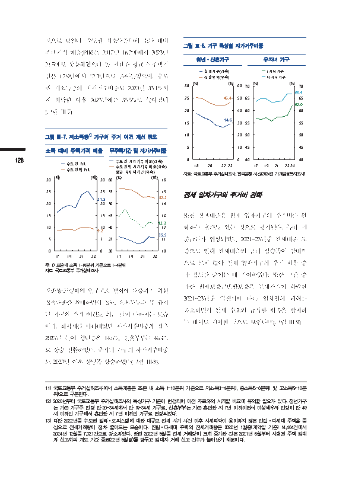</td>
<td width="50%" valign="top"><pre style="white-space: pre-wrap">이 문서는 한국은행의 자산으로 허가받지 않은 복사, 촬영, 수정 및 배포를 금합니다.

것으로 보인다. 수도권 저소득층11)의 소득 대비
주택가격 배율(PIR)은 2017년 16.2배에서 2023년
21.5배로 상승하였으나 동 기간중 평균 무주택기
간은 12.9년에서 12.3년으로 줄어들었으며, 수도
권 저소득층의 자가거주비중도 2020년 33.1%까
지 하락한 이후 2023년에는 35.5%로 높아졌다
(그림 Ⅲ-7).
그림 Ⅲ-7. 저소득층1) 가구의 주거 여건 개선 정도
소득 대비 주택가격 배율

[그래프]
설명: 이 그래프는 17년부터 23년까지의 무주택기간 및 자가거주비중 변화를 보여줍니다. 단위는 좌축 %, 우축 년입니다. 23년 기준 수도권외 자가거주비중은 52.2, 평균 무주택기간은 12.3, 수도권 자가거주비중은 35.5입니다.

| 구분 | 23 |
| --- | --- |
| 수도권 자가거주비중(좌축) | 35.5 |
| 수도권외 자가거주비중(좌축) | 52.2 |
| 평균 무주택기간(우축) | 12.3 |

무주택기간 및 자가거주비중

[그래프]
설명: 이 그래프는 17년부터 23년까지 수도권 PIR과 수도권외 PIR의 소득 대비 주택가격 배율(단위: 배) 추이를 나타냅니다. 수도권 PIR은 변동을 거쳐 23년에 21.5를 기록하고, 수도권외 PIR은 23년에 9.2를 나타냅니다.

| 구분 | 23 |
| --- | --- |
| 수도권 PIR | 21.5 |
| 수도권외 PIR | 9.2 |

소득 대비 주택가격 배율
주: 1) 표본내 소득 1~10분위 기준으로

128
주: 1) 표본내 소득 1~10분위 기준으로 1~4분위
자료: 국토교통부 주거실태조사
저출생·고령화의 인구구조 변화에 대응하기 위한
정책대출을 확대하면서 청년, 신혼부부12) 및 유자
녀 가구의 주거 여건도 최근 들어 나아지는 모습
이다. 하락세를 나타내었던 자가거주비중의 경우
2023년 들어 청년층은 14.6%, 신혼부부는 46.4%
로 상승 전환하였다. 유자녀 가구의 자가거주비중
도 2023년 이후 상당폭상승하였다(그림 Ⅲ-8).

그림 Ⅲ-8. 가구 특성별 자가거주비중

[그래프]
설명: 2018년부터 2023년까지 청년가구와 신혼부부의 추이를 나타낸 그래프입니다. 단위는 %이며, 청년가구(좌축)와 신혼부부(우축) 모두 감소세를 보이다가 2023년에 각각 14.6, 46.4로 상승했습니다.

| 구분 | 23 |
| --- | --- |
| 청년가구(좌축) | 14.6 |
| 신혼부부(우축) | 46.4 |

자료: 국토교통부 주거실태조사, 한국은행

[그래프]
설명: 유자녀 가구 중 1자녀가구와 다자녀가구의 비율(%)을 17년부터 24년까지 나타낸 꺾은선 그래프입니다. 24년 기준 다자녀가구 비율은 66.9%, 1자녀가구 비율은 62.0%입니다.

| 구분 | 24 |
| --- | --- |
| 다자녀가구 | 66.9 |
| 1자녀가구 | 62.0 |

유자녀 가구
한국은행, 시사(2024년 가계금융복지조사)

자료: 국토교통부 주거실태조사,한국은행 시산(2024년 가계금융복지조사)
전세 임차가구의 주거비 완화
또한 정책대출은 전세 임차가구의 주거비를 완
화하는 효과도 있는 것으로 평가된다. 특히 기
준금리가 인상되었던 2021~23년중 전세대출 보
증으로 인해 전세대출의 금리 상승폭이 상대적
으로 크지 않아 전세 임차가구의 주거 비용 증
가 정도를 줄이는 데 기여하였다. 또한 그간 증
가한 전세보증금반환보증은 전세가격이 하락한
2021~23년중 역전세에 따른 임차인의 피해를
축소하면서 전세 수요의 급격한 위축을 방지하
는 데에도 기여한 것으로 보인다13)(그림 Ⅲ-9).

11) 국토교통부 주거실태조사에서 소득계층은 표본 내 소득 1~10분위 기준으로 저소득(1~4분위), 중소득(5~8분위) 및 고소득(9~10분
위)으로 구분된다.
12) 2020년부터 국토교통부 주거실태조사의 특성가구 기준이 변경되어 이전 자료와의 시계열 비교에 유의할 필요가 있다. 청년가구
는 기존 가구주 연령 만 20~34세에서 만 19~34세 가구로, 신혼부부는 기존 혼인한 지 7년 이하이면서 여성배우자 연령이 만 49
세 이하인 가구에서 혼인한 지 7년 이하인 가구로 변경되었다.
13) 다만 2022년중 수도권 빌라·오피스텔에 대한 대규모 전세 사기 사건 이후 시세파악이 용이하지 않은 연립·다세대 주택을 중
심으로 전세거래량이 점차 줄어드는 모습이다. 연립·다세대 주택의 전세거래량은 2022년 1월중(계약일 기준) 14,484건에서
2024년 12월중 7,321건으로 감소하였다. 한편 2022년 5월중 전세 거래량이 크게 증가한 것은 2021년 6월부터 시행된 주택 임대
차 신고제의 계도 기간 종료(22년 5월말)를 앞두고 임대차 거래 신고 건수가 늘어났기 때문이다.
이연재 / 안정분석팀 / 2025-07-01 11:36:22</pre></td>
</tr></table>

## 7쪽

<table><tr>
<td width="50%" valign="top">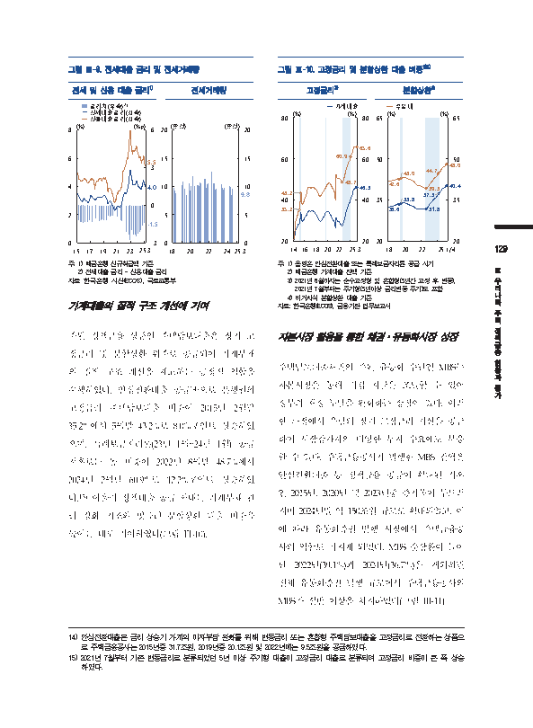</td>
<td width="50%" valign="top"><pre style="white-space: pre-wrap">이 문서는 한국은행의 자산으로 허가받지 않은 복사, 촬영, 수정 및 배포를 금합니다.

그림 Ⅲ-9. 전세대출 금리 및 전세거래량

[그래프]
설명: 2015년부터 2025년 3월까지의 전세 및 신용 대출 금리 추이를 나타낸 그래프입니다. 단위는 금리가 %, 금리차가 %p입니다. 25.3 기준 신용대출금리(좌측)는 5.5, 전세대출금리(좌측)는 4.0, 금리차(우측)는 -1.5를 나타냅니다.

| 구분 | 25.3 |
| --- | --- |
| 신용대출금리(좌측) | 5.5 |
| 전세대출금리(좌측) | 4.0 |
| 금리차(우측) | -1.5 |

전세 및 신용 대출 금리1)
주: 1) 예금은행 신규취급액 기준

[그래프]
설명: 2018년부터 2025년 3월까지의 전세거래량 추이를 나타낸 그래프입니다. 단위는 만건이며, 2025년 3월 수치는 9.8로 적혀 있습니다.

| 구분 | 25.3 |
| --- | --- |
| 전세거래량 | 9.8 |

전세거래량

주: 1) 예금은행 신규취급액 기준
2) 전세대출 금리 – 신용대출 금리
자료: 한국은행 시산(ECOS), 국토교통부
가계대출의 질적 구조 개선에 기여
주된 정책금융 상품인 주택담보대출은 장기 고
정금리 및 분할상환 위주로 공급되어 가계부채
의 질적 구조 개선을 제고하는 긍정적 역할을
수행하였다. 안심전환대출 공급14)으로 은행권의
고정금리 주택담보대출 비중이 2015년 2월말
35.2%에서 5월말 43.2%로 8.0%포인트 상승하였
으며, 특례보금자리론(23년 1월~24년 1월) 공급
전후로는 동 비중이 2022년 8월말 48.7%에서
2024년 2월말 60.9%로 12.2%포인트 상승하였
다.15) 아울러 정책대출 공급 확대는 가계부채 관
리 강화 기조와 맞물려 분할상환 대출 비중을
높이는 데도 기여하였다(그림 Ⅲ-10).
14) 안심전환대출은 금리 상승기 가계의 이자부담 완화를 위해

그림 Ⅲ-10. 고정금리 및 분할상환 대출 비중1)2)

[그래프]
설명: 이 그래프는 2014년부터 2025년 3월(25.3)까지 고정금리 비중(%) 추이를 보여줍니다. 고정금리 비중은 기간에 따라 등락을 거치며 증가하는 추세를 보여 25.3 시점에 가계대출 46.3%, 갈색 선 지표 65.6%로 가장 높은 수치를 기록했습니다.

- 그래프:

| 구분 | 15 | 22~23 | 24 | 25.3 |
| --- | --- | --- | --- | --- |
| 가계대출 | - | - | - | 46.3 |
| 갈색 선 | 35.2 / 43.2 | 48.7 | 60.9 | 65.6 |

고정금리3)
주: 1) 음영은 안심전환대출 또는 특례보...

[그래프]
설명: 본 그래프는 2018년부터 2025년 1분기까지의 분할상환 비중 변화를 나타냅니다. 단위는 %이며, 주담대 비중은 39.3%에서 48.0%로, 하단의 지표는 31.8%에서 40.4%로 상승하는 추세를 보입니다. 두 지표 모두 2025년 1분기에 가장 높은 수치를 기록했습니다.

- 그래프:

| 구분 | | | | | 25.1/4 |
| --- | --- | --- | --- | --- | --- |
| 주담대 | 42.6 | 43.0 | 39.3 | 44.7 | 48.0 |
| | 33.6 | 33.8 | 31.8 | 37.3 | 40.4 |

분할상환⁴)
특례보금자리론 공급 시기

주:1)음영은 안심전환대출 또는 특례보금자리론 공급 시기
2)예금은행 가계대출 잔액 기준
3)2021년 6월까지는 순수고정형 및 혼합형(5년간 고정 후 변동),
2021년 7월부터는 주기형(5년이상 금리변동 주기)도 포함
4)비거치식 분할상환 대출 기준
자료: 한국은행(ECOS), 금융기관 업무보고서
자본시장 활용을 통한 채권·유동화시장 성장
주택담보대출채권의 주된 유동화 수단인 MBS는
자본시장을 통해 직접 자금을 조달할 수 있어
정부의 재정 부담을 완화하는 장점이 있다. 이러
한 과정에서 우량의 장기 고정금리 자산을 공급
하여 시장참가자의 다양한 투자 수요에도 부응
할 수 있다. 주택금융공사가 발행한 MBS 잔액은
안심전환대출 등 정책금융 공급이 확대된 직후
인 2015년, 2020년 및 2023년중 증가폭이 두드러
지며 2024년말 약 150조원 규모로 확대되었고, 이
에 따라 유동화증권 발행 시장에서 주택금융공
사의 역할도 커지게 되었다. MBS 순상환이 늘어
난 2022년(39.1%)과 2024년(36.7%)을 제외하면
전체 유동화증권 발행 규모에서 주택금융공사의
MBS가 절반 이상을 차지하였다(그림 Ⅲ-11).
변동금리 또는 혼합형 주택담보대출을 고정금리로 전환하는 상품으

로 주택금융공사는 2015년중 31.7조원, 2019년중 20.1조원 및 2022년에는 9.5조원을 공급하였다.
15) 2021년 7월부터 기존 변동금리로 분류되었던 5년 이상 주기형 대출이 고정금리 대출로 분류되며 고정금리 비중이 큰 폭 상승
하였다.
이연재 / 안정분석팀 / 2025-07-01 11:36:22</pre></td>
</tr></table>

## 8쪽

<table><tr>
<td width="50%" valign="top">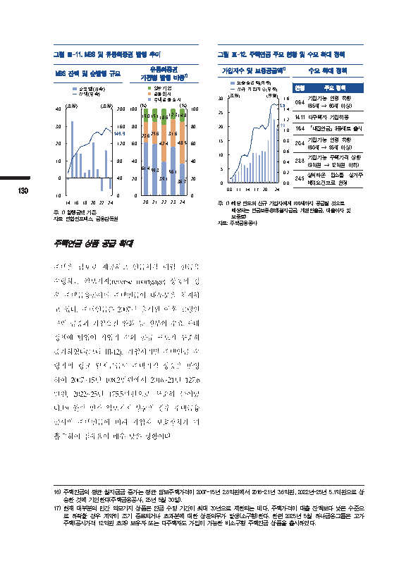</td>
<td width="50%" valign="top"><pre style="white-space: pre-wrap">이 문서는 한국은행의 자산으로 허가받지 않은 복사, 촬영, 수정 및 배포를 금합니다.

그림 Ⅲ-11. MBS 및 유동화증권 발행 추이
유동화증권

[그래프]
설명: 14년부터 24년까지의 MBS 잔액 및 순발행 규모를 조원 단위로 나타낸 그래프입니다. 잔액은 대체로 증가하는 추세를 보이며 24년에 149.9를 나타냅니다.

| 구분 | 24 |
| --- | --- |
| 잔액 | 149.9 |

MBS 잔액 및 순발행 규모
주: 1) 발행금액 기준

기관별 발행 비중1)
일반기업
금융회사
주택금융공사
(%) (%)
100 100
15.015.118.6 12.314.8
80 80
23.625.6 31.6
60 42.4 48.5 60
40 40
61.459.3
56.1
20 39.1 36.7 20
130
0 0
20 21 22 23 24
주: 1) 발행금액 기준
자료: 연합인포맥스, 금융감독원
주택연금 상품 공급 확대
주택을 담보로 제공하고 연금처럼 매월 현금을
수령하는 역모기지(reverse mortgage) 상품의 경
우 주택금융공사의 주택연금이 대부분을 차지하
고 있다. 주택연금은 2007년 출시된 이후 고령인
구의 급증과 가입요건 완화 등 정부의 수요 확대
정책에 힘입어 가입자 수와 공급 규모가 꾸준히
증가하였다(그림 Ⅲ-12). 가입시기별 주택연금 수
령자의 평균 월지급금도 주택가격 상승을 반영
하여 2007~15년 108.2만원에서 2016~21년 127.6
만원, 2022~25년 175.5만원으로 꾸준히 늘어났
다.16) 한편 민간 역모기지 상품의 경우 주택금융
공사의 주택연금에 비해 가입자 보호장치가 미
흡17)하여 점유율이 매우 낮은 상황이다.

그림 Ⅲ-12. 주택연금 주요 현황 및 수요 확대 정책
가입자수 및 보증공급액1) 수요 확대 정책
보증공급액(좌축)
신규가입자수(우축) 연월 주요 정책
30 (조원) (만명) 1.6 가입가능 연령 하향
09.4
1.5 (65세 → 60세 이상)
1.4
25
14.11 다주택자 가입허용
1.2
20 19 1.0 16.4 「내집연금」 3종세트 출시
15 0.8 20.4 가입가능 연령 하향
(60세 → 55세 이상)
0.6
10 가입가능 주택가격 상향
0.4 23.8 (9억원 → 12억원 이하)
5
0.2 실버타운 입소를 실거주
24.5
0 0.0 예외요건으로 인정
08 11 14 17 20 24
주:1)해당 연도의 신규 가입자에게 100세까지 공급될 것으로
예상되는 연금보증총액(월지급금, 개별인출금, 대출이자 및
보증료)
자료: 주택금융공사

16) 주택연금의 평균 월지급금 증가는 평균 담보주택가격이 2007~15년 2.8억원에서 2016~21년 3.6억원, 2022년~25년 5.1억원으로 상
승한 것에 기인한다(주택금융공사, 25년 5월 30일).
17) 현재 대부분의 민간 역모기지 상품은 연금 수령 기간이 최대 30년으로 제한되는 데다, 주택가격이 대출 잔액보다 낮은 수준으
로 하락할 경우 계약이 조기 종료되거나 초과분에 대한 상환의무가 발생(소구형)한다. 한편 2025년 5월 하나금융그룹은 고가
주택(공시가격 12억원 초과) 보유자 또는 다주택자도 가입이 가능한 비소구형 주택연금 상품을 출시하였다.
이연재 / 안정분석팀 / 2025-07-01 11:36:22</pre></td>
</tr></table>

## 9쪽

<table><tr>
<td width="50%" valign="top">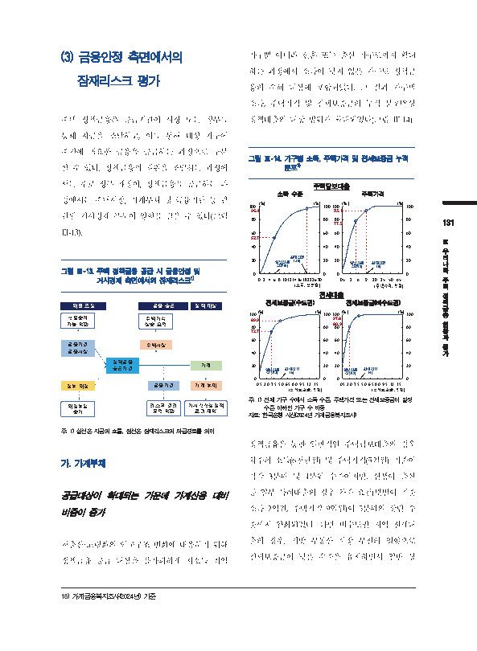</td>
<td width="50%" valign="top"><pre style="white-space: pre-wrap">이 문서는 한국은행의 자산으로 허가받지 않은 복사, 촬영, 수정 및 배포를 금합니다.
(3) 금융안정 측면에서의 가구뿐 아니라 신혼 또는 출산 가구로까지 확대
하는 과정에서 소득이 낮지 않은 가구도 정책금
잠재리스크 평가
융의 수혜 대상에 포함되었다. 그 결과 가구별
소득, 주택가격 및 전세보증금의 누적 분포18)상
주택 정책금융은 공급기관이 시장 또는 정부를 정책대출의 대상 범위가 확대되었다(그림 Ⅲ-14).
통해 자금을 조달하고, 이를 통해 대상 가구에
주거에 필요한 금융을 공급하는 과정으로 구분
그림 Ⅲ-14. 가구별 소득, 주택가격 및 전세보증금 누적
할 수 있다. 정책금융의 재원을 조달하는 과정에 분포1)

[그래프]
설명: 소득 수준에 따른 비율(%)을 나타낸 누적 그래프이다. 소득(천만원)축에서 일반상품 상한(6) 지점의 값은 52.7%이며, 최대상한 (20) 지점의 값은 96.4%이다.

| 구분 | 일반상품 상한(6) | 최대상한 (20) |
| --- | --- | --- |
| 비율 (%) | 52.7 | 96.4 |

주택담보
소득 수준
전세대출

서는 주로 정부 재정이, 정책금융을 공급하는 과
보대출
주택가격
정에서는 주택시장, 가계부채 및 금융기관 등 관
(%) (%)
100 100
93.1
련된 거시경제 부문이 영향을 받을 수 있다(그림
7 8 7 0 .9 80 131
Ⅲ-13).
60 60
Ⅲ
40 40
우
리
20 20
일반상품 최대상한 나
그림 Ⅲ-13. 주택 정책금융 공급 시 금융안정 및 상한(5) (9) 라
0
0
거시경제 측면에서의 잠재리스크1)
주
0.5 3 6 9 20 35 50 65~
(주택가격, 억원) 택
전세대출 정

[그래프]
설명: 수도권 전세보증금 구간에 따른 누적 비율(%)을 보여주는 그래프입니다. 전세보증금이 증가함에 따라 누적 비율이 계속 상승하며, 일반상품 상한(3)에서 72.7%, 최대상한(5)에서 89.9%를 기록합니다.

| 구분 | 일반상품 상한(3) | 최대상한 (5) |
| --- | --- | --- |
| 비율(%) | 72.7 | 89.9 |

주: 1) 전체 가구 수에서 소득 수준, 주

[그래프]
설명: 비수도권의 전세보증금(억원) 구간별 비율(%) 추세를 보여주는 그래프입니다. 전세보증금이 늘어날수록 비율이 증가하는 흐름을 보이며, 일반상품 상한(2) 지점에서 80.9%, 최대상한 (4) 지점에서 97.8%를 나타냅니다.

| 구분 | 일반상품 상한(2) | 최대상한 (4) |
| --- | --- | --- |
| 비율(%) | 80.9 | 97.8 |

전세보증금(비수도권)

책
재원조달 금융공급 정책대상 금
융
신용중개 주택가격
기능약화 상승요인 현
황
과
금융기관 주택시장 평
금융시장 가
정책금융
가계
공급기관
정부재정 금융기관 가계부채
주: 1) 전체 가구 수에서 소득 수준, 주택가격 또는 전세보증금이 일정
재정부담 리스크관리 거시건전성정책 수준 이하인 가구 수 비중
증가 유인약화 효과제약 자료: 한국은행 시산(2024년 가계금융복지조사)
주: 1) 실선은 자금의 흐름, 점선은 잠재리스크의 파급경로를 의미
정책금융을 통한 일반적인 주택담보대출의 경우
가. 가계부채 차주의 소득(6천만원) 및 주택가격(5억원) 기준이
각각 3분위 및 4분위 수준이지만, 신생아 출산
공급대상이 확대되는 가운데 가계신용 대비 등 일부 특례대출의 경우 차주 요건(맞벌이 기준
소득 2억원, 주택가격 9억원)이 5분위의 상단 수
비중이 증가
준까지 완화되었다. 다만 비수도권 지역 전세대
출의 경우, 지방 부동산 시장 부진의 영향으로
저출산·고령화의 인구구조 변화에 대응하기 위해
전세보증금이 낮은 수준을 유지하면서 일반 상
정책금융 공급 대상을 불가피하게 저소득 취약
18) 가계금융복지조사(2024년) 기준
이연재 / 안정분석팀 / 2025-07-01 11:36:22</pre></td>
</tr></table>

## 10쪽

<table><tr>
<td width="50%" valign="top">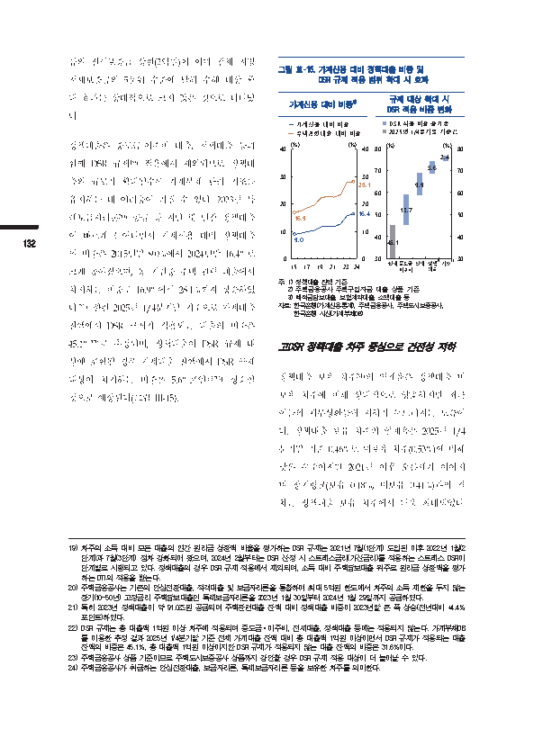</td>
<td width="50%" valign="top"><pre style="white-space: pre-wrap">이 문서는 한국은행의 자산으로 허가받지 않은 복사, 촬영, 수정 및 배포를 금합니다.

품의 전세보증금 상한(2억원)이 이미 전체 지방
전세보증금의 5분위 수준에 달해 수혜 대상 확
대 효과는 상대적으로 크지 않은 것으로 나타났
다.
정책대출은 중도금·이주비 대출, 전세대출 등과
함께 DSR 규제19) 적용에서 제외되므로 정책대
출의 규모가 확대될수록 가계부채 관리 기조를
유지하는 데 어려움이 커질 수 있다. 2023년 특
례보금자리론20) 공급 등 지난 몇 년간 정책대출
이 빠르게 늘어나면서 가계신용 대비 정책대출
132
의 비중은 2015년말 9.0%에서 2024년말 16.4%로
크게 높아졌으며, 동 기간중 주택 관련 대출에서
차지하는 비중도 16.9%에서 28.1%까지 상승하였
다.21) 한편 2025년 1/4분기말 기준으로 가계대출
잔액에서 DSR 규제가 적용되는 대출의 비중은
45.1%22)로 추정되며, 정책대출이 DSR 규제 대
상에 포함될 경우 가계대출 잔액에서 DSR 규제
대상이 차지하는 비중은 5.6%포인트23) 상승할
것으로 예상된다(그림 Ⅲ-15).
19) 차주의 소득 대비 모든 대출의 연간 원리금 상환액 비율을

그림 Ⅲ-15. 가계신용 대비 정책대출 비중 및
DSR 규제 적용 범위 확대 시 효과

[그래프]
설명: 규제 대상 확대 시 DSR 적용 비중 변화를 보여주는 그래프로, 단위는 %이다. 2025년 1/4분기말 기준값은 45.1이며, DSR 적용 비중 증가폭은 중도금 이주비가 13.7로 가장 높고 전세 9.9, 정책²⁾ 대출 5.6, 기타³⁾ 2.4 순이다.

| 구분 | 현재 | 중도금 이주비 | 전세 | 정책²⁾ 대출 | 기타³⁾ |
| --- | --- | --- | --- | --- | --- |
| 값 | 45.1 | 13.7 | 9.9 | 5.6 | 2.4 |

규제 대상 확대 시 DSR 적용 비중 변화
- DSR 적용 비중 증가폭
- 2025년 1/4분기말 기준값

[그래프]
설명: 이 그래프는 15년부터 24년까지 가계신용 대비 비중과 주택관련대출 대비 비중의 추이를 나타냅니다. 단위는 %이며, 가계신용 대비 비중은 15년 9.0%에서 24년 16.4%로 증가하였고 주택관련대출 대비 비중은 15년 16.9%에서 24년 28.1%로 증가하였습니다.

| 구분 | 15 | 24 |
| --- | --- | --- |
| 가계신용 대비 비중 | 9.0 | 16.4 |
| 주택관련대출 대비 비중 | 16.9 | 28.1 |

가계신용 대비 비중1)
주: 1) 정책대출 잔액 기준

주: 1) 정책대출 잔액 기준
2) 주택금융공사 주택구입자금 대출 상품 기준
3) 예적금담보대출, 보험계약대출, 소액대출 등
자료: 한국은행(가계신용통계), 주택금융공사, 주택도시보증공사,
한국은행 시산(가계부채DB)
고DSR 정책대출 차주 중심으로 건전성 저하
정책대출 보유 차주24)의 연체율은 정책대출 미
보유 차주에 비해 상대적으로 양호하지만 최근
이들의 채무상환능력 저하가 두드러지는 모습이
다. 정책대출 보유 차주의 연체율은 2025년 1/4
분기말 기준 0.46%로 미보유 차주(0.53%)에 비해
낮은 수준이지만 2021년 이후 오름세가 이어지
며 장기평균(보유 0.18%, 미보유 0.41%)과의 격
차는 정책대출 보유 차주에서 더욱 확대되었다.
평가하는 DSR 규제는 2021년 7월(1단계) 도입된 이후 2022년 1월(2

단계)과 7월(3단계) 점차 강화되어 왔으며, 2024년 2월부터는 DSR 산정 시 스트레스금리(가산금리)를 적용하는 스트레스 DSR이
단계별로 시행되고 있다. 정책대출의 경우 DSR 규제 적용에서 제외되며, 소득 대비 주택담보대출 위주로 원리금 상환액을 평가
하는 DTI의 적용을 받는다.
20) 주택금융공사는 기존의 안심전환대출, 적격대출 및 보금자리론을 통합하여 최대 5억원 한도에서 차주의 소득 제한을 두지 않는
장기(10~50년) 고정금리 주택담보대출인 특례보금자리론을 2023년 1월 30일부터 2024년 1월 29일까지 공급하였다.
21) 특히 2023년 정책대출이 약 91.0조원 공급되며 주택관련대출 잔액 대비 정책대출 비중이 2023년말 큰 폭 상승(전년대비 +4.4%
포인트)하였다.
22) DSR 규제는 총 대출액 1억원 이상 차주에 적용되며 중도금·이주비, 전세대출, 정책대출 등에는 적용되지 않는다. 가계부채DB
를 이용한 추정 결과 2025년 1/4분기말 기준 전체 가계대출 잔액 대비 총 대출액 1억원 이상이면서 DSR 규제가 적용되는 대출
잔액의 비중은 45.1%, 총 대출액 1억원 이상이지만 DSR 규제가 적용되지 않는 대출 잔액의 비중은 31.6%이다.
23) 주택금융공사 상품 기준이므로 주택도시보증공사 상품까지 감안할 경우 DSR 규제 적용 대상이 더 늘어날 수 있다.
24) 주택금융공사가 취급하는 안심전환대출, 보금자리론, 특례보금자리론 등을 보유한 차주를 의미한다.
이연재 / 안정분석팀 / 2025-07-01 11:36:22</pre></td>
</tr></table>

## 11쪽

<table><tr>
<td width="50%" valign="top">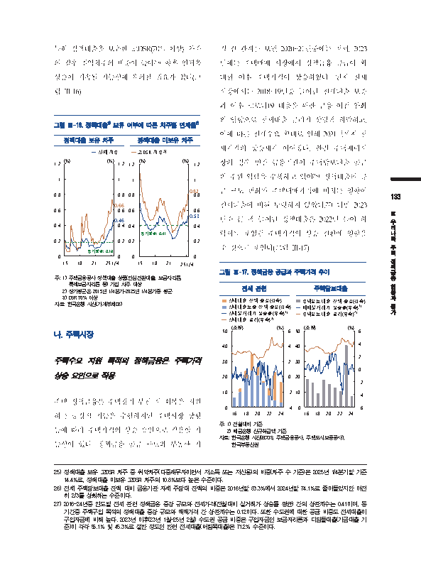</td>
<td width="50%" valign="top"><pre style="white-space: pre-wrap">이 문서는 한국은행의 자산으로 허가받지 않은 복사, 촬영, 수정 및 배포를 금합니다.

특히 정책대출을 보유한 고DSR(70% 이상) 차주
의 경우 취약차주의 비중이 높아25) 향후 연체율
상승이 지속될 가능성에 유의할 필요가 있다(그
림 Ⅲ-16).
그림 Ⅲ-16. 정책대출1) 보유 여부에 따른 차주별 연체율2)

[그래프]
설명: 이 그래프는 15년부터 25.1/4까지 정책대출 미보유 차주의 비율(%) 추이를 보여준다. 그래프상 고DSR 차주는 0.82, 아래의 선은 0.53을 나타내며, 장기평균은 0.41이다.

| 구분 | 수치 |
| --- | --- |
| 고DSR 차주 3) | 0.82 |
| 파란색 선 | 0.53 |
| 장기평균 | 0.41 |

그림 제목: 정책대출 미보유 차주

[그래프]
설명: 15년부터 25.1/4까지 정책대출 보유 차주 비율 추이를 나타낸 그래프이다. 단위는 %이며, 전체 차주는 0.46, 상단 지표는 0.66, 장기평균은 0.18을 보여준다.

| 구분 | 값 |
| --- | --- |
| 전체 차주 | 0.46 |
| 장기평균 | 0.18 |

정책대출 보유 차주

주: 1) 주택금융공사 정책대출 상품(안심전환대출, 보금자리론,
특례보금자리론 등) 가입 차주 대상
2) 장기평균은 2015년 1/4분기~2025년 1/4분기중 평균
3) DSR 70% 이상
자료: 한국은행 시산(가계부채DB)
나. 주택시장
주택수요 지원 목적의 정책금융은 주택가격
상승 요인으로 작용
주택 정책금융은 주택경기 부진 시 회복을 지원
하는 긍정적 기능을 수행하지만 주택시장 상황
등에 따라 주택가격의 상승 요인으로 작용할 가
능성이 있다. 정책금융 공급 규모와 부동산 가

격 간 관계를 보면 2020~21년중에는 전세, 2023
년에는 주택매매 시장에서 정책금융 공급이 확
대된 이후 주택가격이 상승하였다. 먼저 전세
시장에서는 2018~19년중 늘어난 전세대출 보증
과 이후 코로나19 대응을 위한 금융 여건 완화
의 영향으로 전세대출 금리가 상당폭 하락하고,
이에 따른 전세수요 확대로 인해 2021년까지 전
세가격의 상승세가 이어졌다. 한편 주택매매시
장의 경우 민간 금융기관이 주택담보대출 공급
의 주된 역할을 수행하고 있어26) 정책대출의 공
급 규모 변화가 주택매매가격에 미치는 영향이
전세대출에 비해 뚜렷하지 않았다.27) 다만 2023
년중 큰 폭 늘어난 정책대출은 2022년 들어 하
락세를 보였던 주택가격의 상승 전환에 영향을
준 것으로 보인다(그림 Ⅲ-17).
그림 Ⅲ-17. 정책금융 공급과 주택가격 추이

[그래프]
설명: 2016년부터 2024년까지의 전세 관련 및 주택담보대출 동향을 나타내는 그래프입니다. 좌축 단위는 잔액 증감(조원), 우축 단위는 상승률 및 금리(%)이며 대출 잔액 증감, 실거래가 상승률, 대출 금리의 추이를 함께 보여줍니다.

주: 1) 전월대비 기준

주: 1) 전월대비 기준
2) 예금은행 신규취급액 기준
자료: 한국은행 시산(ECOS, 주택금융공사, 주택도시보증공사),
한국부동산원

25) 정책대출 보유 고DSR 차주 중 취약차주(다중채무자이면서 저소득 또는 저신용)의 비중(차주 수 기준)은 2025년 1/4분기말 기준
14.4%로, 정책대출 미보유 고DSR 차주의 10.8%보다 높은 수준이다.
26) 전체 주택담보대출 잔액 대비 금융기관 자체 주담대 잔액의 비중은 2016년말 83.3%에서 2024년말 74.1%로 줄어들었지만 여전
히 2/3를 상회하는 수준이다.
27) 2016~24년중 연도별 전세 관련 정책금융 증감 규모와 전세가격(전월대비 실거래가 상승률 평균) 간의 상관계수는 0.41이며, 동
기간중 주택구입 목적의 정책대출 증감 규모와 매매가격 간 상관계수는 0.12이다. 또한 수도권에 대한 공급 비중도 전세대출이
구입자금에 비해 높다. 2023년 이후(23년 1월~25년 2월) 수도권 공급 비중은 구입자금인 보금자리론과 디딤돌대출(기금대출 기
준)이 각각 55.1% 및 45.3%로 절반 정도인 반면 전세대출(버팀목대출)은 71.2% 수준이다.
이연재 / 안정분석팀 / 2025-07-01 11:36:22</pre></td>
</tr></table>

## 12쪽

<table><tr>
<td width="50%" valign="top">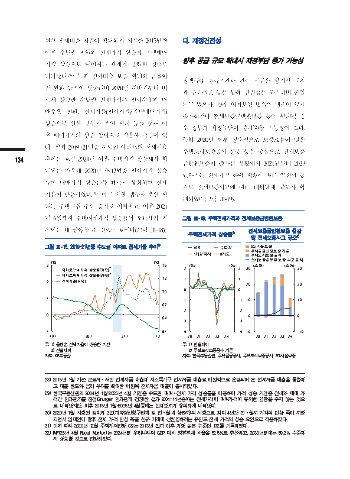</td>
<td width="50%" valign="top"><pre style="white-space: pre-wrap">이 문서는 한국은행의 자산으로 허가받지 않은 복사, 촬영, 수정 및 배포를 금합니다.

한편 전세대출 지원이 확대되기 시작한 2015년28)
이후 수도권 지역의 전세가격 상승이 주택매매
가격 상승으로 이어지는 관계가 강화된 것으로
나타났다.29) 특히 전세대출 보증 확대와 금융여
건 완화 등30)이 맞물리며 2020년 하반기부터 빠
르게 상승한 수도권 전세가격은 전세수요의 매
매수요 전환, 전세가율(전세가격/주택매매가격)
상승으로 인한 갭투자 유인 확대 등을 통해 이
후 매매가격의 상승 압력으로 작용한 측면이 있
다. 실제 2019~21년중 수도권 아파트의 전세가율
134 추이를 보면 2020년 이후 주택가격 상승세가 확
대되는 가운데 2020년 9~12월중 전세가격 상승
률이 매매가격 상승률을 빠르게 상회하며 전세
가율이 반등하였다.31) 이로 인한 갭투자 유인 확
대는 주택구입 수요 증가로 이어지고, 이후 2021
년 6월까지 주택매매가격 상승률의 오름세가 지
속되는 데 영향을 준 것으로 보인다(그림 Ⅲ-18).
그림 Ⅲ-18. 2019~21년중 수도권 아파트 전세가율 추이1)

[그래프]
설명: 이 그래프는 2019년 1월부터 2021년 12월까지 아파트전세가격 상승률(좌축, %), 아파트매매가격 상승률(좌축, %), 전세가율(우축, %)의 추이를 보여줍니다. 아파트매매가격 상승률과 전세가격 상승률은 변동을 나타내며, 전세가율은 전반적으로 감소하다가 음영으로 표시된 기간 동안 상승하는 추세를 보입니다.

주: 1) 음영은 전세가율이 상승한 기간

주: 1)음영은 전세가율이 상승한 기간
2)전월대비
자료: KB부동산

다. 재정건전성
향후 공급 규모 확대시 재정부담 증가 가능성
정책금융 공급기관과 관련 기금은 장기적 계획
과 관리목표 등을 통해 건전성을 유지하며 운영
되고 있으나, 향후 이차보전 방식의 대출이 크게
증가하거나 전세보증금반환보증 등이 확대될 경
우 정부의 재정부담이 증가32)할 가능성이 있다.
특히 2020년 이후 상대적으로 보증료율이 낮은
주택도시보증공사 상품 등을 중심으로 전세보증
금반환보증이 증가한 상황에서 2021년부터 2023
년까지는 전세가격 하락 지속에 따른 역전세 등
으로 전세보증사고에 따른 대위변제 규모가 확
대되었다(그림 Ⅲ-19).
그림 Ⅲ-19. 주택전세가격과 전세보증금반환보증
전세보증금반환보증 증감
주택전세가격 상승률1)
및 전세보증사고 규모2)

[그래프]
설명: 2020년부터 2024년까지 전국, 수도권, 5대광역시, 8개도의 주택전세가격 상승률(%) 추이를 나타낸 그래프입니다. 21년에 상승을 보이다가 23년에 크게 감소하여 가장 낮았으며, 이후 다시 상승하는 추세를 보입니다.

주택전세가격 상승률1)
주: 1) 전월대비

[그래프]
설명: 및 전세보증사고 규모를 20년부터 24년까지 (조원) 단위로 나타낸 그래프입니다. SGI서울보증, 주택금융신용보증기금, 주택도시보증공사의 보증 금액과 전세보증금반환보증 사고금액 추이를 보여주며, 사고금액은 20년에서 23년까지 증가하는 추세를 보입니다.

및 전세보증사고 규모²⁾

주: 1) 전월대비
2) 주택도시보증공사 기준
자료: 한국부동산원, 주택금융공사, 주택도시보증공사, SGI서울보증

28) 2015년 1월 기존 근로자·서민 전세자금 대출과 저소득가구 전세자금 대출로 이원적으로 운영되어 온 전세자금 대출을 통합하
고 대출 한도와 금리 우대를 확대한 버팀목 전세자금 대출이 출시되었다.
29) 한국부동산원의 2004년 1월~2025년 4월 기간중 수도권 매매·전세 가격 상승률을 이용하여 가격 상승 기간중 전세와 매매 가
격간 인과관계를 점검(Granger 인과관계 검정)한 결과 2004~14년중에는 전세가격이 매매가격에 유의한 영향을 주지 않는 것으
로 나타났지만, 이후 2015년 7월~2025년 4월중에는 인과관계가 유의하게 나타났다.
30) 2020년 7월 시행된 임대차 2법(계약갱신청구권제 및 전·월세 상한제)의 시행으로 최대 4년간 전·월세 가격의 인상 폭이 제한
되면서 임대인이 향후 전세 가격 인상 폭을 신규 거래에 선반영하려는 유인도 전세 가격의 상승 요인으로 작용하였다.
31) 이에 따라 2020년 12월 주택가격전망 CSI는 2013년 집계 이후 가장 높은 수준인 132를 기록하였다.
32) IMF(25년 4월 Fiscal Monitor)는 2024년말 우리나라의 GDP 대비 정부부채 비율을 52.5%로 추산하고, 2030년말에는 59.2% 수준까
지 상승할 것으로 전망하였다.
이연재 / 안정분석팀 / 2025-07-01 11:36:22</pre></td>
</tr></table>

## 13쪽

<table><tr>
<td width="50%" valign="top">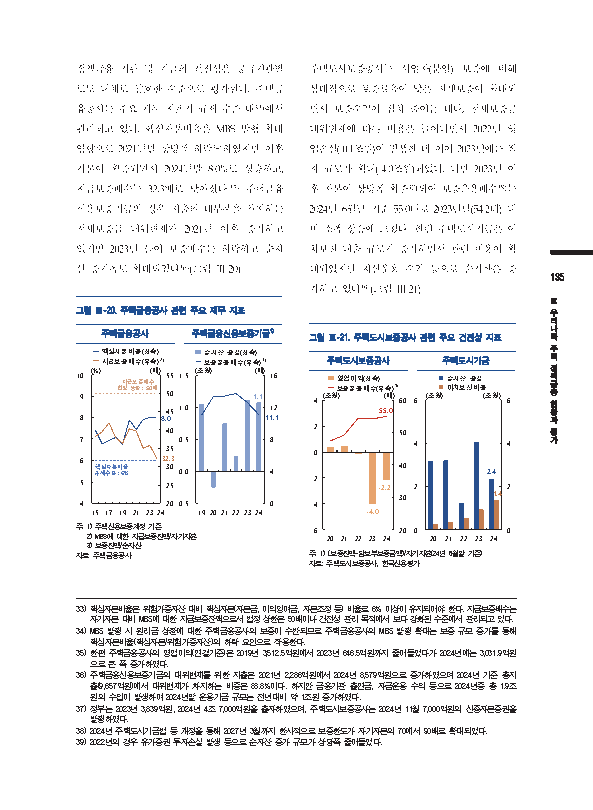</td>
<td width="50%" valign="top"><pre style="white-space: pre-wrap">이 문서는 한국은행의 자산으로 허가받지 않은 복사, 촬영, 수정 및 배포를 금합니다.

정책금융 기관 및 기금의 건전성은 공급기관별
로도 대체로 양호한 수준으로 평가된다. 주택금
융공사는 주요 재무 지표가 규제 수준 내33)에서
관리되고 있다. 핵심자본비율은 MBS 발행 확대
영향으로 2021년말 상당폭 하락34)하였지만 이후
자본이 확충되면서 2024년말 8.0%로 상승하고,
지급보증배수는 32.3배로 낮아졌다.35) 주택금융
신용보증기금의 경우 지출의 대부분을 차지하는
전세보증금 대위변제가 2021년 이후 증가하고
있지만 2023년 들어 보증배수는 하락하고 순자
산 증가폭도 확대되었다36)(그림 Ⅲ-20).
그림 Ⅲ-20. 주택금융공사 관련 주요 재무 지표
주택금융공사 주택금융신용보증기금1)

[그래프]
주택금융공사의 15년부터 24년까지 핵심자본비율(%)과 지급보증배수(배) 추이를 나타낸 그래프이다. 핵심자본비율 규제수준은 6%이며 24년 값은 8.0이고, 지급보증배수 법정 상한은 50배이며 24년 값은 32.3이다.

| 구분 | 24 |
| --- | --- |
| 핵심자본비율 | 8.0 |
| 지급보증배수 | 32.3 |

주택금융공사
주: 1) 주택신용보증계정 기준

[그래프]
설명: 주택금융신용보증기금의 2019년부터 2024년까지 순자산 증감과 보증운용배수의 추이를 보여주는 그래프이다. 2024년 기준 순자산 증감은 1.1조원, 보증운용배수는 11.1배로 기재되어 있다.

- 그래프:
| 구분 | 24 |
| --- | --- |
| 순자산 증감 | 1.1 |
| 보증운용배수 | 11.1 |

주택금융신용보증기금

주:1)주택신용보증계정 기준
2)MBS에 대한 지급보증잔액/자기자본
3)보증잔액/순자산
자료: 주택금융공사

주택도시보증공사는 사업자(분양) 보증에 비해
상대적으로 보증료율이 낮은 전세보증이 확대되
면서 보증수익이 점차 줄어든 데다, 전세보증금
대위변제에 따른 비용은 늘어나면서 2022년 영
업손실(-0.1조원)이 발생한 데 이어 2023년에는 적
자 규모가 확대(-4.0조원)되었다. 다만 2023년 이
후 자본이 상당폭 확충37)되어 보증운용배수38)는
2024년 6월말 기준 55.0배로 2023년말(54.2배) 대
비 소폭 상승에 그쳤다. 한편 주택도시기금은 이
차보전 대출 규모가 증가하면서 관련 비용이 확
대되었지만 자산운용 수익 등으로 순자산은 증
가하고 있다39)(그림 Ⅲ-21).
그림 Ⅲ-21. 주택도시보증공사 관련 주요 건전성 지표

[그래프]
설명: 주택도시보증공사의 2020년부터 2024년까지 영업이익(조원)과 보증운용배수(배) 추이를 보여주는 그래프이다. 영업이익은 2023년에 -4.0조원으로 가장 낮았으며 2024년에는 -2.2조원을 기록했고, 보증운용배수는 2024년에 55.0배를 기록했다.

- 그래프:

| 구분 | 2020 | 2021 | 2022 | 2023 | 2024 |
| --- | --- | --- | --- | --- | --- |
| 영업이익(조원) | | | | -4.0 | -2.2 |
| 보증운용배수(배) | | | | | 55.0 |

주: 1) (보증잔액-담보부보증금액)/자기

주택도시기금

[그래프]
설명: 2020년부터 2024년까지 주택도시기금의 순자산 증감 및 이차보전비용 추이를 나타낸 막대그래프이다. 단위는 조원이며, 2024년 수치로 순자산 증감 2.4와 이차보전비용 1.4가 적혀 있다.

| 구분 | 24 |
| --- | --- |
| 순자산 증감 | 2.4 |
| 이차보전비용 | 1.4 |

주택도시기금

주: 1) (보증잔액–담보부보증금액)/자기자본(24년 6월말 기준)
자료: 주택도시보증공사, 한국신용평가

33) 핵심자본비율은 위험가중자산 대비 핵심자본(자본금, 이익잉여금, 자본조정 등) 비율로 6% 이상이 유지되어야 한다. 지급보증배수는
자기자본 대비 MBS에 대한 지급보증잔액으로서 법정 상한은 50배이나 건전성 관리 목적에서 보다 강화된 수준에서 관리되고 있다.
34) MBS 발행 시 원리금 상환에 대한 주택금융공사의 보증이 수반되므로 주택금융공사의 MBS 발행 확대는 보증 규모 증가를 통해
핵심자본비율(핵심자본/위험가중자산)의 하락 요인으로 작용한다.
35) 한편 주택금융공사의 영업이익(연결기준)은 2019년 3,512.5억원에서 2023년 646.5억원까지 줄어들었다가 2024년에는 3,031.9억원
으로 큰 폭 증가하였다.
36) 주택금융신용보증기금의 대위변제를 위한 지출은 2021년 2,286억원에서 2024년 8,579억원으로 증가하였으며 2024년 기준 총지
출(9,657억원)에서 대위변제가 차지하는 비중은 88.8%이다. 하지만 금융기관 출연금, 자금운용 수익 등으로 2024년중 총 1.9조
원의 수입이 발생하여 2024년말 운용기금 규모는 전년대비 약 1조원 증가하였다.
37) 정부는 2023년 3,839억원, 2024년 4조 7,000억원을 출자하였으며, 주택도시보증공사는 2024년 11월 7,000억원의 신종자본증권을
발행하였다.
38) 2024년 주택도시기금법 등 개정을 통해 2027년 3월까지 한시적으로 보증한도가 자기자본의 70에서 90배로 확대되었다.
39) 2022년의 경우 유가증권 투자손실 발생 등으로 순자산 증가 규모가 상당폭 줄어들었다.
이연재 / 안정분석팀 / 2025-07-01 11:36:22</pre></td>
</tr></table>

## 14쪽

<table><tr>
<td width="50%" valign="top">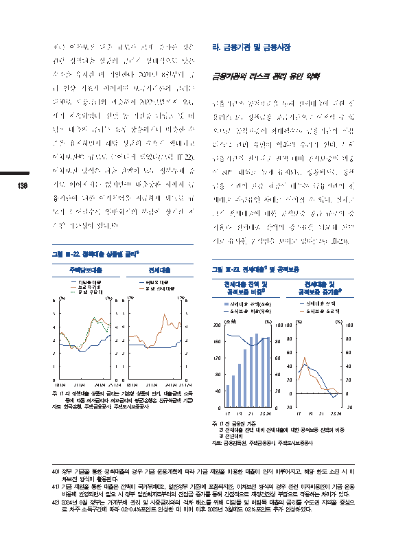</td>
<td width="50%" valign="top"><pre style="white-space: pre-wrap">이 문서는 한국은행의 자산으로 허가받지 않은 복사, 촬영, 수정 및 배포를 금합니다.

최근 이차보전 대출 규모가 크게 증가한 것은
관련 정책대출 상품의 금리가 상대적으로 낮은
수준을 유지한 데 기인한다. 2021년 8월부터 금
리 인상 기조가 이어지며 보금자리론의 금리는
대체로 시장금리와 비슷하게 2022년말까지 오름
세가 지속되었다. 반면 동 기간중 디딤돌 및 버
팀목 대출의 금리는 소폭 상승하거나 비슷한 수
준을 유지하면서 해당 상품의 수요가 확대되고
이차보전40) 규모도 늘어나게 되었다(그림 Ⅲ-22).
이차보전 방식은 대출 잔액이 모두 정부부채 증
136 가로 이어지지는 않지만41) 대출상환 시까지 금
융기관에 대한 이자차액을 지급하게 되므로 규
모가 늘어날수록 일반회계의 부담이 장기간 지
속될 가능성이 있다.42)
그림 Ⅲ-22. 정책대출 상품별 금리1)

[그래프]
설명: 18.1/4부터 25.1/4까지 주택담보대출과 전세대출의 금리 추이를 단위(%)로 나타낸 그래프입니다. 주택담보대출은 디딤돌대출, 보금자리론, 은행 주담대의 금리 변동을 보여주며, 전세대출은 버팀목대출과 은행 전세대출의 금리 변동을 비교하여 보여줍니다.

주: 1) 각 정책대출 상품의 금리는 기본형 상품의 만기, 대출금액, 소득

주:1)각 정책대출 상품의 금리는 기본형 상품의 만기, 대출금액, 소득
등에 따른 최저금리와 최고금리의 평균(은행은 신규취급액 기준)
자료: 한국은행, 주택금융공사, 주택도시보증공사

라. 금융기관 및 금융시장
금융기관의 리스크 관리 유인 약화
금융기관은 공적보증을 통해 전세대출에 대한 신
용리스크를 정책금융 공급기관으로 이전할 수 있
으므로 공적보증이 확대될수록 금융기관의 신용
리스크 관리 유인이 약화될 우려가 있다. 특히
금융기관의 전세대출 잔액 대비 공적보증의 비중
이 80% 내외로 높게 유지되는 상황에서는 정책
금융 기관의 보증 제공이 대부분 금융기관의 전
세대출 취급유인 확대로 이어질 수 있다. 실제로
그간 전세대출에 대한 공적보증 공급 규모의 증
가율과 전세대출 잔액의 증가율을 비교해 보면
서로 유사한 움직임을 보이고 있다(그림 Ⅲ-23).
그림 Ⅲ-23. 전세대출1) 및 공적보증
전세대출 잔액 및 전세대출 및

[그래프]
설명: 이 그래프는 17년부터 24년까지의 전세대출 잔액(단위: 조원)과 공적보증 비중(단위: %) 추이를 보여줍니다. 그래프의 막대와 꺾은선 위에 구체적인 숫자는 표기되어 있지 않습니다.

전세대출 잔액 및 공적보증 비중²⁾
주: 1) 전 금융권 기준

공적보증 증가율333)))

[그래프]
설명: 이 그래프는 17년부터 24년까지 전세대출 잔액과 공적보증 공급액의 증가율(%) 추이를 나타냅니다. 전세대출 잔액과 공적보증 공급액 모두 초기에 상승한 이후 전반적으로 감소하는 추세를 보입니다.

주: 1) 전 금융권 기준
2) 전세대출 잔액 대비 전세대출에 대한 공적보증 잔액의 비중
3) 전년대비
자료: 금융감독원, 주택금융공사, 주택도시보증공사

40) 정부 기금을 통한 정책대출의 경우 기금 운용계획에 따라 기금 재원을 이용한 대출이 먼저 이루어지고, 해당 한도 소진 시 이
차보전 방식이 활용된다.
41) 기금 재원을 통한 대출은 전액이 국가부채(D2, 일반정부 기준)에 포함되지만, 이차보전 방식의 경우 관련 이자비용만이 기금 운용
비용에 반영되면서 필요 시 정부 일반회계로부터의 전입금 증가를 통해 간접적으로 재정건전성 부담으로 작용하는 차이가 있다.
42) 2024년 8월 정부는 가계부채 관리 및 시중금리와의 격차 해소를 위해 디딤돌 및 버팀목 대출의 금리를 수도권 지역을 중심으
로 차주 소득구간에 따라 0.2~0.4%포인트 인상한 데 이어 이후 2025년 3월에도 0.2%포인트 추가 인상하였다.
이연재 / 안정분석팀 / 2025-07-01 11:36:22</pre></td>
</tr></table>

## 15쪽

<table><tr>
<td width="50%" valign="top">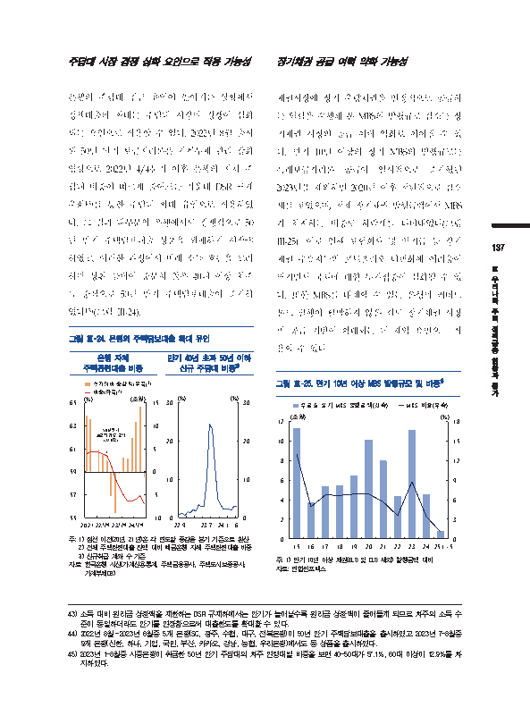</td>
<td width="50%" valign="top"><pre style="white-space: pre-wrap">이 문서는 한국은행의 자산으로 허가받지 않은 복사, 촬영, 수정 및 배포를 금합니다.

주담대 시장 경쟁 심화 요인으로 작용 가능성
은행의 주담대 취급 유인이 높아지는 상황에서
정책대출의 확대는 주담대 시장의 경쟁이 심화
되는 요인으로 작용할 수 있다. 2022년 8월 출시
된 50년 만기 보금자리론은 가계부채 관리 강화
영향으로 2022년 4/4분기 이후 은행의 자체 주
담대 비중이 빠르게 줄어드는 가운데 DSR 규제
우회43)를 통한 주담대 확대 유인으로 작용하였
다. 그 결과 대부분의 은행에서도 경쟁적으로 50
년 만기 주택담보대출 상품을 판매하기 시작44)
하였고, 이러한 과정에서 미래 소득 흐름을 고려
하면 상환 능력이 충분치 않은 40대 이상 차주
를 중심으로 50년 만기 주택담보대출이 증가하
였다45)(그림 Ⅲ-24).
그림 Ⅲ-24. 은행의 주택담보대출 확대 유인

[그래프]
설명: 2020년부터 2024년 1/4분기 이후까지 은행 자체 주택관련대출 비중(좌축, %)과 전기대비 증감액(우축, 조원)의 추이를 나타낸 그래프이다. 비중은 전반적으로 감소하는 추세를 보이며, 그래프 중앙에는 22.8월 50년만기 보금자리론 출시 시점이 표시되어 있다.

그림 Ⅲ-14. 은행 ...
은행 자체 주택관련대출 비중
주: 1) 점선 이전(20년, 21년)은 각 연도...

만기 40년 초과 50년 이하
신규 주담대 비중3)

[그래프]
설명: 단기 결제 비중의 추이를 나타내는 그래프이다. 기간은 22.9부터 24.1 6까지이며 단위는 %이다. 23.7 시점에 급격히 증가하였다가 이후 감소하는 추세를 보인다.

주: 은 각 연동망 증감율 분기 기준으로 환산

주:1)점선 이전(20년, 21년)은 각 연도말 증감을 분기 기준으로 환산
2)전체 주택관련대출 잔액 대비 예금은행 자체 주택관련대출 비중
3)신규취급 계좌 수 기준
자료: 한국은행 시산(가계신용통계, 주택금융공사, 주택도시보증공사,
가계부채DB)

장기채권 공급 여력 약화 가능성
채권시장에 장기 우량채권을 안정적으로 공급하
는 역할을 수행해 온 MBS의 발행규모 감소는 장
기채권 시장의 공급 여력 약화로 이어질 수 있
다. 만기 10년 이상의 장기 MBS의 발행규모는
특례보금자리론 공급이 일시적으로 증가했던
2023년을 제외하면 2020년 이후 전반적으로 감소
세를 보였으며, 전체 장기채권 발행금액에서 MBS
가 차지하는 비중도 하락세를 나타내었다(그림
Ⅲ-25). 이로 인해 보험회사 및 연기금 등 장기
채권 수요자들의 포트폴리오 다변화에 어려움이
커지면서 국채에 대한 투자집중이 심화될 수 있
다. 또한 MBS를 대체할 수 있는 은행의 커버드
본드 발행이 활발하지 않은 점도 장기채권 시장
의 공급 기반이 확대되는 데 제약 요인으로 작
용할 수 있다.
그림 Ⅲ-25. 만기 10년 이상 MBS 발행규모 및 비중1)

[그래프]
설명: 이 그래프는 2015년부터 2025년 1~5월까지의 주금공 장기 MBS 발행금액(단위: 조원)과 MBS 비중(단위: %) 추이를 보여줍니다. 주금공 장기 MBS 발행금액과 MBS 비중은 2015년과 2023년에 높은 수준을 기록한 뒤 2025년 1~5월에 크게 감소하는 추세를 보입니다.

주금공 장기 MBS 발행금액(좌축)
MBS 비중(우축)

주: 1) 만기 10년 이상 채권(ELS 및 DLS 제외) 발행금액 대비

주: 1) 만기 10년 이상 채권(ELS 및 DLS 제외) 발행금액 대비
자료: 연합인포맥스

43) 소득 대비 원리금 상환액을 제한하는 DSR 규제하에서는 만기가 늘어날수록 원리금 상환액이 줄어들게 되므로 차주의 소득 수
준이 동일하더라도 만기를 연장함으로써 대출한도를 확대할 수 있다.
44) 2022년 8월~2023년 6월중 5개 은행(SC, 광주, 수협, 대구, 전북은행)이 50년 만기 주택담보대출을 출시하였고 2023년 7~8월중
9개 은행(신한, 하나, 기업, 국민, 부산, 카카오, 경남, 농협, 우리은행)에서도 동 상품을 출시하였다.
45) 2023년 1~8월중 시중은행이 취급한 50년 만기 주담대의 차주 연령대별 비중을 보면 40~50대가 57.1%, 60대 이상이 12.9%를 차
지하였다.
이연재 / 안정분석팀 / 2025-07-01 11:36:22</pre></td>
</tr></table>

## 16쪽

<table><tr>
<td width="50%" valign="top">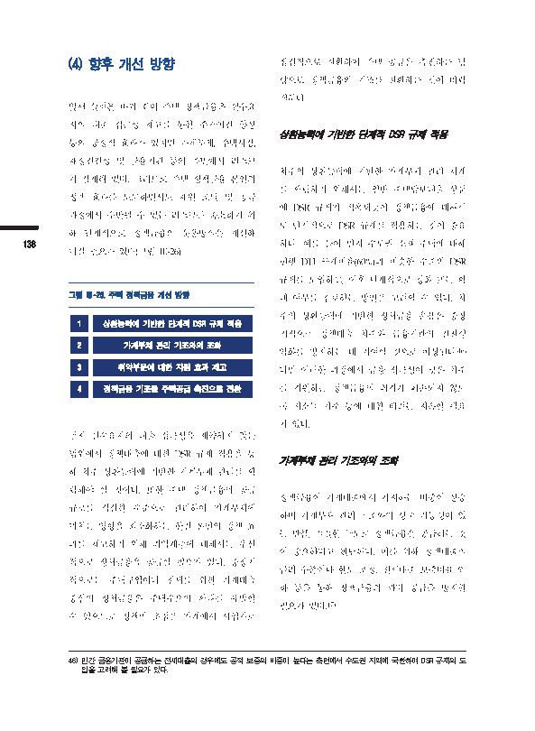</td>
<td width="50%" valign="top"><pre style="white-space: pre-wrap">이 문서는 한국은행의 자산으로 허가받지 않은 복사, 촬영, 수정 및 배포를 금합니다.
(4) 향후 개선 방향 점진적으로 전환하여 주택 공급을 촉진하는 방
향으로 정책금융의 기조를 전환하는 것이 바람
직하다.
앞서 살펴본 바와 같이 주택 정책금융은 실수요
자의 대출 접근성 제고를 통한 주거여건 향상
상환능력에 기반한 단계적 DSR 규제 적용
등의 긍정적 효과가 있지만 가계부채, 주택시장,
재정건전성 및 금융기관 등의 측면에서 리스크
차주의 상환능력에 기반한 가계부채 관리 체계
가 잠재해 있다. 그러므로 주택 정책금융 본연의
를 확립하기 위해서는 일반 주택담보대출 상품
정책 효과를 도모하면서도 재원 조달 및 공급
에 DSR 규제가 적용되듯이 정책금융에 대해서
과정에서 수반될 수 있는 리스크를 축소하기 위
도 단계적으로 DSR 규제를 적용하는 것이 중요
해 단계적으로 정책금융의 운용방식을 개선해
138 하다. 예를 들어 먼저 수도권 소재 주택에 대해
나갈 필요가 있다(그림 Ⅲ-26).
현행 DTI 규제비율(60%)과 비슷한 수준의 DSR
규제를 도입하고, 이후 단계적으로 강화 또는 확
그림 Ⅲ-26. 주택 정책금융 개선 방향 대 여부를 검토하는 방안을 고려할 수 있다. 차
주의 상환능력에 기반한 정책금융 운용은 중장
1 상환능력에 기반한 단계적 DSR 규제 적용
기적으로 정책대출 차주와 금융기관의 건전성
2 가계부채 관리 기조와의 조화
악화를 방지하는 데 기여할 것으로 예상된다.46)
3 취약부문에 대한 지원 효과 제고 다만 이러한 과정에서 금융 접근성이 낮은 차주
4 정책금융 기조를 주택공급 촉진으로 전환 를 지원하는 정책금융의 취지가 훼손되지 않도
록 저소득 차주 등에 대한 배려는 지속할 필요
가 있다.
먼저 실수요자의 대출 접근성을 제약하지 않는
범위에서 정책대출에 대한 DSR 규제 적용을 통
가계부채 관리 기조와의 조화
해 차주 상환능력에 기반한 가계부채 관리를 확
립해야 할 것이다. 또한 주택 정책금융의 공급
정책금융이 가계대출에서 차지하는 비중이 상승
규모를 적절한 수준으로 관리하여 가계부채에
하며 가계부채 관리 기조와의 상충 가능성이 있
미치는 영향을 최소화하는 한편 본연의 정책 효
는 만큼, 적절한 규모로 정책금융을 공급하는 것
과를 제고하기 위해 취약계층에 대해서는 우선
이 중요하다고 판단된다. 이를 위해 정책대출의
적으로 정책금융을 공급할 필요가 있다. 중장기
금리 수준이나 한도 조정, 전세대출 보증비율 인
적으로는 주택구입이나 전세를 위한 가계대출
하 등을 통해 정책금융의 과다 공급을 방지할
중심의 정책금융은 주택수요의 확대를 유발할
필요가 있다.47)
수 있으므로 정책의 초점을 가계에서 사업자로
46) 민간 금융기관이 공급하는 전세대출의 경우에도 공적 보증의 비중이 높다는 측면에서 수도권 지역에 국한하여 DSR 규제의 도
입을 고려해 볼 필요가 있다.
이연재 / 안정분석팀 / 2025-07-01 11:36:22</pre></td>
</tr></table>

## 17쪽

<table><tr>
<td width="50%" valign="top">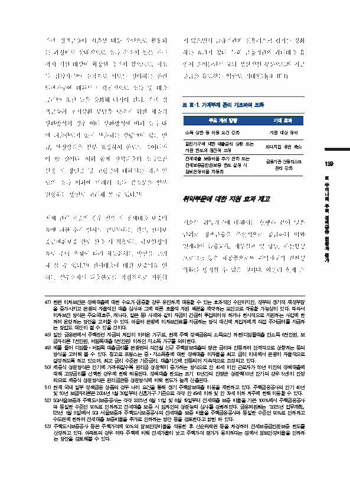</td>
<td width="50%" valign="top"><pre style="white-space: pre-wrap">이 문서는 한국은행의 자산으로 허가받지 않은 복사, 촬영, 수정 및 배포를 금합니다.

주택 정책금융이 저출생 대응 수단으로 활용되
는 과정에서 상대적으로 소득 수준이 높은 가구
까지 지원 대상이 확장된 측면이 있으므로, 저소
득 취약가구48) 중심으로 제도를 정비하는 한편
일반가구에 대해서는 점진적으로 소득 및 대출
금리49) 요건 등을 강화해 나가야 한다. 주택 정
책금융의 초기상환 부담을 낮추기 위한 체증식
상환방식의 경우 여타 상환방식에 비해 소득 대
비 대출한도가 높게 산출되는 경향50)이 있는 만
큼, 산정방식을 일부 조정하여 한도를 줄여나가
야 할 것이다. 이와 함께 정책대출의 소득요건
산정 시 장년층 및 고령층에 대해서는 최근 연
도의 소득 이외에 미래의 소득 감소분을 일부
반영하는 방안도 고려해 볼 수 있다.51)
전세 관련 보증의 경우 필요 시 전세대출 보증비
율에 대한 추가 인하를 검토52)하는 한편, 전세보
증금반환보증 한도 산출 시 적용되는 담보인정비
율도 주택 유형에 따라 차등화하는 방안을 고려
해 볼 수 있다.53) 전세대출에 대한 보증비율 인
하는 실수요자의 대출한도를 직접적으로 제한하

지 않으면서 금융기관의 신용리스크 평가를 강화
하는 효과가 있다. 특히 금융기관의 과다대출 유
인이 줄어들면서 보다 생산적인 부문으로의 자금
공급을 유도하는 역할도 기대된다(표 Ⅲ-1).
표 Ⅲ-1. 가계부채 관리 기조와의 조화
주요 개선 방향 기대 효과
소득 상한 등 이용 요건 강화 지원 대상 정비
일반가구에 대한 대출금리 상향 또는
과다차입 유인 축소
지원 한도의 점진적 조정
전세대출 보증비율 추가 인하 또는
금융기관 신용리스크
전세보증금반환보증 한도 설정 시
관리 강화
담보인정비율 차등화
취약부문에 대한 지원 효과 제고
저소득 취약가구에 대해서는 현행과 같이 낮은
금리로 정책금융을 우선적으로 공급하되 이와
연계하여 금융교육, 재무설계 및 상담, 자산형성
프로그램 등을 제공함으로써 취약가구의 건전성
악화를 방지할 수 있을 것이다. 아울러 현재 소

47) 한편 이차보전은 정책대출에 대한 수요가 급증할 경우 유연하게 대응할 수 있는 효과적인 수단이지만, 정부의 장기적 재정부담
을 증가시키고 은행의 자율적인 대출 심사와 그에 따른 효율적 자원 배분을 제약하는 요인으로 작용할 가능성이 있다. 따라서
이차보전 방식은 주요국(호주, 캐나다, 일본 등) 사례와 같이 자금이 긴급히 투입되어야 하거나 한시적으로 지원하는 사업에 한
하여 운영하는 방안을 고려할 수 있다. 아울러 은행에 이차보전료를 지급하는 방식 대신에 차입자에게 직접 주거급여를 지급하
는 방법도 대안이 될 수 있을 것이다.
48) 일반 금융권에서 주택관련 자금의 차입이 어려운 가구로, 현재 주택 정책금융의 소득요건 하한(디딤돌대출 연소득 6천만원, 보
금자리론 7천만원, 버팀목대출 5천만원) 이하인 저소득 가구를 의미한다.
49) 예를 들어 디딤돌·버팀목 대출금리를 은행권의 직전월 신규 주택담보대출의 평균 금리와 연동하여 단계적으로 상향하는 등의
방식을 고려해 볼 수 있다. 참고로 프랑스는 중·저소득층에 대한 정책대출 이자율을 최고 금리 이내에서 은행이 자율적으로
결정하도록 하고 있으며, 최고 금리 수준은 기준금리, 대출기간에 연동되어 지속적으로 조정되고 있다.
50) 체증식 상환방식은 만기에 가까워질수록 원리금 상환액이 증가하는 방식으로 만 40세 미만 근로자가 50년 미만의 정책대출에
대해 고정금리를 선택한 경우에 한해 허용된다. 정책대출 한도는 초기 10년간의 연평균 상환액(10년 만기의 경우 5년)이 반영
되므로 체증식 상환방식은 원리금균등 상환방식에 비해 한도가 높게 산출된다.
51) 현재 국내 일부 정책금융 상품의 경우 나이 요건을 통해 장기 주택담보대출 이용을 제한하고 있다. 주택금융공사의 만기 40년
및 50년 보금자리론은 2024년 1월 30일부터 신혼가구 기준으로 각각 만 49세 이하 및 만 39세 이하 차주에 한해 이용할 수 있다.
52) SGI서울보증과 주택도시보증공사는 각각 2025년 6월 11일 및 6월 19일부터 전세대출 보증 비율을 기존 100%에서 주택금융공사
와 동일한 수준인 90%로 인하하고 전세대출 보증 시 임차인의 상환능력 심사를 강화하였다. 금융위원회는 「2025년 업무계획」
(25년 1월 8일)에서 SGI 서울보증과 주택도시보증공사의 전세대출 보증 비율을 주택금융공사와 동일한 수준인 90%로 인하하고
수도권에 한하여 전세대출 보증비율을 추가로 인하하는 방안 등을 검토한다고 밝힌 바 있다.
53) 주택도시보증공사 등은 주택가격에 90%의 담보인정비율을 적용한 후 선순위채권 등을 차감하여 전세보증금반환보증 한도를
산정하고 있다. 아파트의 경우 여타 주택에 비해 전세가율이 낮고 주택가격 평가가 용이하다는 점에서 담보인정비율을 인하하
는 방안을 검토해볼 수 있다.
이연재 / 안정분석팀 / 2025-07-01 11:36:22</pre></td>
</tr></table>

## 18쪽

<table><tr>
<td width="50%" valign="top">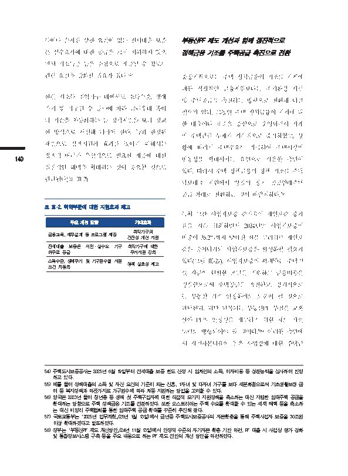</td>
<td width="50%" valign="top"><pre style="white-space: pre-wrap">이 문서는 한국은행의 자산으로 허가받지 않은 복사, 촬영, 수정 및 배포를 금합니다.

득이나 순자산 상한 요건이 없는 전세대출 보증
은 실수요자에 대한 공급을 크게 저해하지 않으
면서 저소득층 등을 중심으로 제공될 수 있도록
관련 요건을 강화할 필요가 있다.54)
한편 저소득 취약가구 내에서도 소득수준, 생애
주기 및 가구원 수 등55)에 따라 금리우대 폭이
나 기간을 차등화하는 등 정책지원을 보다 정교
한 방식으로 개선해 나가야 한다. 특히 한정된
재원으로 정책지원의 효과를 높이기 위해서는
정책적 배려가 우선적으로 필요한 계층에 대한
140
실질적인 혜택을 확대하는 것이 중요할 것으로
판단된다(표 Ⅲ-2).
표 Ⅲ-2. 취약부문에 대한 지원효과 제고
주요 개선 방향 기대효과
취약가구의
금융교육, 재무설계 등 프로그램 제공
건전성 개선 지원
전세대출 보증은 서민·실수요 가구 취약가구에 대한
위주로 공급 주거지원 강화
소득수준, 생애주기 및 가구원수별 지원
정책 실효성 제고
조건 차등화

부동산PF 제도 개선과 함께 점진적으로
정책금융 기조를 주택공급 촉진으로 전환
중장기적으로는 주택 정책금융의 기조를 가계에
대한 직접적인 금융지원보다는 주거환경 개선
및 주택공급을 촉진하는 방향으로 전환해 나갈
필요가 있다. 그동안 주택 정책금융이 가계에 대
한 대출이나 보증을 중심으로 운영되면서 가계
의 주택관련 부채가 지속적으로 증가하였고, 상
황에 따라서 주택수요를 자극하여 주택시장의
변동성을 확대시키는 요인으로 작용한 측면이
있다. 따라서 주택 정책금융의 정책 기조를 주택
담보대출 지원에서 양질의 장기 공공임대주택
공급 확대로 전환하는 것이 바람직하다.56)
특히 그간 사업자보증 증가율이 개인보증 증가
율을 지속 하회하면서 2024년말 사업자보증의
비중이 35.2%까지 낮아진 점을 고려하면 개인보
증은 줄여나가되 사업자보증은 활성화할 필요가
있다(그림 Ⅲ-27). 사업자보증의 확대57)는 주택건
설 자금의 원활한 조달을 지원하고 금융비용을
경감함으로써 주택공급을 촉진하고, 장기적으로
는 부동산 가격 안정화에도 도움이 될 것으로
판단된다. 다만 반복되는 부동산PF 부실을 교훈
삼아 PF의 안정성을 제고하기 위한 제도 개선
노력도 병행되어야 할 것이다.58) 이러한 측면에
서 자기자본비율이 높은 사업장에 대한 주택금

54) 주택도시보증공사는 2025년 6월 19일부터 전세대출 보증 한도 산정 시 임차인의 소득, 이자비용 등 상환능력을 심사하여 반영
하고 있다.
55) 예를 들어 정책대출의 소득 및 자산 요건의 기준이 되는 신혼, 1자녀 및 다자녀 가구를 보다 세분화함으로써 기초생활보장 급
여 등 복지정책과 마찬가지로 가구원수에 따라 차등 지원하는 방법을 고려할 수 있다.
56) 영국은 2023년 들어 청년층 등 생애 첫 주택구입자에 대한 직접적 모기지 지원정책을 축소하는 대신 저렴한 임대주택 공급을
확대하는 방향으로 주택 정책금융 기조를 전환하였다. 또한 오스트리아는 주택 수요를 확대할 수 있는 세제 혜택 등을 축소하
는 대신 비영리 주택협회를 통한 임대주택 공급 확대를 꾸준히 추진해 왔다.
57) 국토교통부는 「2025년 업무계획」(25년 1월 13일)에서 금년중 주택도시보증공사의 자본확충을 통해 주택사업자 보증을 30조원
이상 확대하겠다고 발표하였다.
58) 정부는 「부동산PF 제도 개선방안」(24년 11월 13일)에서 안정적 수준의 자기자본 확충 기반 마련, PF 대출 시 사업성 평가 강화
및 통합정보시스템 구축 등을 주요 내용으로 하는 PF 제도 전반의 개선 방안을 마련하였다.
이연재 / 안정분석팀 / 2025-07-01 11:36:22</pre></td>
</tr></table>

## 19쪽

<table><tr>
<td width="50%" valign="top">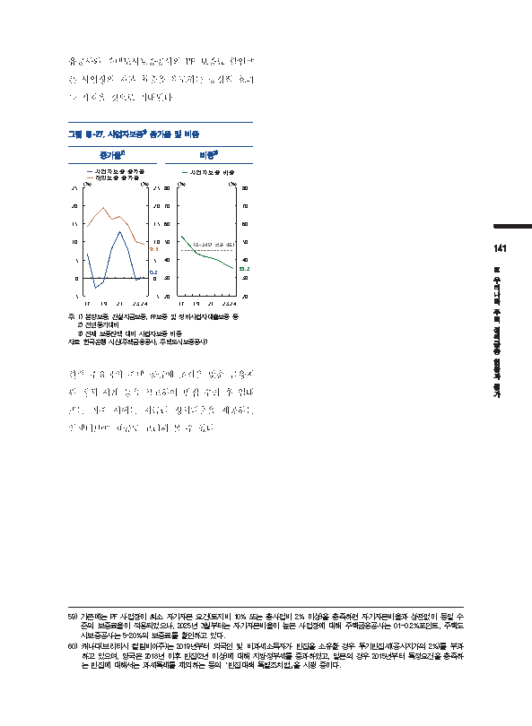</td>
<td width="50%" valign="top"><pre style="white-space: pre-wrap">이 문서는 한국은행의 자산으로 허가받지 않은 복사, 촬영, 수정 및 배포를 금합니다.
융공사와 주택도시보증공사의 PF 보증료 할인59)
은 사업장의 자본 확충을 유도하는 긍정적 효과
를 가져올 것으로 기대된다.
그림 Ⅲ-27. 사업자보증1) 증가율 및 비중

[그래프]
설명: 2017년부터 2024년까지의 사업자보증 증가율과 개인보증 증가율 추이를 % 단위로 나타낸 그래프입니다. 2024년 사업자보증 증가율은 0.2, 개인보증 증가율은 9.3을 나타냅니다.

| 구분 | 24 |
| --- | --- |
| 사업자보증 증가율 | 0.2 |
| 개인보증 증가율 | 9.3 |

증가율²⁾
주: 1) 분양보증, 건설자금보증, PF보증

[그래프]
설명: 17년부터 24년까지 사업자보증 비중(%)의 추이를 나타낸 그래프이다. 사업자보증 비중은 전반적으로 감소하는 추세를 보이며, 24년에는 35.2%로 15~24년 평균인 45.1%보다 낮은 수치를 기록했다.

| 구분 | 15~24년 평균 | 24년 |
| --- | --- | --- |
| 사업자보증 비중 | 45.1 | 35.2 |

비중³⁾

141
Ⅲ
우
리
나
라
주
주:1)분양보증, 건설자금보증, PF보증 및 정비사업자대출보증 등 택
2)전년동기대비
정
3)전체 보증잔액 대비 사업자보증 비중
책
자료: 한국은행 시산(주택금융공사, 주택도시보증공사) 금
융
현
황
한편 주요국의 주택 공급에 초점을 맞춘 금융지 과
평
원 정책 사례 등을 참고하여 빈집 수리 후 임대 가
또는 거주 시에는 저금리 정책대출을 제공하는
인센티브60) 제공도 고려해 볼 수 있다.
59) 기존에는 PF 사업장이 최소 자기자본 요건(토지비 10% 또는 총사업비 2% 이상)을 충족하면 자기자본비율과 상관없이 동일 수
준의 보증료율이 적용되었으나, 2025년 3월부터는 자기자본비율이 높은 사업장에 대해 주택금융공사는 0.1~0.2%포인트, 주택도
시보증공사는 5~20%의 보증료를 할인하고 있다.
60) 캐나다(브리티시 컬럼비아주)는 2019년부터 외국인 및 비과세소득자가 빈집을 소유할 경우 투기빈집세(공시지가의 2%)를 부과
하고 있으며, 영국은 2018년 이후 빈집(2년 이상)에 대해 지방정부세를 중과하였고, 일본의 경우 2015년부터 특정요건을 충족하
는 빈집에 대해서는 과세특례를 제외하는 등의 「빈집대책 특별조치법」을 시행 중이다.
이연재 / 안정분석팀 / 2025-07-01 11:36:22</pre></td>
</tr></table>

## 20쪽

<table><tr>
<td width="50%" valign="top">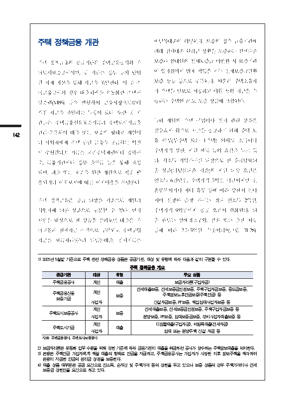</td>
<td width="50%" valign="top"><pre style="white-space: pre-wrap">이 문서는 한국은행의 자산으로 허가받지 않은 복사, 촬영, 수정 및 배포를 금합니다.
주택 정책금융 개관 버팀목대출이 해당된다. 보증의 경우 금융기관에
대해 전세대출 원리금 상환을 보증하는 전세대출
주택 정책금융의 공급기관은 주택금융공사와 주 보증과 임대인의 전세보증금 미반환 시 보증기관
택도시보증공사이며, 두 기관은 정부 등이 납입 이 임차인에게 변제 책임을 지는 전세보증금반환
한 자체 자본을 통해 자금을 조달한다. 이 중 주 보증 상품 등으로 구분된다. 아울러 주택소유자
택금융공사의 경우 대출채권을 유동화한 주택저 가 주택을 담보로 제공하고 매월 생활 자금을 수
당증권(MBS) 등을 발행하여 금융시장으로부터 령하는 주택연금3)도 보증 상품에 포함된다.
직접 자금을 조달하는 특징이 있다. 또한 동 기
특히 개인의 주택 구입이나 전세 관련 상품은
관들은 주택금융신용보증기금과 주택도시기금을
실수요자 위주로 자금을 공급하기 위해 주택 보
관리·운용하여 대출 또는 보증의 형태로 개인이
142
유 여부(무주택 또는 1주택) 외에도 소득이나
나 사업자에게 주택 관련 금융을 공급하는 역할
주택가격 상한, 지원 한도 등의 요건을 두고 있
도 수행한다.1) 기금은 국민주택채권이나 청약저
다. 저소득 취약가구를 대상으로 한 주택담보대
축, 금융기관이나 정부 출연금 등을 통해 조성
출 상품(디딤돌대출 기준)의 지원 대상 요건은
되며, 대출 또는 보증을 위한 재원으로 직접 활
연소득 6천만원, 주택가격 5억원 미만이지만 신
용되거나 이차보전에 따른 이자비용을 부담한다.
혼부부이거나 자녀 유무 등에 따라 상한이 높아
주택 정책금융은 공급 대상을 기준으로 개인과 지며 신생아 출생 가구는 최대 연소득 2억원,
사업자에 대한 상품으로 구분할 수 있다. 먼저 주택가격 9억원까지 공급 요건이 완화된다. 대
개인을 대상으로 한 상품을 살펴보면 대출은 주 출 한도는 생애최초구입, 결혼 또는 출산 여부
택구입과 전세자금 목적으로 구분되고 주택구입 등에 따라 2.5~5억원 수준이다4)(그림 Ⅲ-28).
자금은 보금자리론2)과 디딤돌대출, 전세자금은
1) 2025년 5월말 기준으로 주택 관련 정책금융 상품은 공급기관, 대상 및 유형에 따라 다음과 같이 구분할 수 있다.
주택 정책금융 개요

| 공급기관 | 대상 | 유형 | 주요 상품 |
| --- | --- | --- | --- |
| 주택금융공사 | 개인 | 대출 | 보금자리론(구입자금) |
| 주택금융신용 보증기금 | 개인 | 보증 | 전세대출보증, 전세보증금반환보증, 주택구입자금보증, 중도금보증, 주택담보노후연금보증(주택연금) 등 |
| 주택금융신용 보증기금 | 사업자 | 보증 | 건설자금보증, PF보증, 매입임대사업자보증 등 |
| 주택도시보증공사 | 개인 | 보증 | 전세대출보증, 전세보증금반환보증, 주택구입자금보증 등 |
| 주택도시보증공사 | 사업자 | 보증 | 분양보증, PF보증, 임대보증금보증, 정비사업자대출보증 등 |
| 주택도시기금 | 개인 | 대출 | 디딤돌대출(구입자금), 버팀목대출(전세자금) |
| 주택도시기금 | 사업자 | 대출 | 임대 또는 분양주택 건설 자금 등 |

자료: 주택금융공사, 주택도시보증공사
2) 보금자리론은 유동화 업무 수행을 위해 정한 기준에 따라 금융기관이 대출을 취급하면 공사가 양수하는 주택담보대출을 의미한다.
3) 은행은 주택연금 가입자에게 매월 대출의 형태로 연금을 지급하고, 주택금융공사는 가입자가 사망한 이후 담보주택을 매각하여
은행이 지급한 연금의 원리금 상환을 보증한다.
4) 대출 상품 대부분은 공급 요건으로 연소득, 순자산 및 주택가격 등의 상한을 두고 있으나 보증 상품의 경우 주택가격이나 전세
보증금 상한만을 요건으로 하고 있다.
이연재 / 안정분석팀 / 2025-07-01 11:36:22</pre></td>
</tr></table>

## 21쪽

<table><tr>
<td width="50%" valign="top">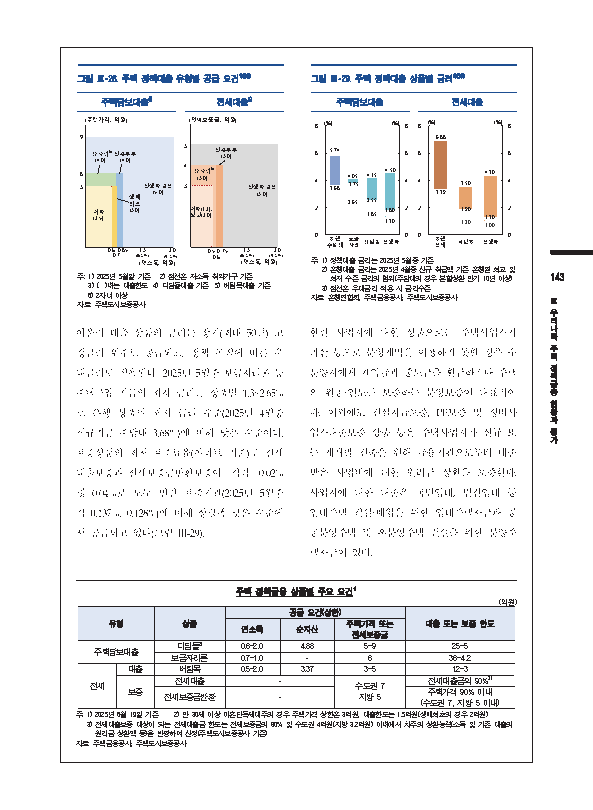</td>
<td width="50%" valign="top"><pre style="white-space: pre-wrap">이 문서는 한국은행의 자산으로 허가받지 않은 복사, 촬영, 수정 및 배포를 금합니다.
그림 Ⅲ-28. 주택 정책대출 유형별 공급 요건1)2)3) 그림 Ⅲ-29. 주택 정책대출 상품별 금리1)2)3)
주택담보대출4) 전세대출5) 주택담보대출 전세대출

[그래프]
설명: 연소득과 주택가격에 따른 주택담보대출 조건과 한도를 보여주는 그래프이다. 단위는 억원이며, 신생아 출산 한도가 5.0으로 가장 높고 취약 한도가 2.5로 가장 낮다.

| 구분 | 값 |
| --- | --- |
| 취약 | 2.5 |
| 생애최초 | 3.0 |
| 다자녀⁶ | 4.0 |
| 신혼부부 | 4.0 |
| 신생아 출산 | 5.0 |

주택담보대출
주: 1) 2025년 5월말 기준 2) 점선은

[그래프]
설명: 이 그림은 주택담보대출 종류별 금리 범위를 (%) 단위로 보여주는 그래프입니다. 은행 주담대, 보금자리, 디딤돌, 신생아 대출 항목의 금리가 제시되어 있으며, 은행 주담대의 상단 금리가 5.74로 가장 높고 신생아 대출의 하단 금리가 1.30으로 가장 낮습니다.

| 구분 | 금리(%) |
| --- | --- |
| 은행 주담대 | 3.68, 5.74 |
| 보금자리 | 2.65, 3.75, 4.05 |
| 디딤돌 | 1.85, 2.55, 4.15 |
| 신생아 | 1.30, 1.80, 4.50 |

주택담보대출

주: 1) 정책대출 금리는 2025년 5월중

[그래프]
설명: 전세대출 종류별 금리(%) 범위를 보여주는 그래프입니다. 은행 전세의 금리 상단이 6.88%로 가장 높고, 신생아 전세대출의 금리 하단이 1.00%로 가장 낮습니다.

| 구분 | 금리(%) |
| --- | --- |
| 은행 전세 | 3.39 ~ 6.88 |
| 버팀목 | 1.20 ~ 3.50 (1.90) |
| 신생아 | 1.00 ~ 4.30 (1.30) |

전세대출

[그래프]
설명: 연소득(억원)과 전세보증금(억원)에 따른 전세대출 대상별 기준 및 한도를 보여주는 그래프이다. 취약, 청년, 다자녀, 신혼부부, 신생아 출산 유형으로 구분되어 있으며, 연소득 기준은 0.5억원부터 2.0억원(맞벌이)까지, 전세보증금 기준은 3억원에서 5억원까지 나타나 있다.

- 그래프:

| 구분 | 한도(억원) |
| --- | --- |
| 취약 | 1.2 |
| 청년 | 2.0 |
| 다자녀⁶⁾ | 3.0 |
| 신혼부부 | 3.0 |
| 신생아 출산 | 3.0 |

전세대출

6

| 신혼부부 (3.0) 다자녀6) (3.0) 신생아출산 (3.0) 취약(1.2), 청년(2.0) | 신혼부부 (3.0) 다자녀6) (3.0) 신생아출산 (3.0) 취약(1.2), 청년(2.0) |
| --- | --- |
| 다자녀6) (3.0) 취약(1.2), 청년(2.0) |  |
| 취약(1.2), 청년(2.0) | 신혼부부 (3.0) 다자녀6) (3.0) 신생아출산 (3.0) 취약(1.2), 청년(2.0) |

4
2
0 0
주: 1) 정책대출 금리는 2025년 5월중 기준
2) 은행대출 금리는 2025년 4월중 신규 취급액 기준 은행별 최고 및
주: 1) 2025년 5월말 기준 2) 점선은 저소득 취약가구 기준 최저 수준 금리의 범위(주담대의 경우 분할상환 만기 10년 이상) 143
3) ( )내는 대출한도 4) 디딤돌대출 기준 5) 버팀목대출 기준 3) 점선은 우대금리 적용 시 금리수준
6) 2자녀 이상 자료: 은행연합회, 주택금융공사, 주택도시보증공사 Ⅲ
자료: 주택도시보증공사
우
리
아울러 대출 상품의 금리는 장기(최대 50년) 고 한편 사업자에 대한 상품으로는 주택사업자가 나
라
정금리 위주로 공급되고, 정책 목적에 따른 우 파산 등으로 분양계약을 이행하지 못할 경우 수 주
택
대금리도 적용된다. 2025년 5월중 보금자리론 등 분양자에게 계약금과 중도금을 환급하거나 주택 정
책
금
주택구입 자금의 최저 금리는 상품별 1.3~2.65% 의 완공·인도를 보증하는 분양보증이 대표적이 융
현
로 은행 상품의 최저 금리 수준(2025년 4월중 다. 이외에도 건설자금보증, PF보증 및 정비사 황
과
신규취급 주담대 3.68%)에 비해 낮은 수준이다. 업자대출보증 상품 등은 주택사업자가 신규 또 평
가
보증상품의 최저 보증료율(아파트 기준)도 전세 는 재개발 건축을 위해 금융기관으로부터 대출
대출보증과 전세보증금반환보증이 각각 0.02% 받은 사업비에 대한 원리금 상환을 보증한다.
및 0.04%로 모두 민간 보증기관(2025년 5월중 사업자에 대한 대출은 국민임대, 민간임대 등
각 0.137%, 0.128%)에 비해 상당폭 낮은 수준에 임대주택 건설·매입을 위한 임대주택자금과 공
서 공급되고 있다(그림 Ⅲ-29). 공분양주택 및 후분양주택 건설을 위한 분양주
택자금이 있다.
주택 정책금융 상품별 주요 요건1)
(억원)

| 유형 | 유형 | 상품 | 공급 요건(상한) | 공급 요건(상한) | 공급 요건(상한) | 대출 또는 보증 한도 |
| --- | --- | --- | --- | --- | --- | --- |
| 유형 | 유형 | 상품 | 연소득 | 순자산 | 주택가격 또는 전세보증금 | 대출 또는 보증 한도 |
| 주택담보대출 | 주택담보대출 | 디딤돌2) | 0.6~2.0 | 4.88 | 5~9 | 2.5~5 |
| 주택담보대출 | 주택담보대출 | 보금자리론 | 0.7~1.0 | - | 6 | 3.6~4.2 |
| 전세 | 대출 | 버팀목 | 0.5~2.0 | 3.37 | 3~5 | 1.2~3 |
| 전세 | 보증 | 전세대출 | - | - | 수도권 7 지방 5 | 전세대출금의 90%3) |
| 전세 | 보증 | 전세보증금반환 | - | - | 수도권 7 지방 5 | 주택가격 90% 이내 (수도권 7, 지방 5 이내) |

주: 1) 2025년 6월 19일 기준 2) 만 30세 이상 미혼단독세대주의 경우 주택가격 상한은 3억원, 대출한도는 1.5억원(생애최초의 경우 2억원)
3)전세대출보증 대상이 되는 전세대출금 한도는 전세보증금의 80% 및 수도권 4억원(지방 3.2억원) 이내에서 차주의 상환능력(소득 및 기존 대출의
원리금 상환액 등)을 반영하여 산정(주택도시보증공사 기준)
자료: 주택금융공사, 주택도시보증공사
이연재 / 안정분석팀 / 2025-07-01 11:36:22</pre></td>
</tr></table>

## 22쪽

<table><tr>
<td width="50%" valign="top">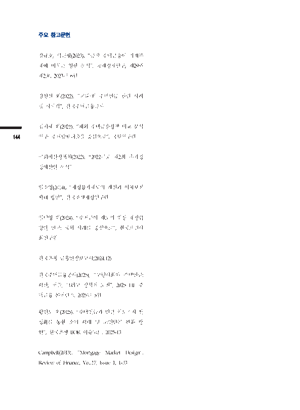</td>
<td width="50%" valign="top"><pre style="white-space: pre-wrap">이 문서는 한국은행의 자산으로 허가받지 않은 복사, 촬영, 수정 및 배포를 금합니다.
주요 참고문헌
강규호, 박근형(2023), “공적 주택금융이 가계부
채에 미치는 영향 분석”, 국제경제연구, 제29권
제2호, 2023년 6월
강영신 외(2022), “국내·외 주택연금 관련 사례
및 시사점“, 한국주택금융공사
김지혜 외(2021), “해외 주택금융정책 비교 분석
144 연구: 주택담보대출을 중심으로”, 국토연구원
국회예산정책처(2022), “2022년도 제2회 추가경
정예산안 분석”
임소영(2014), “재정융자제도의 개선과 이차보전
확대 방안”, 한국조세재정연구원
임덕영 외(2024), “주거급여 제도의 위상 재정립
방안 연구: 국외 사례를 중심으로”, 한국보건사
회연구원
한국은행 금융안정보고서(2024.12)
한국주택금융공사(2025), “고령사회와 주택연금:
확산, 퍼즐, 그리고 정책적 도전”, 2025 HF 주
택금융 콘퍼런스, 2025년 5월
황인도 외(2025), “주택연금과 민간 역모기지 활
성화를 통한 소비 확대 및 노인빈곤 완화 방
안”, 한국은행 BOK 이슈노트, 2025-13
Campbell(2013), “Mortgage Market Design”,
Review of Finance, Vol.17, Issue 1, 1-33
이연재 / 안정분석팀 / 2025-07-01 11:36:22</pre></td>
</tr></table>
