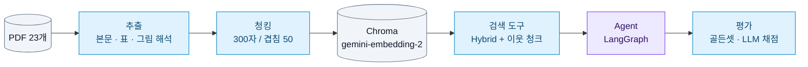
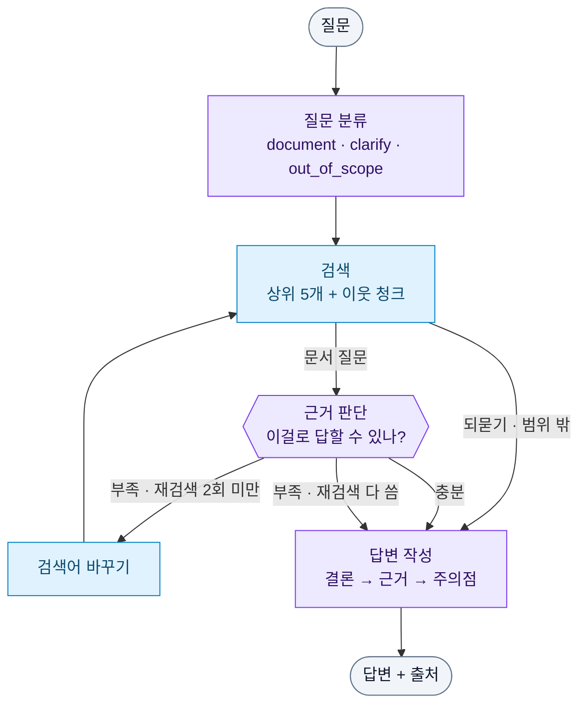

# Financial RAG Agent

> 금융 문서 PDF 23개를 검색해서 **근거(파일명·페이지)와 함께 답하는 RAG Agent**


| 기간 | 형태 | 진행 방식 | AI 도구 |
|:---:|:---:|:---:|:---:|
| 2026.10.20 ~ 10.22 (3일) | RAG Agent 실습 과제, 3인 | 설계 방향은 3명이 함께 논의 | Claude Code |

과제 원문 → [docs/assignment.md](docs/assignment.md)


<br>

## 목차

1. [핵심 결과](#1-핵심-결과)
2. [전체 흐름](#2-전체-흐름)
3. [Agent 구조](#3-agent-구조)
4. [주요 실험](#4-주요-실험)
5. [기본 RAG vs Agent](#5-기본-rag-vs-agent)
6. [빠른 시작](#6-빠른-시작)
7. [폴더 구조](#7-폴더-구조)
8. [문서](#8-문서)

<br>

## 1. 핵심 결과

| 영역 | 결과 | 설명 |
|:---|:---|:---|
| 검색 | 437문항 hit@5 **0.952** | 300/50 청크 + Hybrid(벡터·BM25 5:5) + 용어집은 용어 하나 = 청크 하나 + 약관 청크에 "[약관 이름] 제○조" 머리말 |
| 답변 | 정답률 **0.725 → 0.950** | 표 제목 붙이기 + 이웃 청크 + 프롬프트(결론 → 근거 → 주의점) |
| Agent | 처음 보는 120문항 정답률 **0.854 → 0.904** | 같은 조건의 기본 RAG보다 4개 셋 모두 높음. 비용·시간 1.7배 |
| 비용 | 답변 출력 토큰 **−58%**, 시간 −38% | 답변 생각 수준을 `low`로. Agent 문항당 $0.009 · 9초 |

답변 0.950은 프롬프트를 고칠 때 본 20문항 기준이에요. 이후 모든 비교는 **고칠 때 보지 않은 문항**으로 다시 확인했어요.

<br>

## 2. 전체 흐름



<br>

## 3. Agent 구조



<sub>보라: LLM 호출 / 파랑: LLM 없음</sub>

| 분류 | 이런 질문 | Agent가 하는 일 |
|:---|:---|:---|
| `document` | "주택연금은 무상 지원금인가요?" | 검색 → 근거 판단 → 부족하면 검색어를 바꿔 다시 찾기 (최대 2회) |
| `clarify` | "수수료가 얼마야?", "**이** 펀드 수익률은?" | 상품마다 어떻게 다른지 근거로 설명하고 되묻기 |
| `out_of_scope` | "2027년 세액공제 한도는?" | 2026-09-03 기준 문서에 없다고 밝히고, 관련 규정 설명 + 최신 자료 안내 |

- **종료 조건:** 답변 작성이 끝나면 끝. 재검색은 최대 2회라 검색은 최대 3번, LLM 호출은 최대 5번
- 노드별 역할과 설계 결정 → [docs/실험기록.md](docs/실험기록.md) "Agent 설계 상세"

<br>

## 4. 주요 실험

모든 실험은 기준 설정에서 **한 가지만 바꿔서** 비교했어요. 목적·가설·고정 조건은 [docs/실험계획.md](docs/실험계획.md)에 있어요.

| 번호 | 실험 | 비교한 것 | 결과 | 결정 |
|:---:|:---|:---|:---|:---|
| E1 | 청크 크기 | 300/50 vs 500/60 | hit@5 0.938 vs 0.920 | **300/50** |
| E2 | 검색 방식 | Similarity · MMR · BM25 · Hybrid | 모든 근거 유형에서 Hybrid 1위 | **Hybrid** |
| E3 | Hybrid 가중치 | 벡터:BM25 0:10 ~ 10:0 | 0.5~0.7 사이 차이 없음 | 5:5 유지 |
| E4 | 리랭커 | + bge-reranker-v2-m3 | hit@1 0.633 → 0.767, 질문당 15초 | 안 씀 |
| E5 | 표 제목 붙이기 | 쪼개진 표 조각에 제목 반복 | 정답률 0.725 → 0.775 | 채택 |
| E6 | 이웃 청크 | 앞뒤 1개 + 걸친 표 전체 | 0.775 → 0.825 | 채택 |
| E7 | 프롬프트 | 결론 → 근거 → 주의점 + 기준일 + 부족한 근거 처리 | 튜닝셋 0.825 → 0.950, 처음 보는 문항 0.850 → 0.883 | 채택 |
| E8 | 기본 RAG vs Agent | Agent v1 → v2 | 성공 27 → 29 (30문항) | v2 |
| E9-a | 가벼운 모델 | 분류·근거 판단을 Flash-Lite로 | 비용 −12%, 되묻기를 못 함 | 안 씀 |
| E10 | 답변 생각 수준 | 기본 → `low` | 출력 토큰 −58%, 시간 −38%, 정답률 유지 | **채택** |
| E10-b | 최종 비교 | 같은 조건 기본 RAG vs Agent, 120문항 | 0.854 vs 0.904 | 아래 5번 |
| E11 | 용어집 용어 단위 청킹 | 300자 단위(용어 4~5개 섞임 + 출처 목록) → 용어 하나 = 청크 하나 | 용어 정의 쪽 hit@1 0.394 → 0.727, hit@5 0.545 → 0.848 | **채택** |
| E12 | 약관 머리말 | 약관 청크 앞에 "[약관 이름] 제○조(제목)", BM25에서는 뺌 | 약관 66문항 hit@1 0.606 → 0.652, hit@5 0.864 → 0.909 | **채택** |

<br>

## 5. 기본 RAG vs Agent

**같은 조건**(답변 생각 `low`, 같은 검색·프롬프트·채점)으로 **처음 보는 120문항**(제공 60 + 직접 만든 60)을 비교했어요. 다른 건 그래프 구조뿐이에요.

| 질문 세트 | 기본 RAG | Agent |
|:---|:---:|:---:|
| 제공 seed 1 (30) | 0.867 | **0.917** |
| 제공 seed 2 (30) | 0.850 | **0.917** |
| 직접 만든 본문 (30) | 0.783 | **0.833** |
| 직접 만든 표·그림 (30) | 0.917 | **0.950** |
| **전체 120 정답률** | 0.854 | **0.904** |

| 120문항 평균 | 기본 RAG | Agent |
|:---|:---:|:---:|
| 완전 정답 / 성공 | 90 / 111 | **98 / 115** |
| LLM 호출 / 검색 | 1 / 1 | 3.15 / 1.23 |
| 입력 토큰 | 3,196 | 7,646 |
| 시간 | **5.3초** | 8.8초 |
| 문항당 비용 | **$0.005** | $0.009 |

1. **4개 셋 모두 Agent가 높아요.** Agent가 나은 문항 14, 못한 문항 5
2. **되묻기:** NEG010 "청약 철회할 수 있어?" → 상품마다 7일·14일로 다르다고 설명하고 상품을 되물음 (0.5 → 1.0)
3. **재검색:** 첫 검색에 없던 다른 쪽 근거를 찾아냄 (ADD-SE05 · POS035 · PF-37: 0 → 1.0)
4. **결론:** Agent는 비용·시간 1.7배로 정답률 +0.05. 문항당 1센트 미만·9초라 상담 서비스라면 쓸 만해요

<br>

## 6. 빠른 시작

```bash
pip install pdfplumber python-dotenv langchain-google-genai langchain-text-splitters langchain-chroma \
            langchain-classic langchain-community langgraph kiwipiepy rank-bm25
# .env 에 GEMINI_API_KEY=... (커밋하지 않음)
```

| 할 일 | 명령 |
|:---|:---|
| 1. 벡터 DB 만들기 (처음 한 번) | `python indexing/chunk.py` → `python indexing/embed.py` |
| 2. Agent에게 묻기 | `python agent/graph.py "주택연금은 무상 지원금인가요?"` |
| 검색만 해 보기 (LLM 없음) | `python agent/search.py "임의매매 금지"` |
| 검색 평가 | `python evaluation/retrieval_eval.py` |
| 답변 평가 (기본 RAG / Agent) | `python evaluation/answer_eval.py` / `... --mode=agent` |
| 처음 보는 30문항으로 확인 | `python evaluation/answer_eval.py 05_golden_set/golden_set_provided.jsonl --sample=30 --seed=1` |
| Agent 구조도 출력 | `python agent/graph.py --mermaid` |

> **주의:** Windows에서 경로에 한글이 있으면 Chroma가 색인 파일을 못 써서, 자동으로 `C:/Users/Public/financial-rag-agent/chroma_db`에 저장해요. 바꾸려면 `.env`에 `CHROMA_DIR=영문경로`.
> 문서 추출(`extraction/`)은 결과가 이미 레포에 있어서 다시 돌릴 필요 없어요 → [docs/추출_청킹.md](docs/추출_청킹.md)

<br>

## 7. 폴더 구조

```
financial-rag-agent/
├── 01_data/            원문 PDF 23개 (용어집 · 표준약관 15 · 가이드북 · 보고서 6)
├── 02_questions/       질문 180문항        ┐
├── 03_answers/         기준 답안           ┘ 강의 제공
├── 04_extracted/       추출 결과 (pages.jsonl = 쪽마다 한 줄)
├── 05_golden_set/      골든셋 4종 (직접 작성 289 + 제공 180)
├── 06_chunks/          청크 (300/50, 500/60)
├── 07_eval/            평가 결과 (runs.jsonl = 실행 이력, {세트}/ = 문항별 결과)
│
├── extraction/         1. extract.py 추출 · make_review_md.py 비교 문서 · gemini_tables.py · image_regions.py · glossary_terms.py 용어집 용어 단위
├── indexing/           2. chunk.py 청킹 · embed.py 임베딩 · common.py DB 위치·비용 기록
├── agent/              3. search.py 검색 도구 · prompts.py 답변 프롬프트 · graph.py Agent
├── evaluation/         4. retrieval_eval.py 검색 평가 · answer_eval.py 답변 평가 (기본 RAG / Agent)
├── make_golden_set.py  제공 답안(03_answers) → 골든셋 변환
│
├── docs/               문서 안내(README) · 실험계획 · 실험기록 · 추출_청킹 · 비용기록 · 과제 설명
└── 회고.md             단계마다 만난 문제와 해결 과정 (28개)
```

<br>

## 8. 문서

전체 문서 목록과 읽는 순서 → [docs/README.md](docs/README.md)

| 문서 | 내용 |
|:---|:---|
| [docs/실험계획.md](docs/실험계획.md) | 실험 목적·가설, 데이터, 기준 설정, 실험 목록, 평가 지표, 기록 방식, 비교 원칙 |
| [docs/실험기록.md](docs/실험기록.md) | 검색·답변·프롬프트·Agent·비용 실험의 전체 수치와 결정 과정 |
| [docs/추출_청킹.md](docs/추출_청킹.md) | 추출 방식(깨지는 18가지 경우와 처리), 청킹 규칙, 결과 검토법 |
| [docs/비용기록.md](docs/비용기록.md) | 유료 API 호출마다 토큰·비용 (평가 스크립트가 자동 기록) |
| [회고.md](회고.md) | 단계마다 만난 문제와 해결 과정, 배운 점 |
