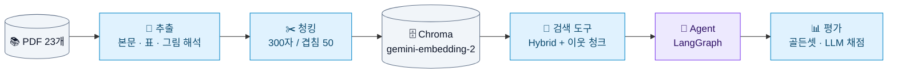
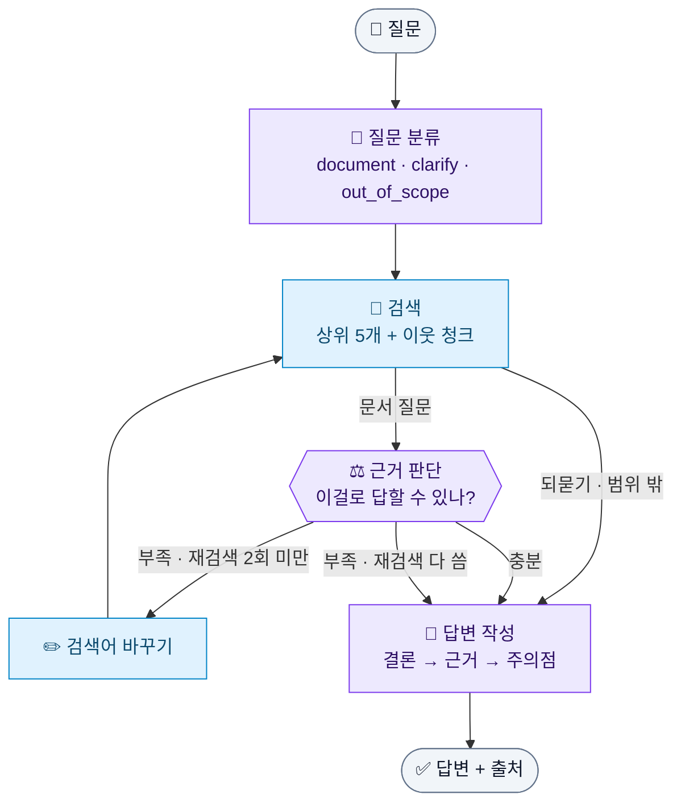

# 💰 Financial RAG Agent

> 금융 문서 PDF 23개를 검색해서 **근거(파일명·페이지)와 함께 답하는 RAG Agent**


| 기간 | 형태 | 진행 방식 | AI 도구 |
|:---:|:---:|:---:|:---:|
| 2026.10.20 ~ 10.22 (3일) | RAG Agent 실습 과제, 3인 | 설계 방향은 3명이 함께 논의 | Claude Code |

과제 원문 → [docs/assignment.md](docs/assignment.md)

<br>

## ✨ 핵심 결과

| | 결과 | 한 줄 설명 |
|:---|:---|:---|
| 🔎 **검색** | 437문항 hit@5 **0.938** | 청킹 2 × 검색 4 비교 → **300/50 청크 + Hybrid(벡터·BM25 5:5)** |
| 📝 **답변** | correctness **0.725 → 0.950** | 표 제목 붙이기 + 이웃 청크 + 프롬프트(결론 → 근거 → 주의점) |
| 🤖 **Agent** | 처음 보는 30문항 정답률 **0.875 → 0.900**, 성공 **27.5 → 29** | **되묻기·범위 밖·흩어진 근거**에서 행동이 더 맞음 (2번 실행 평균). 비용 1.3배 |

> 답변 0.950은 프롬프트를 고칠 때 본 20문항 기준이에요. 처음 보는 30문항에서는 0.850 → 0.883으로, **안 본 문항으로 따로 확인**하는 걸 원칙으로 했어요.

<br>

## 🗺️ 전체 흐름



<br>

## 🤖 Agent 구조



<sub>🟪 LLM 호출 · 🟦 LLM 없음</sub>

| 분류 | 이런 질문 | Agent가 하는 일 |
|:---|:---|:---|
| `document` | "주택연금은 무상 지원금인가요?" | 검색 → 근거 판단 → 부족하면 검색어를 바꿔 다시 찾기 (최대 2회) |
| `clarify` | "수수료가 얼마야?", "**이** 펀드 수익률은?" | 상품마다 어떻게 다른지 근거로 설명하고 **되묻기** |
| `out_of_scope` | "2027년 세액공제 한도는?" | "2026-09-03 기준 문서에 없음" + 관련 규정 설명 + 최신 자료 안내 |

- **종료 조건:** 답변 작성이 끝나면 끝. 재검색은 최대 2회 → 검색 최대 3번, LLM 최대 5번
- 설계 결정과 이유 → [docs/실험기록.md](docs/실험기록.md) "Agent 설계 상세"

<br>

## ⚖️ 기본 RAG vs Agent

처음 보는 30문항, 같은 검색 도구·답변 프롬프트·채점으로 **두 번씩** 돌려서 평균을 냈어요 (LLM 답변·채점이 실행마다 1~2문항씩 흔들려서).

| | 정답률 (1차 / 2차) | 성공 (1차 / 2차) | LLM 호출 | 입력 토큰 | 시간 | 비용 |
|:---|:---:|:---:|:---:|:---:|:---:|:---:|
| 기본 RAG | 0.875 (0.883 / 0.867) | 27.5 (27 / 28) | 1회 | 2,858 | 12초 | $0.31 |
| **Agent** | **0.900** (0.883 / 0.917) | **29** (29 / 29) | 3회 | 6,577 | 16초 | $0.41 |

- 정답률 차이는 작고, Agent의 이점은 **행동**에서 나와요
  - 되묻기: NEG010 "청약 철회할 수 있어?" → 기본 RAG는 두 번 다 0.5, Agent는 두 번 다 **1.0** (실행마다 똑같이 재현)
  - 재검색으로 다른 쪽 근거 찾기: ADD-HF09 0.5 → 1.0
- **결론:** 일반 문서 질문만 있으면 기본 RAG가 효율적이고, 모호하거나 범위 밖 질문이 섞인 상담이라면 Agent가 맞아요

<br>

## 🚀 빠른 시작

```bash
pip install pdfplumber python-dotenv langchain-google-genai langchain-text-splitters langchain-chroma \
            langchain-classic langchain-community langgraph kiwipiepy rank-bm25
# .env 에 GEMINI_API_KEY=... (커밋하지 않음)
```

| 할 일 | 명령 |
|:---|:---|
| ① 벡터 DB 만들기 (처음 한 번) | `python indexing/01_chunk.py` → `python indexing/02_embed.py` |
| ② Agent에게 묻기 | `python agent/graph.py "주택연금은 무상 지원금인가요?"` |
| 검색만 해 보기 | `python agent/search.py "임의매매 금지"` |
| 검색 평가 | `python evaluation/01_retrieval_eval.py` |
| 답변 평가 (기본 RAG / Agent) | `python evaluation/02_answer_eval.py` / `... --mode=agent` |
| 처음 보는 30문항으로 확인 | `python evaluation/02_answer_eval.py 05_golden_set/golden_set_provided.jsonl --sample=30 --seed=1` |
| Agent 구조도 출력 | `python agent/graph.py --mermaid` |

> ⚠️ **Windows에서 경로에 한글이 있으면** Chroma가 색인 파일을 못 써서, 자동으로 `C:/Users/Public/financial-rag-agent/chroma_db`에 저장해요. 바꾸려면 `.env`에 `CHROMA_DIR=영문경로`.
> 문서 추출(`extraction/`)은 결과가 이미 레포에 있어서 다시 돌릴 필요 없어요 → [docs/추출_청킹.md](docs/추출_청킹.md)

<br>

## 📂 폴더 구조

```
financial-rag-agent/
├── 01_data/            📚 원문 PDF 23개 (용어집 · 표준약관 15 · 가이드북 · 보고서 6)
├── 02_questions/       💬 질문 180문항        ┐
├── 03_answers/         ✅ 기준 답안           ┘ 강의 제공
├── 04_extracted/       📄 추출 결과 (pages.jsonl = 쪽마다 한 줄)
├── 05_golden_set/      🎯 골든셋 4종 (직접 작성 289 + 제공 180)
├── 06_chunks/          ✂️ 청크 (300/50, 500/60)
├── 07_eval/            📊 평가 결과 (runs.jsonl = 실행 이력, {골든셋}/ = 문항별 결과)
│
├── extraction/         ① PDF → 본문 · 표 · 그림 해석
├── indexing/           ② 청킹 · 임베딩 (common.py = DB 위치 · 비용 기록)
├── agent/              ③ search.py 검색 도구 · prompts.py 답변 프롬프트 · graph.py Agent
├── evaluation/         ④ 01 검색 평가 · 02 답변 평가 (기본 RAG / Agent)
│
├── docs/               실험계획 · 실험기록 · 추출_청킹 · 비용기록 · 과제 설명
└── 회고.md             단계마다 만난 문제와 해결 과정 (24개)
```

<br>

## 🔑 주요 결정

| 단계 | 결정 | 이유 |
|:---|:---|:---|
| 추출 | pdfplumber + 깨진 표·그림만 Gemini, **숫자는 원문·OCR로 검증** | 표가 많이 깨지지만 전부 LLM에 맡기면 숫자를 지어낼 수 있음 |
| 청킹 | **300/50**, 표는 제목·헤더를 조각마다 반복 | 문항이 가장 많은 본문 질문에서 500/60보다 hit@5 10문항 더 맞힘 |
| 검색 | **Hybrid 5:5**, 리랭커 없이 상위 5개 + 이웃 청크 | 모든 유형에서 Hybrid 1위. 리랭커는 효과는 있지만 CPU에서 질문당 15초 |
| 채점 | RAGAS 대신 **LLM 채점 1회** (골든셋의 기준 답안·필수 내용·피할 오류 사용) | 호출이 적고 토큰을 정확히 기록할 수 있음 |
| 프롬프트 | **결론 → 근거 → 주의점** + 문서 기준일 + 부족한 근거 처리 | 기준 답안이 대부분 이 구조. 빠지던 "주의점"을 채움 |
| Agent | 모든 질문이 검색, 재검색은 문서 질문만 | 되묻기·범위 밖 답도 문서 근거가 필요함 (v1 → v2에서 고침) |
| 기록 | 결과는 **JSONL**, 실행마다 `run_id`로 설정·문항 결과·요약 연결 | git diff로 리뷰 가능, pandas로 바로 분석 |

<br>

## 📚 더 보기

| 문서 | 내용 |
|:---|:---|
| [docs/실험계획.md](docs/실험계획.md) | 실험 목적·가설, 데이터, 기준 설정, 실험 8개, 평가 지표, 기록 방식, 비교 원칙 |
| [docs/실험기록.md](docs/실험기록.md) | 검색·답변·프롬프트·Agent 실험의 전체 수치와 결정 과정 |
| [docs/추출_청킹.md](docs/추출_청킹.md) | 추출 방식(깨지는 18가지 경우와 처리), 청킹 규칙, 결과 검토법 |
| [docs/비용기록.md](docs/비용기록.md) | 유료 API 호출마다 토큰·비용 (평가 스크립트가 자동 기록) |
| [회고.md](회고.md) | 단계마다 만난 문제와 해결 과정, 배운 점 |
