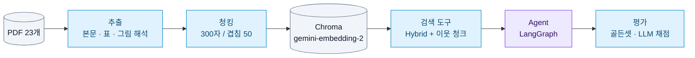

# Financial RAG Agent

> 금융 문서 PDF 23개를 검색해서 **근거(파일명·페이지)와 함께 답하는 RAG Agent**


| 기간 | 형태 | 진행 방식 | AI 도구 |
|:---:|:---:|:---:|:---:|
| 2026.10.20 ~ 10.22 (3일) | RAG Agent 실습 과제, 3인 | 설계 방향은 3명이 함께 논의 | Claude Code |

과제 원문 → [docs/assignment.md](docs/assignment.md)


<br>

## 목차

1. [최종 성적](#1-최종-성적)
2. [전체 흐름](#2-전체-흐름)
3. [Agent 구조](#3-agent-구조)
4. [기본 RAG vs Agent](#4-기본-rag-vs-agent)
5. [주요 실험](#5-주요-실험)
6. [배운 점](#6-배운-점)
7. [빠른 시작](#7-빠른-시작)
8. [폴더 구조](#8-폴더-구조)
9. [문서](#9-문서)

<br>

## 1. 최종 성적

| 항목 | 결과 |
|:---|:---|
| **답변 정답률** (제공 골든셋 178문항) | Agent **0.933** · 기본 RAG 0.899 |
| **검색** (골든셋 437문항) | 정답 근거가 상위 5개 안 **95.4%** · 1위 **74.8%** |
| **검색 실패** (정답 근거를 못 찾아서 틀림) | **0개** |
| **Agent 비용·시간** | 문항당 약 **$0.009 · 9초** |

**어떻게 여기까지 왔나**

| 단계 | 한 일 | 결과 |
|:---|:---|:---|
| 1. 검색 정하기 | 청크 크기 2종 × 검색 방식 4종 비교 | 300자 청크 + Hybrid 검색, hit@5 0.938 |
| 2. 답변 다듬기 | 표 제목, 이웃 청크, "결론 → 근거 → 주의점" 프롬프트 | 정답률 0.725 → 0.950 (고칠 때 본 20문항) |
| 3. Agent 만들기 | 분류 · 근거 판단 · 재검색 | 같은 조건 120문항 기본 RAG 0.854 → Agent 0.904 |
| 4. 비용 줄이기 | 답변의 "생각" 양을 `low`로 | 비용 −36%, 시간 −38%, 품질 그대로 |
| 5. 오답 보고 청킹 고치기 | 용어집 용어 단위, 약관 머리말, 잡음 정리 | 180문항 Agent 0.897 → 0.928, 검색 실패 7 → 0 |
| 6. 마무리 | 분산투자 문장 범위, 문서 밖 내용을 요구하는 2문항 제외 | 178문항 Agent **0.933** |

<sub>정답률 = 문항마다 채점 LLM이 기준 답안과 비교해 준 점수(1 / 0.5 / 0)의 평균. 고칠 때 본 문항은 점수가 부풀려져서, 이후 모든 비교는 **고칠 때 보지 않은 문항**으로 다시 확인했어요. 178문항 숫자는 마지막 변경(E18) 전 설정으로 잰 값이에요.</sub>

<br>

## 2. 전체 흐름



| 단계 | 핵심 처리 |
|:---|:---|
| 추출 | 표가 깨지는 18가지 경우를 하나씩 처리, 깨진 표·그림만 Gemini로 읽고 **숫자는 원문과 대조**, 2단 편집은 단마다 |
| 청킹 | 300자 단위 + **표는 조각마다 제목 반복**, 용어집은 **용어 하나 = 청크 하나**, 약관은 **"[약관 이름] 제○조" 머리말** |
| 검색 | 벡터 + 키워드(BM25) **5:5 Hybrid**, 상위 5개 + 앞뒤 청크(걸친 표는 전체) |
| 평가 | 골든셋 4종, LLM이 기준 답안·필수 내용·피할 오류·기대 행동으로 채점 |

<br>

## 3. Agent 구조


<sub>보라: LLM 호출 / 파랑: LLM 없음</sub>

| 분류 | 이런 질문 | Agent가 하는 일 |
|:---|:---|:---|
| `document` | "주택연금은 무상 지원금인가요?" | 검색 → 근거 판단 → 부족하면 검색어를 바꿔 다시 찾기 (최대 2회) |
| `clarify` | "수수료가 얼마야?", "**이** 펀드 수익률은?" | 상품마다 어떻게 다른지 근거로 설명하고 되묻기 |
| `out_of_scope` | "2027년 세액공제 한도는?" | 2026-09-03 기준 문서에 없다고 밝히고, 관련 규정 설명 + 최신 자료 안내 |

- **종료 조건:** 답변 작성이 끝나면 끝. 재검색은 최대 2회 → 검색 최대 3번, LLM 호출 최대 5번
- **모델:** 전부 `gemini-3.6-flash`. 분류는 생각 `minimal`, 근거 판단·답변은 `low`
- 노드별 역할과 설계 결정 → [docs/실험기록.md](docs/실험기록.md) "Agent 설계 상세"

<br>

## 4. 기본 RAG vs Agent

두 방식은 **검색 도구·답변 프롬프트·채점이 같고, 그래프 구조만 달라요.**

| | 기본 RAG | Agent |
|:---|:---:|:---:|
| **처음 보는 120문항** (같은 조건, 4개 셋) | 0.854 | **0.904** |
| **제공 골든셋 178문항** (최종 설정) | 0.899 | **0.933** |
| LLM 호출 / 검색 (문항당) | 1 / 1 | 3.15 / 1.23 |
| 시간 / 비용 (문항당) | **5.3초 / $0.005** | 8.8초 / $0.009 |

<details>
<summary>120문항 셋별 결과</summary>

| 질문 세트 | 기본 RAG | Agent |
|:---|:---:|:---:|
| 제공 seed 1 (30) | 0.867 | **0.917** |
| 제공 seed 2 (30) | 0.850 | **0.917** |
| 직접 만든 본문 (30) | 0.783 | **0.833** |
| 직접 만든 표·그림 (30) | 0.917 | **0.950** |

</details>

**Agent가 나은 점**

1. **4개 셋 모두 Agent가 높아요.** 120문항에서 나은 문항 14, 못한 문항 5
2. **되묻기:** "청약 철회할 수 있어?" → 상품마다 7일·14일로 다르다고 설명하고 상품을 되물음 (0.5 → 1.0)
3. **재검색:** 첫 검색에 없던 다른 쪽 근거를 찾아냄

**결론:** Agent는 비용·시간 1.7배로 정답률 +0.03~0.05. 문항당 1센트 미만·9초라 상담 서비스라면 쓸 만해요.

<br>

## 5. 주요 실험

모든 실험은 기준 설정에서 **한 가지만 바꿔서** 비교했어요. 목적·가설·고정 조건은 [docs/실험계획.md](docs/실험계획.md), 전체 수치는 [docs/실험기록.md](docs/실험기록.md)에 있어요.

**검색 · 청킹**

| | 실험 | 결과 | 결정 |
|:---:|:---|:---|:---:|
| E1 | 청크 크기 300/50 vs 500/60 | hit@5 0.938 vs 0.920 | **300/50** |
| E2 | Similarity · MMR · BM25 · Hybrid | 모든 근거 유형에서 Hybrid 1위 | **Hybrid** |
| E3 | Hybrid 가중치 0:10 ~ 10:0 | 0.5~0.7 사이 차이 없음 | 5:5 |
| E4 | 리랭커 추가 | hit@1 0.633 → 0.767, 대신 질문당 15초 | 안 씀 |
| E11 | 용어집: 용어 하나 = 청크 하나 | 용어 정의 쪽 hit@1 0.394 → 0.727 | **채택** |
| E12 | 약관 청크에 "[약관 이름] 제○조" | 약관 문항 hit@5 0.864 → 0.909 | **채택** |
| E13 | 출처 목록 제거 + 2단 편집 정리 | 437문항 hit@1 0.725 → 0.748 | **채택** |

**답변**

| | 실험 | 결과 | 결정 |
|:---:|:---|:---|:---:|
| E5 | 표 조각에 제목 반복 | 정답률 0.725 → 0.775 | 채택 |
| E6 | 앞뒤 청크 같이 넘기기 | 0.775 → 0.825 | 채택 |
| E7 | 프롬프트: 결론 → 근거 → 주의점 | 처음 보는 문항 0.850 → 0.883 | 채택 |
| E14 | 청킹 개선(E11~13) 뒤 180문항 다시 | RAG 0.844 → 0.894, Agent 0.897 → 0.928 | 확인 |
| E15 | 약관 용어 · 항목 점검 규칙 | 흔들림 범위 | 옵션으로만 |
| E16 | 답변 생각 수준 다시 올리기 | 차이 없음, 비용 2.8배 | 안 씀 |
| E18 | 분산투자 설명은 투자 권유 때만 | 상관없는 질문의 오류 제거 | **채택** |

**Agent · 비용**

| | 실험 | 결과 | 결정 |
|:---:|:---|:---|:---:|
| E8 | Agent v1 → v2 (분류 기준, 재검색 범위) | 성공 27 → 29 (30문항) | v2 |
| E9-a | 분류·근거 판단을 가벼운 모델로 | 비용 −12%, 되묻기를 못 함 | 안 씀 |
| E10 | 답변 생각 수준 기본 → `low` | 출력 토큰 −58%, 정답률 유지 | **채택** |
| E10-b | 같은 조건 기본 RAG vs Agent (120문항) | 0.854 vs 0.904 | 4번 참고 |
| E17 | 근거 판단을 질문의 부분별로 | 흔들림 범위 | 되돌림 |

<br>

## 6. 배운 점

1. **오답은 직접 열어 보기.** "답변 실패"가 사실은 검색 문제였고, "빠뜨림"은 넘겨준 근거에 그 내용이 없어서였어요.
2. **고친 문항과 확인하는 문항 나누기.** 틀린 문항만 골라 다시 돌리기만 해도 0.500 → 0.635가 돼요.
3. **비교는 같은 조건으로.** Agent만 생각을 줄였을 땐 Agent가 더 쌌지만, 같은 조건에선 기본 RAG가 1.7배 쌌어요.
4. **원인을 고치면 점수가 따라와요.** 프롬프트를 다듬은 것보다 청킹 문제를 고친 효과가 훨씬 컸어요.
5. **규칙을 더할수록 다른 규칙과 부딪혀요.** 고칠 문항과 함께 나빠지면 안 되는 문항도 같이 확인해야 해요.

자세한 과정 → [회고.md](회고.md) (32개 문제와 해결 과정)

<br>

## 7. 빠른 시작

```bash
pip install pdfplumber python-dotenv langchain-google-genai langchain-text-splitters langchain-chroma \
            langchain-classic langchain-community langgraph kiwipiepy rank-bm25
# .env 에 GEMINI_API_KEY=... (커밋하지 않음)
```

| 할 일 | 명령 |
|:---|:---|
| 1. 벡터 DB 만들기 (처음 한 번) | `python indexing/chunk.py` → `python indexing/embed.py` |
| 2. Agent에게 묻기 | `python agent/graph.py "주택연금은 무상 지원금인가요?"` |
| 검색만 해 보기 (LLM 없음) | `python agent/search.py "임의매매 금지"` |
| 검색 평가 | `python evaluation/retrieval_eval.py` |
| 답변 평가 (기본 RAG / Agent) | `python evaluation/answer_eval.py` / `... --mode=agent` |
| 처음 보는 30문항으로 확인 | `python evaluation/answer_eval.py 05_golden_set/golden_set_provided.jsonl --sample=30 --seed=1` |
| 특정 문항만 | `python evaluation/answer_eval.py 05_golden_set/golden_set_provided.jsonl --cases=POS006,NEG033` |
| Agent 구조도 출력 | `python agent/graph.py --mermaid` |

> **주의:** Windows에서 경로에 한글이 있으면 Chroma가 색인 파일을 못 써서, 자동으로 `C:/Users/Public/financial-rag-agent/chroma_db`에 저장해요. 바꾸려면 `.env`에 `CHROMA_DIR=영문경로`.
>
> 문서 추출(`extraction/`)은 결과가 이미 레포에 있어서 다시 돌릴 필요 없어요 → [docs/추출_청킹.md](docs/추출_청킹.md)
>
> 답변 평가는 Gemini가 붐비면 기다렸다 다시 시도하고, 중간에 멈추면 같은 명령으로 이어서 해요.

<br>

## 8. 폴더 구조

```
financial-rag-agent/
├── 01_data/            원문 PDF 23개 (용어집 · 표준약관 15 · 가이드북 · 보고서 6)
├── 02_questions/       질문 180문항        ┐
├── 03_answers/         기준 답안           ┘ 강의 제공
├── 04_extracted/       추출 결과 (pages.jsonl = 쪽마다 한 줄, review/ = 원문 비교)
├── 05_golden_set/      골든셋 4종 (직접 작성 289 + 제공 180), excluded_cases.json
├── 06_chunks/          청크 (300/50, 500/60)
├── 07_eval/            평가 결과 (runs.jsonl = 실행 이력, {세트}/ = 문항별 결과)
│
├── extraction/         1. 추출      extract · make_review_md · gemini_tables · image_regions · glossary_terms
├── indexing/           2. 청킹      chunk · embed · common(DB 위치·비용 기록)
├── agent/              3. Agent     search(검색 도구) · prompts(답변 프롬프트) · graph(LangGraph)
├── evaluation/         4. 평가      retrieval_eval(검색) · answer_eval(답변, 기본 RAG / Agent)
├── make_golden_set.py  제공 답안 → 골든셋 변환
│
├── docs/               문서 (아래 9번)
└── 회고.md             문제와 해결 과정 32개
```

<br>

## 9. 문서

전체 문서 목록과 읽는 순서 → [docs/README.md](docs/README.md)

| 문서 | 내용 |
|:---|:---|
| [docs/실험계획.md](docs/실험계획.md) | 실험 목적·가설, 데이터, 기준 설정, 실험 목록, 평가 지표, 기록 방식, 비교 원칙 |
| [docs/실험기록.md](docs/실험기록.md) | 실험마다 전체 수치와 결정 과정 |
| [docs/제공골든셋_오답.md](docs/제공골든셋_오답.md) | 제공 골든셋 오답의 원인별·문항별 정리 |
| [docs/추출_청킹.md](docs/추출_청킹.md) | 추출 방식(깨지는 18가지 경우와 처리), 청킹 규칙, 결과 검토법 |
| [docs/비용기록.md](docs/비용기록.md) | 유료 API 호출마다 토큰·비용 (전체 약 $34) |
| [회고.md](회고.md) | 문제 → 원인 → 해결 → 결과, 배운 점 |
