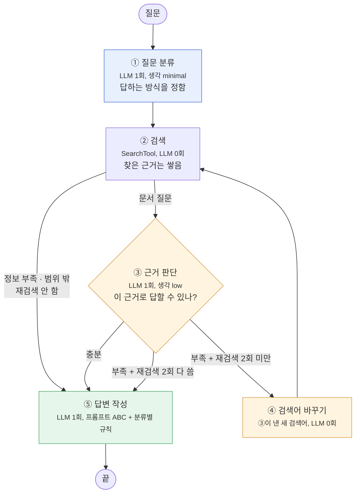

# 🧪 실험 기록

> README의 핵심 결과 뒤에 있는 **전체 실험 과정·수치·결정 이유**예요. 진행 순서대로 적었어요.
> 문제를 만나고 해결한 이야기는 [회고.md](../회고.md), 비용은 [비용기록.md](비용기록.md)에 있어요.

**목차**
1. 📊 검색 평가 — 청킹 2 × 검색 4, 437문항
2. 📝 답변 평가 — 채점 방식, 표 제목·이웃 청크, 프롬프트 ABC
3. 🤖 Agent 설계 상세 — 노드, 설계 결정
4. ⚖️ 기본 RAG vs Agent — v1·v2 비교

<br>

## 📊 검색 평가 (골든셋)

```bash
pip install kiwipiepy rank-bm25 langchain-classic langchain-community
python evaluation/01_retrieval_eval.py                    # 05_golden_set/*.jsonl 전부 (파일마다 따로)
python evaluation/01_retrieval_eval.py 05_golden_set/xxx.jsonl
```

> `kiwipiepy`가 없다는 오류가 나면 패키지를 설치한 가상환경의 파이썬으로 실행하세요 (예: `../../.venv/Scripts/python.exe evaluation/01_retrieval_eval.py`).

- 결과: `07_eval/{골든셋 이름}/retrieval_{청킹}.txt`(난이도별), `..._by_type.txt`(근거 유형별), `retrieval_rows.jsonl`(질문별), `07_eval/runs.jsonl`(실행 이력)
- 정답: 문서 + 쪽 (약관 `kofia-terms-…-{버전}-{조}`는 버전 → 약관 파일, 조 → 쪽 / 용어집은 파일 단위 / 정답 문서 없는 문항은 제외)
- 검색 설정은 강의 스크립트와 같음: k=5, fetch_k=20, MMR λ=0.5, Hybrid 0.5:0.5, BM25는 Kiwi 토큰화
- latency는 질문 임베딩을 뺀 **순수 검색 시간** (질문 임베딩은 한 번만 만들어 모든 방식이 공유)

| 골든셋 | 문항 (평가) | 근거 유형 | 만든 방법 |
|:---|---:|:---|:---|
| `golden_set_table_image` | 189 | table 109 · image 58 · formula 18 · paragraph 2 · none 2 | 직접 작성 (표·그림·수식) |
| `golden_set_paragraph` | 100 | paragraph 98 · none 2 | 직접 작성 (본문 문단, 23개 문서 전체) |
| `golden_set_provided` | 180 (148) | paragraph 135 · table 11 · image 2 · none 32 | 강의 제공 03_answers 전체를 변환 |
| `golden_set` | 20 (16) | paragraph 11 · table 3 · image 2 · none 4 | 제공 문항 중 20개 표본 (`provided`에 포함) |
| `golden_set_all` | 469 (437) | paragraph 235 · table 120 · image 60 · formula 18 · none 4 | table_image + paragraph + provided 합침 |

- 괄호 = 정답 문서가 있어서 검색 평가에 들어간 문항 수
- `provided`의 근거 유형은 20문항만 직접 붙였고 나머지는 **자동 추정**(답의 숫자가 본문엔 없고 표/그림에만 있으면 table/image)
- `golden_set_all`은 파일로 두지 않고 세 파일을 이어 붙여 평가했어요 (`05_golden_set/`에 두면 기본 실행 때 중복 평가됨)

**`golden_set_all` 437문항**

| 청킹 | 검색 | hit@1 | hit@5 | recall@5 | MRR |
|:---|:---|---:|---:|---:|---:|
| 300/50 | Similarity | 0.675 | 0.906 | 0.850 | 0.767 |
| 300/50 | MMR | 0.675 | 0.890 | 0.798 | 0.759 |
| 300/50 | BM25 | 0.597 | 0.822 | 0.754 | 0.686 |
| **300/50** | **Hybrid** | 0.703 | **0.938** | **0.877** | 0.795 |
| 500/60 | Similarity | 0.638 | 0.892 | 0.837 | 0.737 |
| 500/60 | MMR | 0.638 | 0.854 | 0.769 | 0.729 |
| 500/60 | BM25 | 0.586 | 0.858 | 0.787 | 0.694 |
| 500/60 | Hybrid | **0.719** | 0.920 | 0.861 | **0.801** |

**근거 유형별 Hybrid (hit@5 / MRR)**

| 유형 | 문항 | 300/50 | 500/60 |
|:---|---:|:---|:---|
| paragraph | 235 | **0.919 / 0.772** | 0.877 / 0.755 |
| table | 120 | 0.967 / 0.802 | **0.975 / 0.826** |
| image | 60 | 0.967 / 0.871 | **0.983 / 0.917** |
| formula | 18 | 1.000 / 0.847 | 1.000 / **0.926** |

> 표 제목 붙이기(아래 답변 평가 개선) 뒤 다시 돌린 값이에요. 바뀌기 전과 모두 ±0.02 이내이고, 437문항 중 2문항이 새로 맞고 3문항이 빠졌어요 (청크 순위가 조금씩 바뀜).

**결정: 300/50 + Hybrid**
- 검색 방식은 모든 유형에서 Hybrid가 가장 좋음
- 청킹은 유형마다 갈림: paragraph는 300/50, table·image·formula는 500/60이 조금 나음 (hit@1·MRR 전체도 500/60이 약간 높음)
- 그래도 300/50을 고른 이유: 문항이 가장 많은 paragraph에서 차이가 가장 큼(hit@5 10문항 차이), table에서 500/60이 더 맞힌 건 120문항 중 1문항. 정답을 5개 안에 넣는 것(hit@5·recall@5)이 답변 생성에 더 중요
- 청크 종류별로 섞는 방법(본문 300/50 + 표 500/60)도 검토했지만 얻을 수 있는 게 1~2문항이라 하지 않음. 그림·수식 청크는 두 설정에서 똑같음
- 남은 약점은 hit@1(약 0.70) → 다음 단계에서 리랭커 또는 상위 5개를 모두 LLM에 넘기는 방식으로 보완

**hit@1을 올리려는 추가 실험 (300/50 Hybrid 기준)**

| 실험 | 결과 | 판단 |
|:---|:---|:---|
| Hybrid 가중치 (벡터:BM25 0:10 ~ 10:0) | provided로 고른 6:4가 확인용 셋에서 5:5 대비 ±1~2문항 | **5:5 유지.** 섞는 게 중요하고 0.5~0.7 사이는 평평함 |
| 리랭커 `bge-reranker-v2-m3` (Hybrid 상위 10개 → 상위 5개) | paragraph 무작위 30문항: hit@1 0.633 → **0.767**, MRR 0.756 → 0.836, hit@5 그대로 0.967 | 효과는 있지만 **CPU에서 질문당 약 15초** → 지금은 안 씀 |

**결정: 리랭킹 없이 Hybrid 상위 5개를 모두 답변 LLM에 넘김**
- hit@5가 이미 0.94~0.97이라, 정답 근거는 대부분 5개 안에 들어 있음 → 맞는 근거 고르기는 답변 생성 LLM에게 맡김 (추가 비용 없음)
- 답변 평가에서 근거를 잘못 고르는 일이 많으면 그때 리랭킹 추가: Gemini로 후보 순위 매기기(질문당 LLM 1회) 또는 API 리랭커
- 리랭커 실험은 30문항 표본이라 4문항 차이도 흔들릴 수 있음. 실험 코드는 레포에 넣지 않음 (자세한 과정은 [회고](../회고.md) 16번)

> 처음 기록한 500/60 수치(table_image Similarity hit@5 0.810 등)는 Chroma 색인 문제로 틀렸어요. 색인을 다시 만든 뒤 모든 골든셋을 다시 돌린 값이 위 표예요.
> 골든셋별·난이도별·근거 유형별 표는 `07_eval/{골든셋 이름}/`에 있어요.

**평가 결과 관리**

결과는 DB 없이 JSONL 파일로 남겨요. 줄마다 JSON 하나라서 git diff로 바뀐 점이 보이고, pandas로 바로 읽을 수 있어요.

| 파일 | 내용 | 저장 방식 | 용도 |
|:---|:---|:---|:---|
| `07_eval/runs.jsonl` | 실행 한 번 = 한 줄: 실행 시각, 골든셋, 문항 수, 조건(임베딩 모델·k·fetch_k·MMR λ·Hybrid 가중치), 청킹×검색별 hit@1·hit@5·recall@5·MRR·latency | **이어 붙임** (지워지지 않음) | 실행끼리 비교, 결정의 근거 |
| `07_eval/{골든셋}/retrieval_rows.jsonl` | 질문 × 청킹 × 검색마다 한 줄: 점수 + 가져온 청크(파일·쪽) | 실행마다 **덮어씀** | 틀린 문항 찾기 |
| `07_eval/{골든셋}/retrieval_*.txt` | 난이도별·근거 유형별 표 | 실행마다 **덮어씀** | 사람이 읽는 요약 |

```json
{"run_at": "2026-10-21T15:30:00", "golden_set": "golden_set", "count": 16,
 "params": {"embedding": "gemini-embedding-2", "k": 5, "fetch_k": 20, "mmr_lambda": 0.5, "hybrid_weights": [0.5, 0.5]},
 "results": {"chunks_300_50/Hybrid": {"hit@1": 0.562, "hit@5": 0.938, "recall@5": 0.844, "mrr": 0.74, "latency_ms": 17.0}, "...": {}}}
```

```python
import pandas as pd

# 실행 이력: 골든셋별로 300/50 Hybrid hit@5가 어떻게 바뀌었는지
runs = pd.read_json("07_eval/runs.jsonl", lines=True)
runs["hybrid_hit5"] = runs["results"].map(lambda r: r["chunks_300_50/Hybrid"]["hit@5"])
print(runs[["run_at", "golden_set", "hybrid_hit5"]])

# 질문별: Hybrid가 5개 안에 못 맞힌 문항
rows = pd.read_json("07_eval/golden_set_all/retrieval_rows.jsonl", lines=True)
print(rows[(rows.config == "chunks_300_50") & (rows.strategy == "Hybrid") & (rows["hit@5"] == 0)][["case_id", "retrieved"]])
```

- 조건(청킹·가중치·리랭커 등)을 바꿔 실험할 때는 `runs.jsonl`에 쌓인 줄끼리 비교해요. 질문별 결과까지 남기려면 돌리기 전에 `07_eval/{골든셋}/` 폴더를 복사해 두세요.
- `runs.jsonl`은 이 기능을 추가한(2026-10-21) 뒤의 실행부터 기록돼요. 그전 결과는 위 표에 정리돼 있어요.

<br>

## 📝 답변 평가 (골든셋)

```bash
python evaluation/02_answer_eval.py                          # 05_golden_set/golden_set.jsonl (20문항)
python evaluation/02_answer_eval.py 05_golden_set/xxx.jsonl
python evaluation/02_answer_eval.py --neighbors=0             # 이웃 청크 없이 상위 5개만 (비교용)
python evaluation/02_answer_eval.py --prompt=base             # 프롬프트 규칙 묶음 (base / A / AB / ABC, 기본 ABC)
python evaluation/02_answer_eval.py 05_golden_set/golden_set_provided.jsonl --sample=30
                                                              # 무작위 30문항 확인 (튜닝용 golden_set 문항은 빼고, seed 0)
```

검색은 확정한 기준 설정(300/50 + Hybrid 5:5, 상위 5개)에 **이웃 청크 ±1**(아래 개선 실험)을 붙여서 넘기고, Gemini(`gemini-3.6-flash`)가 근거만으로 답한 뒤(프롬프트 ABC, 아래 프롬프트 개선) 같은 모델이 채점해요.
기본 positive(POS001~060)·negative(NEG) 문항은 과제 조건대로 **용어집 + 표준약관만 검색**해요.

**채점 방식:** RAGAS 대신 문항마다 채점 LLM 1회
- 골든셋에 기준 답안·`must_include`·`must_not_include`·`expected_behavior`가 이미 있어서 그대로 기준으로 씀
- RAGAS는 지표마다 LLM을 여러 번 불러서 비용이 더 들고, 토큰 사용량을 따로 모으기 어려움
- 근거 충실성은 RAGAS Faithfulness와 같은 방식 (답을 주장으로 쪼개고 → 근거에 있는 비율)

| 지표 | 뜻 | 계산 |
|:---|:---|:---|
| correctness | 기준 답안과 맞나 | LLM 채점 (1 / 0.5 / 0) |
| faithfulness | 지어낸 내용이 없나 | 근거로 뒷받침되는 주장 비율 |
| must_include | 꼭 들어가야 할 내용 | 충족한 항목 비율 |
| must_not | 피해야 할 오류 | 하나라도 했으면 1 (낮을수록 좋음) |
| behavior_ok | 기대 행동 (근거 인용·거절·추가 정보 요청 등) | LLM 채점 |
| citation_ok | 답에 적은 `[파일 p쪽]` 중 정답 쪽이 있나 | 규칙 (정답 문서 없는 문항 제외) |
| outcome | 성공 / **검색 실패** / **답변 실패** | 성공 = correctness ≥ 0.5 + must_not 없음 + behavior_ok. 실패면 LLM에 넘긴 근거에 정답 쪽이 있었는지로 원인 구분 |

결과: `07_eval/{골든셋}/answer_rows.jsonl`(문항별 답·근거·점수·채점 이유), `answer_summary.txt`, `07_eval/runs.jsonl`(`eval: "answer"`), [docs/비용기록.md](비용기록.md)

**1차 결과 (`golden_set` 20문항, run_id `answer-golden_set-20261021-093244`)**

| 세트 | 문항 | correctness | faithfulness | must_include | must_not | behavior_ok | citation_ok | 성공 |
|:---|---:|---:|---:|---:|---:|---:|---:|---:|
| 전체 | 20 | 0.725 | 0.975 | 0.746 | 0 | 0.95 | 1.00 | 17 |
| positive | 14 | 0.714 | 1.000 | 0.744 | 0 | 1.00 | 1.00 | 12 |
| negative | 6 | 0.750 | 0.917 | 0.750 | 0 | 0.83 | 1.00 | 5 |

- 지어낸 내용은 거의 없음 (faithfulness 0.975, 근거에 없는 주장 1개: NEG001에서 확인처를 안내한 문장)
- 답변 시간 평균 약 8.8초 (검색은 0.05초)
- 비용: 답변 생성 $0.14 + 채점 $0.13 = **약 $0.27** (출력 토큰의 대부분이 생각 토큰)

**실패 3문항 분석**

| 문항 | 판정 | 실제 원인 |
|:---|:---|:---|
| POS080 (현금흐름표 계산) | 답변 실패 | **검색 문제.** p11의 설명 청크는 찾았지만 숫자가 든 표 청크(p11:6~8)는 못 찾음. 표 조각에 "현금흐름표" 제목이 안 붙어 있음 |
| ADD-SE06 (34.2% 불일치) | 답변 실패 | **검색 문제.** p2는 찾았지만 DTA 계산 방식 설명이 있는 p3를 못 찾음 |
| NEG017 (전산장애 책임) | 답변 실패 | 답변 문제. 책임이 확정되지 않는다는 건 맞았지만 "주문 기록·적용 약관 확인" 안내가 빠짐 |

> 💡 **쪽 단위 hit@5는 너그러워요.** 정답 쪽의 청크가 하나라도 오면 hit로 세서, 정작 필요한 청크(표 숫자, 다음 쪽 설명)가 빠져도 "답변 실패"로 분류돼요.
> 두 문항 모두 LLM은 지어내지 않고 "찾을 수 없다"고 답해서 근거 충실성은 지켰어요.
> 다음 개선 후보: 쪼개진 표 조각에 표 제목 붙이기, 근거가 이어지는 다음 쪽 청크 같이 넘기기.

**개선 실험: 근거가 빠지는 문제 (`golden_set` 20문항, 한 번에 하나씩 바꿈)**

| 실험 | 바꾼 것 | 넘긴 청크 | correctness | 완전 정답(1.0) | faithfulness | must_include | 성공 | 비용 |
|:---|:---|---:|---:|---:|---:|---:|---:|---:|
| A. 기준 | - | 5 | 0.725 | 11 | 0.975 | 0.746 | 17 | $0.27 |
| B. 표 제목 | `01_chunk.py`: 표 위 짧은 제목 줄도 표에 붙임 | 5 | 0.775 | 12 | 0.958 | 0.796 | 17 | $0.25 |
| **C. 표 제목 + 이웃 청크** | 검색된 청크마다 앞뒤 1개 + 걸친 표는 모든 조각 | 평균 15 | **0.825** | **14** | **0.983** | **0.838** | 17 | $0.31 |

run_id: A `answer-golden_set-20261021-093244`, B `…-094748`, C `…-095141` (`07_eval/runs.jsonl`, `chunks_md5`로 청크 버전 구분)

- **표 제목 붙이기:** 제목 없던 표 조각이 많았음 (300/50 청크 299개의 글이 바뀜, 그중 표 136개, 나머지는 제목 줄이 빠진 본문). 예: 현금흐름표 조각들은 "현금흐름표(예시)" 줄이 위 본문 청크에만 있었음
  - 줄 끝이 `다.`·`요.`·`?`·`:`로 끝나거나 앞 표의 `자료:` 각주면 제목으로 안 봄
  - 다시 임베딩은 글이 바뀐 청크만 ($0.015, `02_embed.py`가 같은 글은 옛 벡터를 옮김)
  - 검색 지표는 거의 그대로 (위 검색 평가 표), 답할 때 표 숫자가 무엇인지 LLM이 알 수 있게 됨
- **이웃 청크:** POS080(현금흐름표 계산)은 C에서만 맞음. 설명 청크(p11:5)만 검색돼도 표 조각 3개(p11:6~8)가 같이 넘어가서 계산까지 정확히 함
  - ±1만으로는 첫 표 조각만 와서, **범위 끝이 표 조각이면 그 표의 나머지 조각까지** 넓힘 (첫 줄이 같은 연속 표 청크)
  - 넘기는 글이 평균 약 3,700자(최대 9,400자)로 늘어서 입력 토큰이 2.5배, 비용은 20문항당 +$0.04 정도
- **결정: C를 기본값으로** (`--neighbors` 기본 1)

**아직 남은 실패 / 주의할 점**
- ADD-SE06: 필요한 근거(p3의 DTA 계산 방식)가 검색된 p2에서 여러 청크 떨어져 있어서 ±1로도 안 옴. B에서 0.5로 맞은 건 우연에 가까움
- NEG005(2027년 세액공제): A는 성공, B·C는 실패. 모델이 문서 기준일(2026-09-03)을 모르니 "기준일 명시"를 못 함 → 아래 프롬프트 개선 B
- NEG017: 세 번 모두 "주문 기록 확인" 안내가 빠짐 → 아래 프롬프트 개선 A
- 같은 설정으로 다시 돌려도 1~2문항은 결과가 바뀜 (ADD-PF01, NEG009가 0.5 ↔ 1.0). 20문항에서 1~2문항 차이는 잡음으로 보고, **원인이 분명한 변화(POS080)만 근거로 판단**함

**프롬프트 개선 (이웃 청크 ±1 고정, 규칙 묶음을 하나씩 더함)**

점수가 깎인 문항의 패턴: ① 마지막 "주의할 점·추가로 확인할 것"을 빼먹음 ② "문서에서 찾을 수 없다"를 너무 빨리 말함 ③ 문서 기준일을 모름.
기준 답안은 거의 다 "결론 → 근거 → 주의점" 구조라서 그 순서를 프롬프트에 넣었어요. 규칙 원문은 `02_answer_eval.py`의 `EXTRA_RULES`에 있어요.

| 규칙 | 내용 |
|:---|:---|
| A. 답변 구조 | 결론 → 근거(계산 과정 포함) → 주의할 점 (예시 수치는 예시라고, 제도마다 조건이 다르면 그렇다고, 확정 못 하는 판단은 확인할 자료 안내) |
| B. 문서 기준일 | 2026-09-03 (강의 답안에만 나오는 corpus snapshot 날짜). **미래·최신을 물을 때만** 기준일을 밝히고 최신 자료 안내 |
| C. 부족한 근거 | 있는 만큼은 답하기, 계산은 근거 숫자로 직접, 숫자 불일치는 오타 단정 대신 계산 방식 차이 설명, 투자 권유 거절 시에도 위험·분산 설명 |

*튜닝셋 (`golden_set` 20문항, 이 문항들을 보고 고침)*

| 프롬프트 | correctness | 완전 정답 | faithfulness | 성공 |
|:---|---:|---:|---:|---:|
| base | 0.825 | 14 | 0.983 | 17 |
| A | 0.925 | 17 | 1.000 | 19 |
| AB | 0.950 | 18 | 0.951 | 17 |
| ABC | 0.975 | 19 | 0.983 | 19 |
| **ABC (B 수정)** | 0.950 | 18 | 0.993 | **20** |

- AB·ABC 처음 버전은 상관없는 답에도 "2026-09-03 기준"을 붙여서 채점에서 "근거에 없는 숫자"로 감점(must_not 3문항) → B를 "미래·최신 질문에만"으로 좁힘

*처음 보는 30문항 (`golden_set_provided`에서 튜닝 20문항 빼고 무작위, positive 24 · negative 6)*

| 프롬프트 | correctness | 완전 정답 | faithfulness | must_not | 성공 | 답변 시간 |
|:---|---:|---:|---:|---:|---:|---:|
| base | 0.850 | 22 | **0.997** | **0** | **27** | 8.4초 |
| **ABC** | **0.883** | **24** | 0.974 | 1 | 26 | 11.0초 |

- 튜닝셋에서는 +0.125, 처음 보는 문항에서는 **+0.033** → 차이만큼은 튜닝셋에 맞춘 효과
- 좋아짐 4, 나빠짐 2. 네거티브 6문항 correctness 0.833 → **1.000**, 포지티브는 0.854로 같음
- 새 부작용: C의 분산 규칙 때문에 **상관없는 약관 질문에도 분산투자 문장이 붙음** (POS057·POS059, faithfulness 하락의 원인)
- 두 프롬프트 다 못 하는 것: 정보가 부족할 때 **되묻기** (NEG014·NEG016, `ask_clarifying_question`)
- 답이 길어져서 답변 시간 +2.6초, 비용 +25%
- **결정: ABC를 기본값으로** (`--prompt` 기본 ABC). 다음 후보는 분산 문장을 투자 권유 요청 때만 쓰게 하기, 되묻기 규칙. 이 30문항을 보고 고치게 되니까 확인은 **다른 seed의 30문항**으로
- 프롬프트 실험 비용 약 $2.5 (20문항 4회 + 30문항 2회)

<br>

## 🤖 Agent 설계 상세

기본 RAG(`02_answer_eval.py`: 검색 1번 → 답변)에 **질문 분류 · 근거 판단 · 재검색**을 더한 LangGraph `StateGraph`예요 ([agent/graph.py](../agent/graph.py)).
지금까지 평가에서 본 실패(되물어야 할 때 설명만 함, 미래 정보, 근거가 다른 쪽에 있음)를 그래프 구조로 풀어 보는 게 목표예요.

**그래프 구조 (v2, 최종)**



| 노드 | 하는 일 | 겨냥하는 실패 |
|:---|:---|:---|
| ① 질문 분류 | 답하는 방식을 고름. `document`(문서 질문, 투자 권유·전제 오류 포함) / `clarify`(대상이 특정 안 됨: "이 펀드", "수수료가 얼마야?") / `out_of_scope`(대상은 있지만 문서 기준일 이후·실시간 정보). **애매하면 `document`** | NEG010~016 (되묻기), NEG005·006 (미래·오늘 정보) |
| ② 검색 | `SearchTool.search()` 상위 5개 + 이웃 청크. **모든 질문이 검색**. 재검색 때 찾은 근거는 쌓음 (중복 제외) | |
| ③ 근거 판단 | `document`만. 핵심 결론을 낼 근거가 있나? 부족하면 **빠진 내용 + 새 검색어**를 같이 냄 (과제 필수 "근거 판단") | ADD-SE06·SE10, ADD-HF09, POS057 (근거가 다른 쪽에 있음) |
| ④ 검색어 바꾸기 | ③이 낸 새 검색어로 바꾸고 재검색 +1. LLM을 따로 부르지 않음 | |
| ⑤ 답변 작성 | 프롬프트 ABC(기본 RAG와 같음) + 분류별 규칙: `clarify`는 근거로 차이 설명 + 되묻기, `out_of_scope`는 "기준일 문서에 없음" + 관련 규정 설명 + 최신 자료 안내. 재검색을 다 쓰고도 부족하면 빠진 부분을 밝힘 | |

**종료 조건:** ⑤ 답변 작성이 끝나면 끝. 재검색은 **최대 2회** → 문서 질문은 검색 최대 3번·LLM 최대 5번, 정보 부족·범위 밖은 검색 1번·LLM 2번

**실행**

```bash
python agent/graph.py "주택연금은 무상 지원금인가요?"
python agent/graph.py "수수료가 얼마야?" --groups=glossary,standard_terms
python agent/graph.py --mermaid                                   # 그래프 구조도 출력 (LangGraph draw_mermaid)
python evaluation/02_answer_eval.py --mode=agent                  # Agent로 답변 평가 → 07_eval/{골든셋}/agent_rows.jsonl
python evaluation/02_answer_eval.py 05_golden_set/golden_set_provided.jsonl --sample=30 --seed=1 --mode=agent
```

출력 예 (ADD-SE06, 근거가 다른 쪽에 있는 질문):
```
경로: classify → retrieve → grade → rewrite → retrieve → grade → rewrite → retrieve → grade → generate
검색어: 원래 질문 → "자영업 가구 부채 비율 계산 산출 기준" → "자영업 가구 부채 자산 비율 DTA 산출 방식 계산"
LLM 5회, 검색 3회 → p3의 DTA 산출 설명을 찾아서 "오타로 보고 고치면 안 됩니다"로 답함
```

`agent_rows.jsonl`에는 문항마다 분류(`route`), 지나간 노드(`trace`), 쓴 검색어(`queries`), 재검색 수, LLM 호출 수, 검색 수, 입력·출력 토큰, 넘긴 청크 ID가 남아요.

**설계에서 정한 것**

| 결정 | 이유 |
|:---|:---|
| 투자 권유 질문(NEG021)은 분류에서 거절하지 않고 **검색 → 답변에서 거절** | 기준 답안이 "권유는 거절 + 상품 위험·분산은 설명". 바로 거절하면 위험 설명이 빠져 0.5점 |
| 정보 부족(`clarify`)도 **검색함** | 기준 답안이 "신용거래는 14일, 외국집합투자증권은 7일 등 상품별로 다르니 상품을 물어야"(NEG010)처럼 **근거로 차이를 설명하고 되묻기** |
| 범위 밖(`out_of_scope`)도 **검색함** (v2) | v1은 검색 없이 안내만 했는데, NEG006 "오늘 증권사 이자율"의 기준 답안은 "회사별 이자율은 약관 **별첨**에 들어가니 공시 확인" → 문서에 있는 관련 규정도 설명해야 함 |
| 재검색은 `document`만 (v2) | 되묻기·범위 밖 질문은 근거를 더 찾아도 답이 정해지지 않음. v1에서 NEG016이 재검색 2번을 쓰고도 0.5점 |
| 분류와 근거 판단을 **따로** | 질문만 보고 하는 판단(분류)과 근거를 보고 하는 판단은 다름. Agent 구조를 보여 주기에도 나눈 쪽이 분명함 |
| 검색어 바꾸기는 LLM 0회 | 근거 판단이 "무엇이 빠졌나"를 알고 있으니 새 검색어도 같은 호출에서 받음 |
| 분류는 생각 `minimal`, 근거 판단은 `low` | 출력 비용의 대부분이 생각 토큰. 시험해 보니 `low`는 생각 토큰이 517 → 459로 거의 안 줄고 `minimal`은 7로 줄어서, 단순한 분류만 `minimal` |
| 검색 범위(`groups`)는 Agent가 아니라 **입력 조건** | 과제의 "기본 세트는 용어집 + 표준약관만 검색"은 실험 조건이라 기본 RAG와 똑같이 밖에서 정해 줌 |

<br>

## ⚖️ 기본 RAG vs Agent

같은 검색 도구·답변 프롬프트(ABC)·채점으로, 문항별 **LLM 호출 수·검색 횟수·입력/출력 토큰·시간**을 더해서 비교했어요.
여러 요소가 함께 바뀌는 비교라 결과는 **Agent 구조 전체의 효과**로 해석해요.

- **v1:** 처음 설계 (범위 밖은 검색 없이 안내, 모든 분류에서 재검색 가능)
- **v2:** v1을 seed 0 표본에서 비교한 뒤 고친 버전 (분류 기준, 범위 밖도 검색, 재검색은 문서 질문만, 근거 판단 덜 깐깐하게)
- 확인용 표본: `--seed=1` = seed 0과 **겹치지 않는** 새 30문항 (v2를 고칠 때 안 본 문항)
- faithfulness는 근거 없이 답한 경우(v1의 범위 밖 안내)를 빼고 계산

**처음 보는 30문항 (seed 1, positive 24 · negative 6) — 가장 공정한 비교**

| | correctness | 완전 정답 | 성공 | must_not | LLM 호출 | 검색 | 입력 토큰 | 출력 토큰 | 시간 | 답변 비용 |
|:---|---:|---:|---:|---:|---:|---:|---:|---:|---:|---:|
| 기본 RAG | 0.883 | 24 | 27 | 1 | 1.00 | 1.00 | 2,858 | 2,119 | 11.4초 | $0.30 |
| Agent v1 | **0.900** | **25** | 28 | 1 | 3.30 | 1.30 | 7,287 | 2,273 | 15.7초 | $0.42 |
| **Agent v2** | 0.883 | 24 | **29** | **0** | 3.07 | 1.20 | 6,497 | 2,287 | 15.3초 | $0.40 |

**재실행 확인 (seed 1, 같은 30문항을 기본 RAG·v2로 한 번 더)**

| | 1차 correctness | 2차 correctness | 평균 | 1차 성공 | 2차 성공 | 평균 |
|:---|---:|---:|---:|---:|---:|---:|
| 기본 RAG | 0.883 | 0.867 | 0.875 | 27 | 28 | 27.5 |
| Agent v2 | 0.883 | 0.917 | **0.900** | 29 | 29 | **29** |

- 같은 설정이라도 6문항이 0.5 ↔ 1.0 등으로 흔들림 (POS006·POS053·POS058·ADD-HP02·POS048 등)
- **NEG010(되묻기)은 4번 모두 같음:** 기본 RAG 0.5 / 0.5, Agent 1.0 / 1.0 → Agent 구조의 효과로 볼 수 있음
- 재실행 비용 약 $1.2

**seed 0 30문항 (v2를 고칠 때 본 표본)**

| | correctness | 완전 정답 | 성공 | LLM 호출 | 입력 토큰 | 재검색 2회 다 쓴 문항 | 답변 비용 |
|:---|---:|---:|---:|---:|---:|---:|---:|
| 기본 RAG | 0.917 | 25 | 27 | 1.00 | 2,854 | - | $0.30 |
| Agent v1 | 0.933 | 26 | 28 | 3.53 | 8,799 | 8 | $0.46 |
| Agent v2 | **0.950** | **27** | **29** | 3.20 | 7,228 | 4 | $0.41 |

**`golden_set` 20문항 (프롬프트 튜닝셋)**: 기본 RAG 0.975 (성공 20) / v1 0.950 (19) / v2 0.975 (20)

**해석**
- **정답률(correctness)은 기본 RAG와 비슷하거나 조금 높음.** 처음 보는 문항 1차에서 RAG 0.883 / v1 0.900 / v2 0.883, 두 번 평균은 RAG 0.875 / v2 0.900
- **"성공"은 Agent가 꾸준히 더 많음** (seed 0·1 모두 RAG 27 → v2 29). 성공은 정답 + 피해야 할 오류 없음 + 기대 행동이라, Agent의 이점은 **되묻기·범위 밖 대응 같은 행동**에서 나옴
  - NEG010·NEG014 (되묻기): RAG 0.5 → Agent 1.0
  - ADD-HF09: 재검색으로 다른 쪽의 근거를 찾아서 RAG 0.5 → v1·v2 1.0 (ADD-SE10·POS057은 v1에서만 1.0)
- **비용:** 답변 비용 1.3~1.5배, LLM 호출 3배, 입력 토큰 2.3~2.5배, 시간 1.35배 (11초 → 15초)
- **v1 → v2:** 노린 문항(NEG009·NEG006·NEG016)은 모두 0.5 → 1.0, 재검색을 2번 다 쓰는 문항이 절반으로 줄어 입력 토큰 −10~18%. 처음 보는 문항의 correctness는 v1보다 안 올랐음 (POS054·ADD-HP02가 재검색 없이 1.0 → 0.5로 흔들림)
- 한 번 실행에서도 1~2문항은 0.5 ↔ 1.0으로 바뀌어서, 30문항 비교의 1~2문항 차이로 우열을 단정하지 않음

**결론:** 일반 문서 질문은 기본 RAG로 충분하고, Agent는 **정보가 부족한 질문·범위 밖 질문·근거가 흩어진 질문**에서 행동이 더 맞음. 이 유형이 많은 서비스라면 1.4배 비용을 쓸 만하고, 아니면 기본 RAG가 효율적
- 비교 실험 비용: 약 $5 (기본 RAG·v1·v2 × 20·30·30문항 + 채점)

<br>

## 💸 E9-a: 분류·근거 판단을 가벼운 모델로

**가설:** 분류(3개 중 고르기)와 근거 판단(충분한가?)은 쉬운 일이라 `gemini-3.5-flash-lite`(입력 $0.30 / 출력 $2.50, 3.6 Flash의 40% / 67%)로 바꿔도 품질은 그대로, 비용은 준다.

- **바꾼 것:** 분류·근거 판단 모델 3.6 Flash → **3.5 Flash-Lite** (`--small=gemini-3.5-flash-lite`)
- **고정:** 답변 작성·채점 3.6 Flash, Agent v2 구조·프롬프트·생각 수준, 같은 30문항(seed 1)
- 실행마다 흔들려서 v2와 똑같이 **두 번씩** 돌려 평균

| | 정답률 (1차 / 2차) | 성공 | behavior_ok | LLM 호출 | 검색 | 입력 토큰 | 시간 | Agent 비용 |
|:---|:---:|:---:|:---:|:---:|:---:|:---:|:---:|:---:|
| v2 (전부 3.6 Flash) | 0.900 (0.883 / 0.917) | 29 (29 / 29) | 1.000 | 3.09 | 1.22 | 6,577 | 15.6초 | $0.41 |
| **E9-a** (분류·판단 Lite) | 0.900 (0.900 / 0.900) | 28 (27 / 29) | 0.967 | 3.28 | 1.38 | 7,192 | 14.5초 | **$0.36** |

**결과: 비용 −12%, 정답률은 같고, 되묻기를 못 하게 됨**

- **비용:** Agent 비용 $0.41 → $0.36. Lite가 맡은 분류·판단은 30문항에 $0.04. 남은 $0.32는 **답변 작성**(3.6 Flash) 몫이라, 분류·판단만 바꿔서는 크게 못 줄임
- **분류 실수 (두 번 모두 같음 → 우연 아님):** Lite는 30문항 중 `clarify`를 **한 번도** 고르지 않음
  - NEG010 "청약 철회할 수 있어?" → `document`로 분류 → 되묻지 않아서 **1.0 → 0.5** (v2에서는 4번 모두 1.0)
  - NEG002 → `out_of_scope`로 분류 (답은 1.0으로 같음)
- **재검색 증가:** Lite 근거 판단이 "부족"을 더 자주 냄 → 재검색한 문항 4 → 8 (평균), 검색 1.22 → 1.38회, 입력 토큰 +9%. 비용 절감의 일부를 다시 씀
  - 대신 ADD-RP10은 재검색 덕분에 0.5 → 1.0 (두 번 모두), POS058은 1.0 → 0.5
- **분류는 원래 거의 공짜였음:** 3.6 Flash + 생각 `minimal`이라 문항당 입력 약 350 / 출력 약 10토큰 → 30문항에 약 $0.01. Lite로 바꿔 아끼는 돈은 거의 없고 되묻기만 잃음

**결정: E9-a는 채택하지 않음.** 분류는 3.6 Flash로 되돌리고, 근거 판단만 Lite로 바꾸는 E9-c를 다음 후보로 (아래 남은 실험)

<br>

## ⚡ E10: 답변 작성의 생각 수준 낮추기

**가설:** Agent 비용의 78%는 답변 작성이고, 그 출력 토큰(문항당 약 2,300)의 대부분은 생각 토큰이다. 답변의 생각 수준을 `low`로 낮추면 품질은 그대로, 비용·시간은 크게 준다.

**사전 확인 (POS080 현금흐름표 계산 1문항):** 생각 수준별 출력 토큰 — 기본 3,341 / `low` **614** / `minimal` 896, 세 경우 모두 계산(7,200만원·500만원)은 맞음. 분류처럼 짧은 질문에서는 `low`가 거의 안 줄었는데(517 → 459), 생각할 게 많은 답변에서는 크게 줄어서 `low`로 실험

- **바꾼 것:** Agent 답변 작성 `reasoning_effort` 기본 → **`low`** (`--answer-effort=low`)
- **고정:** 모델(전부 3.6 Flash), Agent v2 구조·프롬프트, 채점, 같은 30문항(seed 1), 두 번씩 실행

| | 정답률 (1차 / 2차) | 완전 정답 | 성공 | must_not | 출력 토큰 | 시간 | Agent 비용 |
|:---|:---:|:---:|:---:|:---:|:---:|:---:|:---:|
| 기본 RAG (생각 기본) | 0.875 (0.883 / 0.867) | 23.5 | 27.5 | 0.5 | 2,178 | 11.7초 | $0.31 |
| Agent v2 (생각 기본) | 0.900 (0.883 / 0.917) | 24.5 | 29 | 0.5 | 2,337 | 15.6초 | $0.41 |
| **Agent + 답변 low (E10)** | **0.908** (0.917 / 0.900) | **25.5** | 28 (29 / 27) | 1 | **984** | **9.6초** | **$0.26** |

**결과: 정답률 그대로, 비용 −36%, 시간 −38%**

- 출력 토큰 −58% (2,337 → 984), Agent 비용 $0.41 → **$0.26**, 시간 15.6 → **9.6초**
- **이제 Agent가 기본 RAG보다 싸고 빠름** ($0.26 vs $0.31, 9.6초 vs 11.7초). 기본 RAG는 생각 기본값이라, Agent의 LLM 호출이 3배여도 답변 생각을 줄인 효과가 더 큼
- 정답률·완전 정답은 오히려 약간 높음 (0.908, 25.5문항). faithfulness 0.98, behavior_ok 1.000 유지
- 주의: 2차에서 must_not 2문항. ADD-IN06은 결론과 근거가 **서로 모순**(결론에 "15일 이내면 철회 가능"이라고 잘못 씀) → 생각을 줄여 생긴 실수일 수 있음. 1차에서는 같은 문항이 1.0이라 흔들림 범위로 봄
- 답변 길이는 비슷함 (약 1,000자 → 910자). 생각만 줄고 답변 자체는 거의 그대로

**결정: 채택.** Agent 답변 작성의 기본 생각 수준을 `low`로 (`ANSWER_EFFORT = "low"`, 이전 방식은 `--answer-effort=default`)
- 공정한 비교를 위해서는 기본 RAG도 `low`로 맞춰 다시 재야 함 → 아래 E10-b

<br>

## ⚖️ E10-b: 같은 조건으로 다시 비교 (120문항, 최종)

E10에서 Agent만 답변 생각을 `low`로 줄여서 "Agent가 더 싸다"는 결과가 나왔어요. 공정하게 하려면 **기본 RAG도 `low`로 맞추고**, 문항도 늘려서 다시 재야 했어요.

- **같게 맞춘 것:** 답변 생각 `low`, 검색 도구·답변 프롬프트, 채점 LLM(모델 기본값, 답변 LLM과 분리), 같은 문항
- **다른 것:** 그래프 구조(분류·근거 판단·재검색)뿐
- **문항 120개 (4개 셋):** 제공 seed 1·seed 2(서로 안 겹침), **직접 만든** paragraph·table_image에서 30개씩 → 직접 만든 골든셋을 제공 세트와 따로 평가

| 셋 | 기본 RAG 정답률 | Agent 정답률 | 차이 | 기본 RAG 성공 | Agent 성공 |
|:---|:---:|:---:|:---:|:---:|:---:|
| 제공 seed 1 | 0.867 | **0.917** | +0.050 | 28 | 28 |
| 제공 seed 2 | 0.850 | **0.917** | +0.067 | 25 | **28** |
| 직접 paragraph | 0.783 | **0.833** | +0.050 | 30 | 30 |
| 직접 table_image | 0.917 | **0.950** | +0.033 | 28 | **29** |
| **합계 120** | **0.854** | **0.904** | **+0.050** | **111** | **115** |

| 120문항 평균 | 기본 RAG | Agent | 배수 |
|:---|:---:|:---:|:---:|
| 완전 정답 | 90 | **98** | |
| must_not / faithfulness | 3 / 0.988 | 4 / 0.985 | |
| LLM 호출 · 검색 | 1 · 1 | 3.15 · 1.23 | |
| 입력 / 출력 토큰 | 3,196 / 760 | 7,646 / 870 | 2.4배 / 1.1배 |
| 시간 | **5.3초** | 8.8초 | 1.7배 |
| 문항당 비용 | **$0.0052** | $0.0090 | 1.7배 |

**결과**
- **4개 셋 모두 Agent가 높음.** 120문항에서 Agent가 나은 문항 **14**, 못한 문항 **5**. 30문항 비교에서는 잡음과 구분이 안 됐지만, 문항을 늘리고 셋마다 같은 방향이라 **Agent 구조의 효과로 볼 수 있음**
- 나아진 이유: 되묻기(NEG010·011·002, RP-09 → `clarify`), 재검색으로 다른 쪽 근거 찾기(ADD-SE05·POS035·PF-37 0 → 1.0)
- **비용은 기본 RAG가 다시 쌈.** E10에서 "Agent가 더 쌌던" 건 Agent만 생각을 줄였기 때문. 같은 조건에서는 Agent가 **1.7배** (그래도 문항당 1센트 미만)
- 출력 토큰은 거의 같고(760 vs 870) 입력 토큰이 2.4배 → Agent 비용의 대부분은 분류·근거 판단·재검색에 근거를 다시 넣는 입력

**최종 결론:** 같은 조건에서 Agent는 **비용·시간 1.7배로 정답률 +0.05 (120문항 중 14 vs 5)**. 문항당 $0.009·9초라서 상담 서비스라면 쓸 만한 비용이고, 특히 되묻기·범위 밖·흩어진 근거 질문에서 차이가 남
- 코드 기본값: 기본 RAG·Agent 모두 답변 생각 `low` (`--answer-effort=default`로 이전 방식)
- 실험 비용 약 $3.6 (120문항 × 2방식 + 채점)
